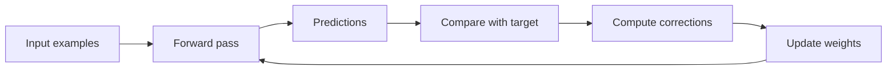

# Artificial Neural Networks — Soft Computing Study Guide

*Based on the three supplied ANN-01, ANN-02, and ANN-03 slide decks. Repeated ideas are combined, and a few inconsistent slide labels and equations are corrected.*

## The whole unit in one minute

An artificial neural network (ANN) is a collection of simple mathematical units called **neurons**. Each neuron combines its inputs using **weights**, adds a **bias**, and applies an **activation function**. The arrangement of neurons determines what patterns the network can represent. **Learning** changes the weights and biases so its outputs better match the task.

The three questions to keep separate are: **What does one neuron compute? Which network structure is needed? How are its parameters learned?**

---

## 1. From biological neuron to artificial neuron

A biological neuron's **dendrites** receive signals; its **soma** combines them; its **axon** sends an output; **synapses** connect neurons and influence how strongly signals are passed on. An ANN takes inspiration from these roles but uses a deliberately simplified mathematical model. It does not reproduce all biological details.

For inputs $x_1,\ldots,x_d$, weights $w_1,\ldots,w_d$, and bias $b$:

$$z=\sum_{i=1}^{d}w_i x_i+b,\qquad y=\phi(z).$$

- $w_i$ controls the influence of $x_i$; a **negative** weight can inhibit an output.
- $b$ shifts the point where the neuron switches or responds. A threshold $\theta$ in the slides is equivalent to $b=-\theta$: $z=\sum_iw_ix_i-\theta$.
- $\phi$ is the **activation** (transfer) function. Without a nonlinear activation between layers, stacking linear layers still gives only a linear transformation.

**Example:** With $x=(1,1)$, $w=(1,1)$, $b=-1.5$, and a step function that outputs 1 when $z>0$, the neuron gives $z=0.5$ and $y=1$. For $(1,0)$ it gives $z=-0.5$ and $y=0$. This one neuron implements **AND**.

### Activation functions to know

| Function | Formula or output | Why used |
| --- | --- | --- |
| Hard limit / step | $\phi(z)=1$ if $z>0$, else $0$ | Binary perceptron decisions; not differentiable at the switch |
| Signum / bipolar step | $\phi(z)=+1$ if $z>0$, else $-1$ | Binary decisions labeled $-1,+1$ |
| Linear / identity | $\phi(z)=z$ | Numerical output; does not introduce a nonlinear boundary |
| Logistic sigmoid | $\sigma(z)=1/(1+e^{-z})$ | Smooth output in $(0,1)$; $\sigma'(z)=\sigma(z)(1-\sigma(z))$ |
| Tanh sigmoid | $\tanh(z)=(e^z-e^{-z})/(e^z+e^{-z})$ | Smooth output in $(-1,1)$; $\tanh'(z)=1-\tanh^2(z)$ |

If an activation uses $\sigma(\alpha z)$ or $\tanh(\alpha z)$, multiply its derivative by $\alpha$. Unlike the step function, sigmoid and tanh have derivatives usable in gradient descent and backpropagation.

**What ANNs are good for:** learning input–output mappings from examples, applying them to unseen cases (**generalization**), and distributing computation over many units. Performance on noisy or incomplete input is possible for suitable architectures and training; it is not an automatic guarantee.

---

## 2. Network architectures and their limits

| Architecture | Connections and computation | Key point |
| --- | --- | --- |
| Single-layer feed-forward network | Inputs connect directly to an output layer; signals move toward the output | One trainable layer; each output neuron makes its own weighted decision |
| Multilayer feed-forward network (MLFFNN) | One or more **hidden layers** sit between input and output; no cycles in the forward computation | Hidden nonlinearities can combine several simple boundaries |
| Recurrent network | Connections form a feedback loop, often involving previous states | Output can depend on earlier information as well as current input |

The input layer is usually **not counted as a trainable layer**. Thus an input layer plus one output layer is called a *single-layer* network. A layout written $l$–$m$–$n$ has $l$ input units, $m$ hidden units, and $n$ output units. The number of units and the number of layers are different concepts.

### Matrix form and dimensions

Use column vectors and include bias vectors explicitly. For $l$ inputs, $m$ hidden neurons, and $n$ outputs:

$$V\in\mathbb{R}^{l\times m},\quad W\in\mathbb{R}^{m\times n},\quad x\in\mathbb{R}^{l\times1},$$
$$z^H=V^{\mathsf T}x+b^H,\quad h=\phi_H(z^H),\quad z^O=W^{\mathsf T}h+b^O,\quad o=\phi_O(z^O).$$

Hence $h$ is $m\times1$ and $o$ is $n\times1$. Each activation acts elementwise. A single-layer network just uses $o=\phi(W^{\mathsf T}x+b)$, with no hidden step. The slide notation sometimes treats an input “neuron” as a pass-through: its output equals its input.

### Why XOR needs a hidden layer

| $x_1$ | $x_2$ | AND | XOR |
| ---: | ---: | ---: | ---: |
| 0 | 0 | 0 | 0 |
| 0 | 1 | 0 | 1 |
| 1 | 0 | 0 | 1 |
| 1 | 1 | 1 | 0 |

A step neuron classifies by $w_1x_1+w_2x_2+b>0$. Its decision boundary, $w_1x_1+w_2x_2+b=0$, is a **line** for two inputs (a hyperplane in higher dimensions). A line can separate $(1,1)$ from the other three AND inputs. It cannot put $(0,1)$ and $(1,0)$ on one side and $(0,0)$ and $(1,1)$ on the other: XOR is **not linearly separable**.

One concrete XOR network uses two hidden step neurons and one output step neuron. Let $S(z)=1$ if $z>0$, otherwise 0:

$$h_1=S(x_1+x_2-0.5)\quad\text{(OR)},\qquad h_2=S(x_1+x_2-1.5)\quad\text{(AND)},$$
$$y=S(h_1-h_2-0.5).$$

For input $(1,1)$, both hidden neurons output 1, so $y=S(-0.5)=0$. For $(1,0)$, their outputs are $(1,0)$, so $y=S(0.5)=1$. The hidden layer lets the network combine multiple linear tests into a nonlinear decision region. Backpropagation training normally uses **smooth** activations instead of these hard steps.

**Feedback has two meanings:** a recurrent network feeds a state or output back during its computation; a training loop feeds *error information* back to update weights. The slides call the latter a “dynamic neural network” framework. Having a training feedback loop alone does not make a feed-forward architecture recurrent.

---

## 3. What does “learning” mean?

Learning means changing the network's parameters, mainly weights and biases, according to experience. The **type of feedback** tells us which learning setting we are in:

| Setting | Information provided | Basic idea |
| --- | --- | --- |
| Supervised | Inputs **and desired outputs** | Predict, measure error against a target, correct parameters; perceptron learning and backpropagation belong here |
| Unsupervised | Inputs **without targets** | Discover clusters, similarities, or other structure; competitive learning is an example |
| Reinforcement learning | Feedback on actions, such as rewards or penalties | Learn behavior from evaluative feedback, without being handed a correct output for each case |

Other learning *rules* in the slides:

- **Gradient descent / error correction:** adjust a parameter opposite the gradient of an error function, $\Delta p=-\eta\,\partial E/\partial p$. The learning rate $\eta>0$ controls the step size. Least-mean-squares learning and backpropagation use this idea.
- **Stochastic learning:** use randomness as part of the update or search, as in simulated annealing. Do not confuse this broad description with *stochastic gradient descent*, which specifically computes gradient updates on individual training examples.
- **Hebbian learning:** strengthen connections between units that are active together. A simple correlation rule is $\Delta w_{ij}=\eta x_i y_j$; across paired patterns, an association matrix can be formed from sums of outer products $x^{(p)}(y^{(p)})^{\mathsf T}$.
- **Competitive learning:** units compete to respond; a winner (or small winning group) updates its weights. This is often described as **winner takes all**.

The main training methods developed in these decks are **perceptron learning** for a single-layer classifier and **backpropagation** for a multilayer network.

---

## 4. Training a single-layer perceptron

For a labeled training pair $(x,t)$ with $t\in\{0,1\}$, first predict $y=S(w^{\mathsf T}x+b)$. The supervised perceptron update is

$$w_i\leftarrow w_i+\eta(t-y)x_i,\qquad b\leftarrow b+\eta(t-y).$$

Equivalently, include $x_0=1$, $w_0=b$, and apply the same weight rule to $i=0$. If $t=y$, nothing changes. If the neuron predicts 0 but should predict 1, the update pushes this input toward the positive side; if it predicts 1 but should predict 0, it pushes it back.

**One training step:** Let $w=(0,0)$, $b=-0.5$, $x=(1,1)$, target $t=1$, and $\eta=0.2$. Initially $w^{\mathsf T}x+b=-0.5$, so $y=0$. Update to $w=(0.2,0.2)$ and $b=-0.3$. The same input then has net input $0.1$, so its new output is 1. Continue cycling through **all** training patterns; fixing one pattern need not mean the others are already correct.

For multiple output neurons, calculate each neuron's error and update its own incoming weights. A hard-limit perceptron can solve linearly separable binary classification tasks, such as AND. It cannot exactly solve XOR with only one trainable layer.

**Terminology correction:** The slides call ADALINE another name for a perceptron. Both are single-neuron linear classifiers, but their learning rules differ: a traditional perceptron uses classification error after a hard threshold; ADALINE commonly minimizes squared error on its **linear pre-threshold output**. Do not treat the training algorithms as interchangeable.

---

## 5. Training a multilayer network: backpropagation

A hidden neuron has no supplied target value, so we cannot simply take `target − hidden output`. Instead, use the **chain rule** to determine how each hidden weight affected the final error.

For one example with target vector $t$ and observed output $o$, the slides use the squared-error loss

$$E=\frac12\sum_{k=1}^{n}(t_k-o_k)^2.$$

For a training set, sum these losses for total error or average them for mean squared error. The factor $1/2$ cancels the 2 when differentiating a square. **Steepest descent** updates each parameter downhill:

$$V\leftarrow V-\eta\frac{\partial E}{\partial V},\qquad W\leftarrow W-\eta\frac{\partial E}{\partial W}.$$

### The forward and backward passes

Assume the slide deck's network: **logistic sigmoid hidden layer** and **tanh output layer**, with slopes $\alpha_H$ and $\alpha_O$ respectively. For each example:

1. **Forward:** compute $h_j=\sigma(\alpha_H z_j^H)$, then $o_k=\tanh(\alpha_O z_k^O)$ using the matrix equations in Section 2.
2. **Output error signal:** use the output error and derivative of tanh:

   $$\delta_k^O=(t_k-o_k)\,\alpha_O(1-o_k^2).$$

3. **Hidden error signal:** pass the output signals backward through the *old* output weights, then multiply by the hidden sigmoid derivative:

   $$\delta_j^H=\alpha_H h_j(1-h_j)\sum_{k=1}^{n}w_{jk}\delta_k^O.$$

4. **Update both weight layers and biases:**

   $$\Delta w_{jk}=\eta h_j\delta_k^O,\quad \Delta b_k^O=\eta\delta_k^O,$$
   $$\Delta v_{ij}=\eta x_i\delta_j^H,\quad \Delta b_j^H=\eta\delta_j^H.$$

Use the same pre-update $W$ to compute all hidden signals before changing weights. Then set $W\leftarrow W+\Delta W$ and $V\leftarrow V+\Delta V$.

**Why this works:** $v_{ij}$ changes hidden input $z_j^H$, which changes hidden output $h_j$, which changes every connected output $o_k$, which changes $E$. Backpropagation multiplies the derivatives along this chain and sums contributions from all affected output neurons.

### Compact matrix version and shape check

With $x$ of shape $l\times1$, $h$ of shape $m\times1$, $\delta^H$ of shape $m\times1$, and $\delta^O$ of shape $n\times1$:

$$\delta^O=(t-o)\odot\alpha_O(1-o\odot o),$$
$$\delta^H=(W\delta^O)\odot\alpha_H h\odot(1-h),$$
$$\boxed{\Delta W=\eta h(\delta^O)^{\mathsf T}},\qquad
\boxed{\Delta V=\eta x(\delta^H)^{\mathsf T}}.$$

$\odot$ means elementwise multiplication. The outer products have exactly the desired shapes: $\Delta W$ is $m\times n$ and $\Delta V$ is $l\times m$. For a general differentiable activation, replace $\alpha_O(1-o_k^2)$ and $\alpha_Hh_j(1-h_j)$ with the relevant derivatives $\phi'_O(z_k^O)$ and $\phi'_H(z_j^H)$.

**One numerical backprop step:** Suppose a one-input, one-hidden, one-output network has $x=1$, hidden output $h=0.5$, output $o=0.2$, target $t=0.8$, and current hidden-to-output weight $w=0.8$. Take both activation slopes as 1 and $\eta=0.1$. The output signal is $\delta^O=(0.8-0.2)(1-0.2^2)=0.576$. The hidden signal is $\delta^H=0.5(1-0.5)(0.8)(0.576)=0.1152$. Thus the weight changes are $\Delta w=0.1(0.5)(0.576)=\boxed{0.0288}$ and $\Delta v=0.1(1)(0.1152)=\boxed{0.01152}$. The hidden weight gets its correction through the output error and the connecting weight.

### Incremental versus batch training

| Training mode | When weights change | Gradient used |
| --- | --- | --- |
| Incremental / online | After each training example | Gradient of that example's error |
| Batch | After processing the full training set | Average or sum of example gradients, consistently scaled |

For $N$ examples and mean loss $\bar E=N^{-1}\sum_{p=1}^{N}E^{(p)}$, a batch update is $\Delta V=-\eta N^{-1}\sum_p\nabla_V E^{(p)}$ and similarly for $W$. The **minus sign** matters: it points toward *decreasing* error. If the total loss is used instead of mean loss, omit $1/N$ or compensate through $\eta$.

---

## Quick exam checklist

1. **One neuron:** $z=w^{\mathsf T}x+b$, then activation $y=\phi(z)$; threshold $\theta=-b$.
2. **Architecture:** one output layer handles linearly separable tasks; a hidden nonlinear layer enables XOR; recurrence means a loop during computation.
3. **Truth tables:** AND gives 1 only for `11`; XOR gives 1 for `01` and `10` only.
4. **Perceptron:** calculate $t-y$ and use $\eta(t-y)x_i$; repeat over training pairs.
5. **Backprop:** forward outputs $\to$ squared error $\to$ output deltas $\to$ hidden deltas $\to$ weight updates.
6. **Matrix dimensions:** $V:l\times m$, $W:m\times n$; updates are outer products $x(\delta^H)^\mathsf T$ and $h(\delta^O)^\mathsf T$.

### Small self-checks

- **Activation:** For a sigmoid output $s=0.8$ and slope 1, its derivative is $s(1-s)=\boxed{0.16}$.
- **Perceptron:** For $t=0,y=1,x_i=2,\eta=0.1$, $\Delta w_i=\boxed{-0.2}$.
- **Backprop:** For one output with $t=1,o=0$, tanh slope 1, and $h_j=0.5$, $\delta^O=1$ and $\Delta w_j=\boxed{0.5\eta}$.

*Source-slide cautions: The XOR truth table in ANN-02 prints an OR-like `11 → 1` entry; correct XOR has `11 → 0`. ANN-01 labels a signum-like function as “linear”; their formulas are different. ANN-03 shows a positive-gradient expression in an intermediate steepest-descent slide and drops the descent sign in a batch expression; the downhill update above is the correct one.*
