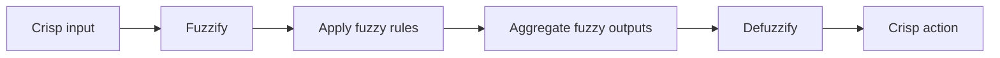

# Fuzzy Logic — Soft Computing Study Guide

*Based on the four supplied FL-01 to FL-04 slide decks. Repeated material is combined; examples and notation are cleaned up where the slides are inconsistent.*

## The whole topic in one picture

A fuzzy system turns numerical observations into degrees of meaning, applies human-readable rules, and (when needed) turns the result back into one number.

Example: A temperature of 30 °C might be **Hot to degree 0.7** and **Warm to degree 0.3**. A controller can use both degrees when choosing a fan speed. A membership grade describes how well a value fits a concept; it is **not** the probability that the temperature is hot.

---

## 1. Crisp sets, fuzzy sets, and membership

- **Universe of discourse** $X$: all values being considered, such as temperatures from 0 to 50 °C.
- **Crisp set**: membership is either 0 or 1. For example, a rule saying “pass if marks $\geq 35$” has a sharp boundary.
- **Fuzzy set** $A$: each $x\in X$ has a membership grade $\mu_A(x)\in[0,1]$:

$$A=\{(x,\mu_A(x)):x\in X\}. $$

For example, $\text{Good student}=\{(\text{Rajat},0.8),(\text{Kabita},0.7),(\text{Salman},0.1)\}$. The numbers express a chosen notion of *good*, so membership functions must be designed for the application. A crisp set is the special case in which every grade is 0 or 1.

**Linguistic variable:** a numerical variable described using words. For example, `Age` may have the fuzzy values `Young`, `Middle-aged`, and `Old`, each with its own membership function. Neighbouring values can overlap.

### Terms to recognize

| Term | Definition | Plain meaning |
| --- | --- | --- |
| Support | $\{x:\mu_A(x)>0\}$ | Wherever $A$ applies at all |
| Core | $\{x:\mu_A(x)=1\}$ | Wherever $A$ applies fully |
| Normal set | $\max_x\mu_A(x)=1$ (a grade of 1 is attained) | Has a nonempty core |
| Crossover point | $\mu_A(x)=0.5$ | Half membership |
| Fuzzy singleton | One point has grade 1; every other point has grade 0 | One fully included point |
| $\alpha$-cut | $A_\alpha=\{x:\mu_A(x)\geq\alpha\}$ | Keep values at or above a threshold |
| Strong $\alpha$-cut | $A_\alpha^+=\{x:\mu_A(x)>\alpha\}$ | Keep values strictly above it |

**Example:** If grades at $x_1,x_2,x_3,x_4$ are $(0.2,0.5,0.7,1)$, the $0.5$-cut is $\{x_2,x_3,x_4\}$; the strong $0.5$-cut is $\{x_3,x_4\}$. Also $\operatorname{support}(A)=A_0^+$ and $\operatorname{core}(A)=A_1$. Higher cuts contain fewer points: if $\alpha>\beta$, then $A_\alpha\subseteq A_\beta$.

**Convex fuzzy set (on a numerical line):** membership cannot dip below the lesser of the two endpoint memberships between any two points:

$$\mu_A(\lambda x_1+(1-\lambda)x_2)\geq\min\bigl(\mu_A(x_1),\mu_A(x_2)\bigr),\qquad 0\leq\lambda\leq1.$$

Equivalently, every nonempty $\alpha$-cut is an interval. For a normal, convex set with two $0.5$ crossover points $p,q$, its **bandwidth** is $|q-p|$. **Symmetry** about $c$ means $\mu_A(c+t)=\mu_A(c-t)$. Left-open shoulder curves go from grade 1 on the left toward 0 on the right; right-open shoulder curves do the reverse. A closed bell or triangle tails toward 0 at both ends.

### Common membership functions

Choose the curve to match the meaning and the desired smoothness. Parameters are numbers you set using data or expert knowledge.

| Shape | Parameters and formula | Use |
| --- | --- | --- |
| Triangle | $a<b<c$; rises linearly from $(a,0)$ to $(b,1)$, falls to $(c,0)$ | One most typical value |
| Trapezoid | $a<b\leq c<d$; rises $a\to b$, stays at 1 until $c$, falls $c\to d$ | A whole range is fully typical |
| Gaussian | $\mu(x)=e^{-(x-c)^2/(2\sigma^2)}$ | Smooth, symmetric bell; center $c$, spread $\sigma$ |
| Generalized bell | $\mu(x)=1/[1+|(x-c)/a|^{2b}]$ | Bell with adjustable width $a$ and slope $b$ |
| Sigmoid | $\mu(x)=1/[1+e^{-a(x-c)}]$ | Smooth “high” or “low” shoulder; $c$ has grade 0.5, sign of $a$ chooses direction |

For a triangle $(a,b,c)$, compute membership with

$$\mu(x)=\max\!\left(0,\min\!\left(\frac{x-a}{b-a},\frac{c-x}{c-b}\right)\right).$$

Example: `Comfortable` with $(20,25,30)$ has grades 0 at 20 °C, 1 at 25 °C, and 0.6 at 28 °C. For a trapezoid, replace the single peak with a flat interval of grade 1.

**Fuzzy versus probability:** “30 °C is Hot to degree 0.7” measures fit to the *Hot* concept. “There is a 70% chance tomorrow reaches 30 °C” describes uncertainty about an event. They answer different questions.

---

## 2. Operations on fuzzy sets

For each $x$, let $a=\mu_A(x)$ and $b=\mu_B(x)$. Perform an operation **at each point separately**.

| Operation | Membership at $x$ | Intuition |
| --- | --- | --- |
| Standard union, $A\cup B$ | $\max(a,b)$ | Fuzzy OR; upper curve |
| Standard intersection, $A\cap B$ | $\min(a,b)$ | Fuzzy AND; lower curve |
| Complement, $A^c$ | $1-a$ | Fuzzy NOT |
| Difference, $A\setminus B=A\cap B^c$ | $\min(a,1-b)$ | $A$ AND NOT $B$ |
| Algebraic product | $ab$ | Another AND-like choice |
| Algebraic sum | $a+b-ab$ | Another OR-like choice |
| Bounded sum | $\min(1,a+b)$ | Sum capped at 1 |
| Bounded product | $\max(0,a+b-1)$ | AND-like operator floored at 0 |
| Scalar scaling | $k a$, provided the result stays in $[0,1]$ | Rescale the curve |
| Power / hedge, $A^k$ | $a^k$ | Change how restrictive a word is |

**Numerical check:** if $a=0.6$ and $b=0.8$, union $=0.8$, intersection $=0.6$, $A^c=0.4$, algebraic product $=0.48$, algebraic sum $=0.92$, bounded sum $=1$, and bounded product $=0.4$.

If $k>1$, $a^k<a$ for $0<a<1$: **concentration**, such as `Very Hot` $\approx(\text{Hot})^2$. If $0<k<1$, $a^k>a$: **dilation**, such as `More or less Hot` $\approx(\text{Hot})^{1/2}$.

With standard max, min, and $1-a$, familiar properties hold: commutativity, associativity, distributivity, De Morgan's laws, $(A^c)^c=A$, and **$A\cap A=A$**. Inclusion means $A\subseteq B$ exactly when $\mu_A(x)\leq\mu_B(x)$ for every $x$. Fuzzy $A$ and $A^c$ can both have positive membership at a point; “not cold” need not be the independently defined concept “hot.”

**Disjunctive sum (XOR-like):** $(A^c\cap B)\cup(A\cap B^c)$, with membership $\max(\min(1-a,b),\min(a,1-b))$.

---

## 3. Fuzzy relations: membership of pairs

A **crisp relation** is a subset of $X\times Y$: each ordered pair $(x,y)$ is either included or excluded. A **fuzzy relation** $R$ assigns each pair a strength $\mu_R(x,y)\in[0,1]$. In a matrix, rows are values of $X$, columns are values of $Y$, and entries are the pair strengths. A pair's grade can mean, for example, how strongly a disease is associated with a symptom.

- **Fuzzy Cartesian product:** given fuzzy $A$ on $X$ and $B$ on $Y$, $\mu_{A\times B}(x,y)=\min(\mu_A(x),\mu_B(y))$. This constructs a particular fuzzy relation.
- **Relations on the same pair space:** union $=\max(R_{xy},S_{xy})$; intersection $=\min(R_{xy},S_{xy})$; complement $=1-R_{xy}$, entry by entry.
- **$\lambda$-cut of a relation:** turn each matrix entry into 1 when its grade is $\geq\lambda$ and 0 otherwise. As with sets, higher thresholds give smaller crisp relations; cuts commute with standard union and intersection.

### Composition = best indirect path

If $R$ connects $X$ to $Y$, and $S$ connects $Y$ to $Z$, **max–min composition** connects $X$ to $Z$:

$$\mu_{R\circ S}(x,z)=\max_{y\in Y}\min\bigl(\mu_R(x,y),\mu_S(y,z)\bigr).$$

For each intermediate $y$, the path $x\to y\to z$ is only as strong as its weaker link (**MIN**). Choose the strongest path (**MAX**). This is used for `plant → disease → symptom` or for fuzzy rule inference.

**Example:** $R(x,y_1)=0.7$, $R(x,y_2)=0.4$; $S(y_1,z)=0.5$, $S(y_2,z)=0.9$. Then $(R\circ S)(x,z)=\max(\min(0.7,0.5),\min(0.4,0.9))=\max(0.5,0.4)=\mathbf{0.5}$. For matrix composition, repeat this calculation for each output cell.

---

## 4. Truth, fuzzy rules, and inference

A fuzzy proposition such as **“temperature is Hot”** has truth grade $T(P)=\mu_{\text{Hot}}(\text{temperature})$. Crisp logic uses $\{0,1\}$; fuzzy logic admits any grade in $[0,1]$. The slides use these standard connectives:

$$T(\neg P)=1-T(P),\quad T(P\land Q)=\min(T(P),T(Q)),\quad T(P\lor Q)=\max(T(P),T(Q)).$$

One logical choice for implication is $T(P\Rightarrow Q)=\max(1-T(P),T(Q))$; the slides also use $1-|T(P)-T(Q)|$ as a graded similarity/equality. **Implication has multiple definitions in fuzzy logic:** always check which one a question specifies.

### IF–THEN rules as relations

For `IF x is A THEN y is B`, $A$ is the **antecedent** (premise), $B$ the **consequent**. The rule may be represented by a relation $R(x,y)$, calculated from $a=\mu_A(x)$ and $b=\mu_B(y)$. The slides distinguish coupling an input to an output from interpreting a logical implication:

| Rule construction | $R(x,y)$ | Meaning |
| --- | --- | --- |
| Mamdani (min) | $\min(a,b)$ | Couple $A$ and $B$; clip consequent |
| Larsen (product) | $ab$ | Couple $A$ and $B$; scale consequent |
| Bounded product | $\max(0,a+b-1)$ | Another AND-like coupling |
| Zadeh arithmetic implication | $\min(1,1-a+b)$ | Implication using a bounded sum |
| Zadeh max–min implication | $\max(1-a,\min(a,b))$ | $(A^c\times Y)\cup(A\times B)$ |
| Boolean/material implication | $\max(1-a,b)$ | Fuzzy extension of NOT $A$ OR $B$ |
| Goguen implication | $1$ if $a\leq b$; $b/a$ if $a>b$ | Consequent at least as strong as premise makes the rule fully satisfied |

**Keep the forms distinct.** For example, $a=0.8,b=0.3$ gives Mamdani $0.3$, Larsen $0.24$, Zadeh max–min $0.3$, Boolean $0.3$, and Goguen $0.375$. For $a=0.2,b=0.1$, Mamdani gives $0.1$ but Boolean implication gives $0.8$: a mostly false premise can make a logical implication largely satisfied.

The slide deck also introduces the **drastic product**, which is $a$ if $b=1$, $b$ if $a=1$, and 0 otherwise. It is another T-norm (AND-like operator); min and algebraic product are the two central controller cases.

For `IF x is A THEN y is B ELSE y is C`, the slide's min–max construction is

$$R(x,y)=\max\!\left[\min\bigl(\mu_A(x),\mu_B(y)\bigr),\ \min\bigl(1-\mu_A(x),\mu_C(y)\bigr)\right].$$

### Generalized reasoning

- **Forward reasoning / generalized modus ponens (GMP):** given `IF x is A THEN y is B` and new fuzzy evidence `x is A′`, infer `y is B′`. Build a rule relation $R$, then use $\mu_{B'}(y)=\max_x\min(\mu_{A'}(x),R(x,y))$.
- **Backward reasoning / generalized modus tollens (GMT):** given the rule and fuzzy evidence `y is B′`, infer a fuzzy set $A'$ on $X$ with $\mu_{A'}(x)=\max_y\min(\mu_{B'}(y),R(x,y))$ using the convention in these slides. This is a composition with the transposed relation when writing row vectors as matrices.
- **Chain reasoning:** a conclusion of one rule can supply a premise to another. In each problem, specify the rule relation and the chosen composition before multiplying fuzzy matrices.

**Mini-example (GMP):** If evidence grades for $(x_1,x_2)$ are $(0.6,0.9)$ and the rule relation's column for $y_1$ is $(0.5,0.8)$, the inferred grade of $y_1$ is $\max(\min(0.6,0.5),\min(0.9,0.8))=0.8$.

---

## 5. Defuzzification: one number from a fuzzy output

After rules fire, their output fuzzy sets are often merged into $C$. A motor or robot needs a single numerical command $y^*$, so we **defuzzify**. First find the fuzzy output *for the actual input*; then apply the requested method.

> An $\alpha$-cut gives a **crisp set or relation**, not normally one numerical output. It is a thresholding method; a further choice may be needed to pick one number.

### Methods at a glance

| Method | Calculation | What it uses |
| --- | --- | --- |
| First of maxima (FoM) | Smallest location where $\mu_C$ is maximal | Left edge of peaks |
| Last of maxima (LoM) | Largest such location | Right edge of peaks |
| Mean of maxima (MoM) | Mean of locations with maximal membership; midpoint for a flat peak interval | All maximum locations |
| Height / maximum membership | Location of a **unique** maximum | Peak only |
| Center of gravity (CoG, centroid) | $\displaystyle y^*=\frac{\int y\mu_C(y)\,dy}{\int\mu_C(y)\,dy}$ | Full aggregated curve |
| Discrete CoG | $\displaystyle y^*=\frac{\sum_i y_i\mu_C(y_i)}{\sum_i\mu_C(y_i)}$ | Sampled output values |
| Center of sums (CoS) | $\displaystyle y^*=\frac{\sum_j A_jc_j}{\sum_j A_j}$, area $A_j$ and centroid $c_j$ of each **individual** rule output | Each rule output separately |
| Center of largest area | Centroid of the largest output region | Largest region only |
| Weighted average | $\displaystyle y^*=\frac{\sum_j w_jc_j}{\sum_jw_j}$, representative center $c_j$ and activation $w_j$ | Centers and firing strengths |

**CoG versus CoS:** CoG finds the centroid after combining rule outputs by pointwise MAX, so overlapping areas count once. CoS sums individual areas, so overlaps contribute for each rule. For a piecewise linear output, compute each piece's area and centroid, then take their area-weighted average. The slides call a largest-region variant “CoA”; use its stated procedure when that label appears in a question.

**Weighted average versus Sugeno:** A weighted average of representative centers works especially simply for symmetric output sets with clear centers. A Takagi–Sugeno controller uses the same weighted-average *shape of formula* with each rule's numerical or functional consequent $f_j(x)$ in place of $c_j$.

**Worked discrete output:** Let $y\in\{0,50,100\}$ and aggregated grades be $(0.6,0.5,0.4)$. The unique maximum is at $0$, so the maxima methods return $0$. Discrete CoG uses *all* grades:

$$y^*=\frac{0(0.6)+50(0.5)+100(0.4)}{0.6+0.5+0.4}=\frac{65}{1.5}\approx\boxed{43.33}.$$

Different methods legitimately produce different crisp results because they summarize different aspects of the same fuzzy output. If the denominator of a centroid or weighted average is zero, no output was activated; the system needs a separately chosen fallback.

---

## 6. Fuzzy logic controllers (FLCs)

An FLC is useful when expert rules are available and a precise mathematical model of the process is hard to write (for example, nonlinear behavior or changing surroundings). It contains **input membership functions**, a **rule base**, an **inference engine**, and an **output calculation**.

### Mamdani controller: fuzzy output, then defuzzify

1. **Fuzzify** each measured input: find its membership in every relevant word category.
2. **Fire** applicable IF–THEN rules. For AND with standard min, a rule's strength is the minimum of its antecedent grades.
3. **Apply** each strength to the consequent: Mamdani clipping $\mu_j^{out}(y)=\min(w_j,\mu_{B_j}(y))$; Larsen scaling instead uses $w_j\mu_{B_j}(y)$.
4. **Aggregate** outputs: $\mu_C(y)=\max_j\mu_j^{out}(y)$.
5. **Defuzzify** $C$ into an action, using CoG, CoS, or another specified method.

**Robot example from the slides:** Inputs are obstacle distance $D$ and angle $\theta$; output is steering deviation $\delta$. The rule base has $4\times5=20$ possible distance–angle combinations. For $D=1.04$ m and $\theta=30^\circ$, the displayed grades are:

| Distance | Grade | Angle | Grade |
| --- | ---: | --- | ---: |
| Near (NR) | 0.6571 | Ahead (AA) | 0.3333 |
| Far (FR) | 0.3429 | Ahead right (AR) | 0.6667 |

Only four combinations have nonzero antecedent grades. Their firing strengths are $\min(0.6571,0.3333)=0.3333$; $\min(0.6571,0.6667)=0.6571$; $\min(0.3429,0.3333)=0.3333$; and $\min(0.3429,0.6667)=0.3429$. The controller clips the four steering consequents, aggregates them, and defuzzifies the combined shape. **The method, not the memorized final angle, is the key exam skill.**

### Takagi–Sugeno (TSK) controller: numerical rule outputs

Its antecedents are fuzzy, but rule $j$ has a number or function as its consequent, often $f_j(x_1,\ldots,x_n)=a_{j0}+\sum_i a_{ji}x_i$. In the slides, rule weights are products of antecedent memberships:

$$w_j=\prod_i\mu_{A_{ji}}(x_i),\qquad y^*=\frac{\sum_j w_j f_j(x)}{\sum_jw_j}.$$

**Worked slide example:** For $I_1=6$ and $I_2=2.2$, the grades are $\mu_L(I_1)=0.8$, $\mu_M(I_1)=0.2$, $\mu_{FR}(I_2)=0.8$, $\mu_{VF}(I_2)=0.2$. The four active rules give:

| Rule | Weight | Function at $(6,2.2)$ | Output |
| --- | ---: | --- | ---: |
| $L,FR$ | $0.8(0.8)=0.64$ | $I_1+2I_2$ | $10.4$ |
| $L,VF$ | $0.8(0.2)=0.16$ | $I_1+3I_2$ | $12.6$ |
| $M,FR$ | $0.2(0.8)=0.16$ | $2I_1+2I_2$ | $16.4$ |
| $M,VF$ | $0.2(0.2)=0.04$ | $2I_1+3I_2$ | $18.6$ |

Therefore $y^*=0.64(10.4)+0.16(12.6)+0.16(16.4)+0.04(18.6)=\boxed{12.04}$, since the weights sum to 1. Mamdani consequents are fuzzy sets; TSK consequents are functions or constants.

---

## Quick revision checklist

1. **Set or relation?** A set grades individual $x$; a relation grades pairs $(x,y)$.
2. **Union, intersection, complement?** Pointwise MAX, MIN, $1-\mu$.
3. **Indirect relation or GMP?** MIN for each route, then MAX over routes.
4. **Which implication?** Mamdani MIN, Larsen product, and logical implications have different formulas.
5. **Which defuzzifier?** An $\alpha$-cut yields a set; maxima picks peaks; CoG uses the aggregated area; CoS uses individual output areas; TSK averages functional rule outputs.
6. **Controller calculation order?** Membership grades $\to$ rule strengths $\to$ consequent outputs $\to$ aggregation $\to$ crisp action.

### Short practice with answers

- **Cut:** For $P=(0.1,0.2,0.7,0.5,0.4)$ on $(x_1,\ldots,x_5)$, find $P_{0.5}$. **Answer:** $\{x_3,x_4\}$.
- **Relation:** Two paths have link grades $(0.9,0.4)$ and $(0.6,0.8)$. What is max–min composition? **Answer:** $\max(0.4,0.6)=0.6$.
- **Rule:** Antecedent grades are $0.7,0.3$. Mamdani AND strength? **Answer:** $\min(0.7,0.3)=0.3$.
- **Hedge:** If $\mu_{Hot}(x)=0.6$, find `Very Hot` using a square. **Answer:** $0.6^2=0.36$.

*Notation caveat: Some supplied slides contain typos, including an idempotence line stating $A\cap A=\varnothing$; the correct identity is $A\cap A=A$. The slides also use “bounded difference” for $\max(0,a+b-1)$, commonly called the bounded product / Łukasiewicz t-norm. This guide uses the mathematical operations explicitly.*
