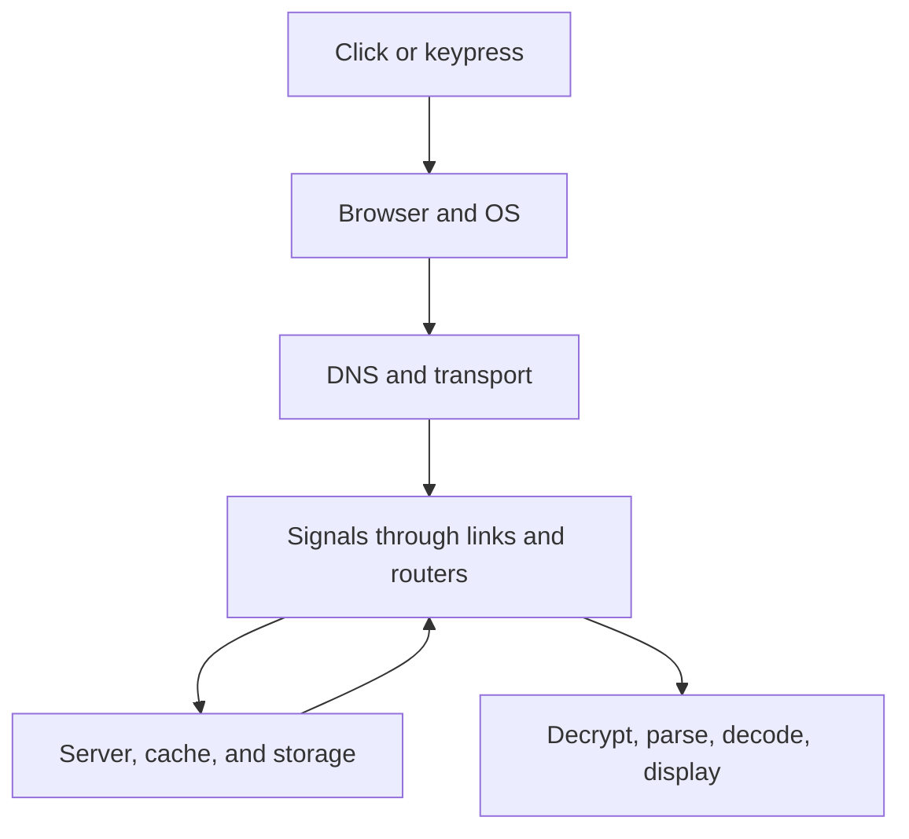
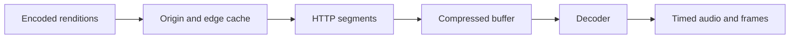

# How the Computing World Actually Works

*A build-first field guide from a voltage change to a video frame, a web page, and a secure server*

**Reader:** A computer science student comfortable writing programs, but looking for a physical and mechanical account of real systems.  
**How to read:** Chapters 1–14 form the main path. Chapter 15 revisits everyday technologies; Chapter 16 is the integrated capstone. Chapters 18–21 investigate complete paths. Parts IX and X provide detailed labs and worked cases. Do each **Build it yourself** exercise on equipment, accounts, and networks you own or are authorized to use.  
**Scope:** Examples use Ethernet, IP, TCP, HTTP/1.1 and TLS 1.3 because their boundaries are easy to see. Real deployments may use Wi-Fi, cellular, IPv6, HTTP/2, HTTP/3 over QUIC, proxies, and hardware acceleration. The principles survive; the exact headers and number of round trips change.

## The story in one page

Imagine pressing Play on a video site. The operating system delivers the click to a browser. The browser may resolve a hostname through DNS, open a connection, authenticate a server with TLS, and ask for a playlist. It then requests short compressed media segments, often from a cache close to you. Each segment becomes bytes in memory, is parsed into video and audio samples, decoded into frames and sound, and presented on a screen and speakers at the right time. Meanwhile a server reads cached files or storage, checks permissions, and sends responses. A firewall may allow the connection because it matches an authorized flow; encryption protects the bytes in transit, but does not decide whether your account can watch the title.



Three questions will recur: **Where are the bytes? Who interprets them? What can go wrong at this boundary?** A byte has no intrinsic meaning. `48 69` is “Hi” under ASCII or UTF-8; under another format it might be two numbers. A protocol is an agreement about interpretation. A system works by stacking agreements, with each layer hiding some complexity and introducing new failure modes.

### Contents

- **Part I — From information to packets:** 1. Bits and signals; 2. Local links; 3. IP and routers; 4. Transport and sockets
- **Part II — Names, requests and visible pages:** 5. DNS and URLs; 6. HTTP and browsers
- **Part III — Where bytes wait and how they become media:** 7. Storage; 8. Video files and codecs; 9. Streaming
- **Part IV — Trust, identity and boundaries:** 10. TLS; 11. Security and identity; 12. DRM
- **Part V — The machines behind the network:** 13. Servers, cloud and databases; 14. CPU and OS
- **Part VI — Everyday technologies:** 15. GPS, touchscreens, QR, radio, search, AI, blockchain
- **Part VII — Put the whole chain together:** 16. End-to-end trace; 17. Study order
- **Part VIII — Four worked investigations:** 18. Packet bytes; 19. DNS and HTTP; 20. Video; 21. Threat model
- **Part IX — Lab manual:** 20 build projects with tests and deliverables
- **Part X — Worked systems cases:** 18 end-to-end scenarios and debugging exercises
- **Appendices:** Artifact checklist, misconceptions, reference shelf, further study, review questions and byte artifacts

### Map of the journey

| Layer | Unit and identifier | Main job | Typical failure |
| --- | --- | --- | --- |
| Physical | Time-varying electrical, optical, or radio signal | Convey symbols over one medium | Noise, attenuation |
| Link | Frame, local hardware address | Deliver to a neighbor on one link | Corrupt frame, contention |
| Network | IP packet, IP address | Forward across networks | No route, congestion |
| Transport | TCP byte stream or UDP datagram, ports | Connect processes; optionally order and retry | Loss, timeout, overload |
| Security | TLS records, certificates, keys | Authenticate peer and protect traffic | Invalid trust, compromised endpoint |
| Application | HTTP message, DNS record, media segment | Give bytes meaning | Bad input, wrong permissions |
| Machine | File, memory page, instruction, pixel | Store, compute, render | Crash, capacity, bugs |

---

# Part I — From information to packets

## 1. A bit is a decision made about a physical quantity

A **bit** is an abstract choice between two states. It is not inherently a tiny object traveling through a wire. A memory cell can be in one of two distinguishable charge states; a magnetic region can have one of two orientations; a receiver can classify a measured voltage or light intensity as one symbol or another. Engineering begins with deciding *how* to represent the distinction, *when* to sample it, and *how confidently* to tell it from noise.

Suppose a sender holds a voltage near 0 V for `0` and near 1 V for `1`. The receiver samples in a time window and uses a threshold, perhaps 0.5 V. A received 0.92 V is probably `1`; a received 0.49 V is ambiguous. Real links use more elaborate encoding, clock recovery and equalization. Some encode multiple bits per symbol by choosing among several amplitudes or phases. The effective bit rate depends on symbol rate, bits per symbol, overhead and error rate; “bandwidth” can mean frequency range in hertz or data rate in bits per second, depending on context.

Signals propagate as electromagnetic effects. In copper, changing electric fields and currents carry information; electrons themselves drift much more slowly than the signal propagates. In fiber, a transmitter modulates light and a receiver measures it. In radio, the transmitter changes properties of an electromagnetic wave, such as amplitude, frequency or phase. Wi-Fi is not “bits floating in air”; it is an agreed modulation, coding, timing and medium-sharing scheme. Undersea cables usually carry optical signals through fiber, with repeaters and power systems along the route. Fiber's advantages include low attenuation and enormous usable optical spectrum, though real throughput also depends on equipment and protocol overhead.

Why not simply send one arbitrarily long stream? A receiver must discover boundaries and detect damage. A simple frame format might be `[length:2 bytes][payload:length bytes][checksum:4 bytes]`. If one bit changes, the checksum may detect the error. A checksum is not an authentication tag: an adversary can often change data and recompute it. A corrupted frame is commonly dropped; a higher layer can request retransmission or tolerate loss. Forward error correction instead adds redundancy allowing some errors to be repaired without asking again. The choice depends on latency, energy and the expected error pattern.

**Ground truth example.** UTF-8 text `Hi` is `48 69` in hex, or `01001000 01101001` as bits. Nothing in the copper knows that these bits mean letters. The application chose text encoding; the link merely carries a representation of those bytes.

**Where to go deeper:** [MIT 6.033 networking guide](https://ocw.mit.edu/courses/6-033-computer-system-engineering-spring-2018/resources/mit6_033s18networking_guide/) motivates layers and unreliable networks; focus on why each layer has its own unit and failure model. [Wireshark's byte view](https://www.wireshark.org/docs/wsug_html_chunked/ChapterWork.html) lets you connect decoded fields to actual bytes; start with a capture you made yourself.

### Build it yourself — A noisy channel

**Difficulty:** Beginner. **You will learn:** Representation, framing and the difference between detection and correction. Write two programs or functions: one serializes a length-prefixed message with a CRC, the other reads an arbitrary number of chunks and reconstructs frames. Inject random bit flips and dropped bytes. Measure undetected corruption and resynchronization failures; then add a sequence number and acknowledgement. Test with the string `Hi`, a zero-length message and a payload containing your delimiter. This is a model, not a substitute for a real network's coding scheme.

### Going deeper: how a receiver recovers symbols

A receiver never sees an abstract string of zeros and ones. It sees measurements over time. Start with a deliberately simple model: every bit lasts one millisecond; a low voltage means zero and a high voltage means one. If the receiver samples every millisecond but its clock begins halfway through a symbol, it may still work. If the clocks drift, the sample point eventually approaches a transition and mistakes become likely. A real communication system therefore needs a way to recover timing. Some line codes guarantee transitions often enough for a receiver to align its clock; others use a preamble, a separately recovered clock, or more elaborate signal processing. “Both ends know the bit rate” is not enough unless their clocks stay aligned or timing is regularly corrected.

The physical channel reshapes the signal. A copper cable has resistance, capacitance and inductance; sharp edges spread out. Fiber attenuates light and can disperse pulses; radio waves reflect off objects, interfere with one another and fade as the receiver moves. The receiver estimates what was sent despite these distortions. Equalization counteracts predictable channel effects; modulation chooses how symbols are represented; coding adds structured redundancy. In a simple two-level diagram we draw a perfect square wave, but measured waveforms have slopes, ringing and noise. The meaningful question is whether the receiver can distinguish allowed symbols at the chosen sampling time with an acceptable error probability.

Suppose a channel has four distinguishable signal states. Each symbol can carry two bits, because there are four combinations: `00`, `01`, `10`, `11`. Packing more bits into a symbol increases potential data rate without increasing symbol rate, but states become closer together and more vulnerable to noise. Communication engineers trade signal power, bandwidth, modulation complexity and error probability. The celebrated capacity results in information theory set bounds under particular noise models; they do not give a magical speed limit for every cable. In practice, coding, retransmissions, interference and protocol overhead determine the useful throughput available to your application.

Error detection is a separate layer of reasoning. A single parity bit tells you whether the number of one bits in a word is even or odd; it detects any odd number of flips, but misses many even-numbered patterns. A CRC treats the bit string as a polynomial and appends a remainder computed under a specified generator polynomial. It is especially useful for common burst errors. Neither can tell you whether an attacker intentionally changed the data, because they are public calculations. A cryptographic message authentication code or authenticated-encryption tag uses a secret key to make undetected tampering infeasible under its assumptions. These three ideas—detect accidental corruption, repair or retransmit damaged data, and authenticate against a malicious change—must remain distinct.

What happens after detection depends on the application. On a link with inexpensive round trips, a sender may retain a frame and resend if no acknowledgement arrives. A spacecraft or long-distance link may use forward error correction because waiting for another round trip is costly. A live voice call may accept a little loss or conceal a missing audio frame rather than replay it too late. TCP retries missing bytes because its contract is an ordered stream; a real-time application may choose a different contract. Reliability is therefore not a single switch that a wire turns on.

### Going deeper: why the ocean and the air still fit this model

A long undersea route is a chain of physical sections, not one uninterrupted laser shining perfectly across an ocean. Terminal equipment launches optical signals into glass fibers; repeaters or optical amplifiers along long routes restore usable signal power; a conductor supplies power to those submerged components. Protective layers and sometimes armoring surround the fibers. Near shore the cable faces more threats from anchors and fishing activity. When a cable is damaged, network operators can route traffic over other paths if capacity exists, while repair ships work on the physical plant. This is a visible example of the distinction between physical connectivity and logical routing: software can choose another route, but it cannot conjure an unlimited alternate cable.

Radio is the same electromagnetic physics with a shared, open medium. A Wi-Fi transmitter modulates a carrier; the receiver measures changes and decodes symbols. Several devices may hear the same channel, so they coordinate transmission opportunities and identify intended recipients in frames. Interference from another network or a microwave oven can make the channel less usable without changing the IP packet format. A signal-strength indicator helps describe reception but is not a guarantee of throughput. The device may fall back to a more robust modulation, use more coding overhead, or retry frames. A cable can also be shared logically through switches and multiplexing, even when the physical medium looks point to point.

**Why the design choice matters:** Once the link provides a plausible frame to a neighbor, higher software need not know whether the underlying medium was copper, fiber or radio. But it must not assume the link is perfect. This is the first example of an abstraction contract: the lower layer promises a particular kind of service and leaves the upper layer to handle residual failure.

**Read alongside this section:** The [International Cable Protection Committee's cable explainer](https://www.iscpc.org/documents/?id=1753) describes repeaters and fiber construction; focus on the power and amplification path. [IEEE 802.11's overview](https://www.ieee802.org/11/abt80211.html) distinguishes the wireless physical and medium access layers. The [MIT networking guide](https://ocw.mit.edu/courses/6-033-computer-system-engineering-spring-2018/resources/mit6_033s18networking_guide/) explains why layering survives imperfect media.

### Extend the build — Measure your channel

Make the noisy-channel project reproducible. Seed a pseudorandom generator and record the seed, number of messages, payload size and bit-flip probability. Run three experiments: flips only, dropped bytes only, and burst corruption of several neighboring bytes. Count *detected* corruptions, *undetected* corruptions, false frame boundaries and successful retransmissions separately. A CRC alone cannot repair dropped framing bytes; your resynchronization strategy should be explicit. Plot delivery success versus error probability and annotate why results differ for short and long frames. The plot becomes evidence for the design tradeoff rather than a decorative figure.


## 2. A local link gets a frame to the next machine

A **link** connects neighbors. On Ethernet, the sender puts a frame on a physical link, with destination and source MAC addresses and a type that says what the payload contains. Switches learn which MAC addresses appear on which ports and forward frames accordingly. A switch is not choosing a route across the whole internet; it is making a local forwarding decision. A router joins different IP networks and will often put the forwarded packet into a *new* link-layer frame for the next hop.

Here is an illustrative Ethernet II frame header. Spaces mark fields; `08 00` means the payload is IPv4. The example addresses are invented for the exercise.

```text
Destination MAC       Source MAC            EtherType   IP packet begins
02 00 00 00 00 02    02 00 00 00 00 01    08 00       45 00 ...
```

How does a host know the neighbor's link address? On a typical IPv4 LAN, ARP asks who has an IP address and caches the answer; IPv6 uses Neighbor Discovery. If the destination IP is outside the local subnet, the host learns the *gateway's* link address and sends the frame there. The IP destination remains the remote host; the Ethernet destination is merely the next neighbor. Network address translation (NAT), often on a home router, can change IP addresses and ports as packets cross the boundary. NAT is common but is not the same thing as routing or as a security policy.

Wi-Fi provides a different local link. Stations share a radio medium, coordinate access and acknowledge many link-layer frames. Your laptop can still run IP and TCP above either Wi-Fi or Ethernet because those upper layers ask for delivery to a next hop without dictating the physical mechanism. Shared-medium efficiency changes with interference, signal strength, modulation, contention and retransmissions. A promised link rate is not your application's download rate.

**Why packets and frames?** Bounded units let multiple conversations share a link and make it possible to discard or retry a damaged unit. A very large indivisible transfer would monopolize the link and make a single corruption expensive. Overhead is the price of division. A maximum transmission unit limits the size of packets a link can carry without fragmentation or other adaptation.

**Where to go deeper:** [Wireshark User's Guide](https://www.wireshark.org/docs/wsug_html/) for capture and byte pane; [MIT 6.033 networking](https://ocw.mit.edu/courses/6-033-computer-system-engineering-spring-2018/pages/week-5/) for switches, addressing and layer boundaries.

### Build it yourself — Frame decoder

**Difficulty:** Beginner–intermediate. **You will learn:** Field offsets and endianness. Capture only your own traffic or use a public sample capture. Parse a saved Ethernet frame's first 14 bytes into destination MAC, source MAC and EtherType; if the type is IPv4, print its version and header length. Compare every field with Wireshark's interpretation. Do not assume all captures begin with Ethernet: loopback and other interfaces can use different link formats.

### Going deeper: link addresses, switches and competing senders

Imagine three hosts A, B and C connected to one Ethernet switch. A sends a frame whose destination MAC belongs to B. The switch maintains a table mapping recently observed *source* addresses to ingress ports. It learns “A is on port 1” when A transmits. If it already knows B is on port 2, it sends the frame only there; if it does not, it may flood an unknown-unicast frame to candidate ports. B replies, so the switch learns B's location. Entries expire because a device might move. A switch's knowledge is local and temporary; it does not consult a worldwide registry for each frame.

A broadcast frame, such as an IPv4 ARP request, is intentionally delivered to the local broadcast domain. This helps hosts discover neighbors, but broadcast traffic cannot simply be flooded through every network on Earth. Routers separate IP networks and do not ordinarily forward local Ethernet broadcasts. For IPv6, Neighbor Discovery uses ICMPv6 and multicast rather than IPv4 ARP. On a Wi-Fi LAN, an access point also handles association, radio scheduling, security and frames; calling it “just a wireless switch” hides substantial work.

A MAC address is an identifier used within a link-layer context. It is not a cryptographic identity, can be randomized or changed in software on many devices, and may be visible differently across interfaces. An IP address identifies a network-layer destination; a port selects a transport endpoint; an application username identifies an account. Confusing these identities leads to faulty security reasoning. “Allow this MAC address” might be a useful local administrative filter, but it is not proof that the sender is a particular person.

Why is local discovery necessary? A host may know that `192.0.2.8` is on its own subnet, but its network interface needs a next-hop link destination. IPv4 ARP asks, in effect, who owns that IP on the local link. The answer supplies a MAC that is cached for a while. If the destination is remote, the host does not seek the remote server's MAC; it seeks the gateway's. The frame to the gateway carries the remote IP inside it. When the gateway forwards, it makes a new local-frame decision. This nesting is easy to miss when diagrams draw one arrow directly from laptop to website.

Wi-Fi's medium-sharing problem differs from a switched full-duplex Ethernet cable. A station cannot reliably infer that every other radio station is silent merely because its own transmitter sees no signal; hidden stations may interfere at the access point. Practical Wi-Fi uses coordinated access procedures, acknowledgements and backoff. Retries consume airtime, so a distant slow client can affect others sharing the channel. Ethernet switched links normally avoid old shared-bus collisions, but congestion can still arise at a switch's output port. The phrase “collision domain” belongs to specific link designs; do not apply the same mechanism to every modern Ethernet link.

### A small ARP thought experiment

You have IP `192.168.1.20/24`, gateway `192.168.1.1`, and want to contact `203.0.113.9`. The subnet mask says that the first three octets identify the local `/24` prefix. The destination is outside it. The computer asks for the gateway's MAC, constructs an Ethernet frame to that MAC, and keeps destination IP `203.0.113.9` in the IP header. A switch forwards the frame to the gateway. The gateway may NAT the source and forward toward an ISP. On the return path, translation state lets the response find the original private host. A firewall rule allowing established responses may be involved, but NAT itself is an address mapping, not a complete security policy.

Draw the same experiment for a local destination `192.168.1.30`: now the host resolves the destination's MAC directly. If it cannot find a neighbor, the failure happens before any remote routing. Test on an isolated lab LAN or with a simulated ARP table; avoid issuing forged responses on other people's networks.

**Read alongside this section:** [RFC 4861](https://www.rfc-editor.org/rfc/rfc4861.html) shows how IPv6 combines neighbor and router discovery. For byte-level Ethernet practice, [Wireshark's packet view](https://www.wireshark.org/docs/wsug_html_chunked/ChapterWork.html) is more approachable than a complete link standard.

### Extend the build — Simulate a switch

Add a switch table to your frame decoder: record source MAC to ingress port with an expiry time, flood an unknown destination, forward a known one, and deliver broadcasts appropriately. Feed the simulator a trace in which a host moves to a different port. Assert that it relearns the new location. This exercise reveals why a network device needs state even when forwarding seems like a simple lookup.


## 3. IP connects many links, and routers forward one hop at a time

The **internet** is an interconnected collection of networks that agree on ways to move IP packets. It is not one central machine. IP provides a best-effort datagram service: a packet can arrive, be lost, be duplicated or take a different path. An IP address identifies a network-layer endpoint/interface in a routing context, not a permanent geographic location or a person. A hostname may map to several addresses; an address may serve many hostnames.

A sender checks whether a destination belongs on its local network. If yes, it sends to the neighbor; otherwise it sends to its default gateway. Each router examines the destination IP, selects a next hop from a routing table, decrements a hop limit or TTL, and forwards a packet in an appropriate local frame. Longest-prefix matching chooses the most specific applicable route. If a router has routes for `10.0.0.0/8` and `10.2.0.0/16`, a destination in `10.2.3.4` follows the `/16` route. This is a *forwarding* decision, distinct from how networks exchange and choose routes. BGP helps autonomous systems announce reachability to one another; operational policy matters as well as physical distance.

A packet's payload can contain a TCP segment or a UDP datagram. Consider the nesting:

```text
Ethernet frame [ destination MAC | source MAC | type |
  IPv4 packet [ source IP | destination IP | TTL | protocol |
    TCP segment [ source port | destination port | sequence | payload ] ] ]
```

At each router, the link header normally changes and the IP hop limit changes. The TCP payload need not be reinterpreted by ordinary routers. This separation makes heterogeneous links possible. It also means a ping or traceroute shows some path behavior, not a complete universal map; return paths can differ and some routers do not respond.

**Latency versus throughput.** A 1 Gbit/s link can serialize a 1,000-byte payload in roughly 8 microseconds, yet a request can take tens of milliseconds because propagation, queueing, handshakes and server processing dominate. More bandwidth does not abolish distance. Congestion is a shared-resource problem: if arrivals exceed outgoing capacity, queues grow and packets eventually drop. Protocols must avoid making that worse.

**Where to go deeper:** [MIT 6.033 routing notes](https://ocw.mit.edu/courses/6-033-computer-system-engineering-spring-2018/pages/week-6/) for forwarding versus interdomain routing; [RFC 9000](https://www.rfc-editor.org/rfc/rfc9000.html) later, to see how modern transport builds on UDP.

### Build it yourself — Tiny router simulator

**Difficulty:** Intermediate. **You will learn:** Prefix matching, TTL and the difference between forwarding and delivery. Define three virtual networks with routing tables. Serialize packets containing source, destination, hop limit and payload; implement longest-prefix forwarding. Drop packets with exhausted hop limit or no route; print the route taken. Add a queue with limited capacity and observe loss under load. Keep this in a local simulation rather than altering your machine's network configuration.

### Going deeper: addresses, prefixes and the global routing problem

An IPv4 address has 32 bits. Prefix notation such as `203.0.113.0/24` says that the first 24 bits identify a routing prefix and the remaining bits vary within it. The router's table might contain a broad default route `0.0.0.0/0`, a route for `203.0.0.0/16`, and a more specific one for `203.0.113.0/24`. Traffic to `203.0.113.9` uses the `/24` entry. Longest-prefix match lets an operator announce a large group of destinations efficiently yet make a more specific exception. Address aggregation keeps tables manageable; excessively fragmented announcements make global routing harder.

IPv6 uses 128-bit addresses and a revised base header. It is not merely “IPv4 with longer numbers”: neighbor discovery, extension headers and fragmentation behavior differ. A practical program should support both address families rather than assuming every hostname resolves to one four-byte address. The TCP or UDP application still uses ports and can often remain conceptually the same. An IPv6 address is not automatically publicly reachable: firewalls, routing and service configuration still matter. [RFC 8200](https://www.rfc-editor.org/rfc/rfc8200.html) defines the basic format; read its introductory comparison with IPv4 before delving into extension headers.

Routing has two layers of work. **Forwarding** is the fast action for one packet: inspect destination, choose output, update permitted header fields and send. **Routing control** is how tables are constructed and updated. A home router may receive a default route from its ISP. Inside a large provider, internal protocols disseminate reachability. Between autonomous systems, BGP exchanges reachability announcements influenced by business and policy. A packet does not carry a complete turn-by-turn itinerary. Paths can change while an application is running; TCP or QUIC must withstand transient loss or movement within its capabilities.

Congestion occurs where offered traffic exceeds capacity. A router may buffer packets briefly, but an unbounded queue would turn overload into very high latency. Eventually packets are dropped or marked, and end hosts adjust sending. This is why a network protocol cannot rely on the router to store everything until the destination catches up. A video player measuring a falling transfer rate can choose a smaller segment rendition, while TCP adjusts its own sending rate to the transport path. These mechanisms solve related but different problems: one chooses media quality; the other manages network load.

A path's **MTU** limits how large a packet can be on a link. If an IP packet is too large for a subsequent link, strategies include fragmentation in applicable cases or feedback that lets the sender use smaller packets. Broken filtering of control messages can cause mysterious stalls for large transfers while small ones work. This illustrates a systems lesson: “I can ping it” proves only that some small packets can make a round trip; it does not prove every size, protocol or port works.

### A route trace you can reason about

Suppose your computer sends three probe packets with hop limits 1, 2 and 3. The first router decrements hop limit 1 to zero and discards the packet, perhaps returning an ICMP Time Exceeded message. The second probe gets beyond the first router but expires at the second. Repeated probes can expose a series of responding routers. The returned addresses and delays are observations, not a guaranteed route map. Some devices rate-limit or suppress responses, load balancing can choose different paths, and the return path for ICMP may differ. A missing hop is not proof of a broken link.

NAT makes another common trace puzzle. A home device `192.168.1.20:51500` sends to a server `203.0.113.9:443`. The gateway may record a mapping to its public address and source port, perhaps `198.51.100.7:62000`. The server's response to that public tuple is translated back. The exact mapping and timeout depend on the gateway. An unsolicited inbound connection lacks an existing mapping unless configured otherwise; that is one reason home hosting needs deliberate router and firewall setup. However, NAT is not a substitute for validating application input or controlling permissions.

**Read alongside this section:** The [MIT 6.033 routing material](https://ocw.mit.edu/courses/6-033-computer-system-engineering-spring-2018/pages/week-6/) separates forwarding and interdomain routing. [RFC 8200](https://www.rfc-editor.org/rfc/rfc8200.html) is the IPv6 base; [RFC 4861](https://www.rfc-editor.org/rfc/rfc4861.html) is neighbor discovery. Draw the address and next-hop fields before reading BGP details.

### Extend the build — Failure and policy

Give your router simulator three prefixes, two alternate paths and a finite output queue. Remove a link mid-transfer and change the table after a simulated reconvergence delay. Measure dropped packets and queue latency. Add a deliberately more specific route that diverts one destination and explain why longest-prefix matching selects it. This is still a toy; real routing protocols must handle loops, convergence, scale and adversarial announcements.


## 4. Ports and transport turn packets into conversations

An IP address finds a host; a **port** helps identify a process-level service. A connection is commonly distinguished by source address, source port, destination address, destination port and protocol. A server may listen on TCP port 8080 while each client uses a temporary source port. A *socket* is an operating-system programming interface and endpoint for this exchange, not a literal opening in the network card.

UDP preserves message boundaries and adds ports and a checksum to datagrams. It offers no inherent guarantee of delivery, order or retry. That makes it useful when the application wants direct control or can tolerate loss. DNS often uses UDP; QUIC is a secure transport built over UDP with its own streams, loss recovery and congestion control. “UDP is faster” is too broad: a particular design may reduce delay, but reliability and congestion still have to be handled somewhere.

TCP presents applications with a **reliable, in-order byte stream**. It uses sequence numbers for byte positions, acknowledgements to show progress, retransmissions for loss, a receive window to avoid overrunning the receiver, and congestion control to avoid overwhelming the network. A TCP connection usually begins with SYN, SYN-ACK, ACK. Crucially, **TCP has no application-message boundaries**. If a sender calls `send()` twice with `hello` and `world`, a receiver might read `hell`, then `oworld`, or `helloworld`. Your parser needs a length, delimiter or format that defines messages. A successful `send()` means bytes were accepted for sending, not necessarily that the other application processed them.

```text
Client                         Server
  SYN, seq=x                     ->
                 <-              SYN+ACK, seq=y, ack=x+1
  ACK, ack=y+1                 ->
  application bytes           ->
                 <-              ACK; application bytes later
```

Retransmission and ordered delivery make TCP convenient, but can delay later bytes behind a missing earlier segment. Flow control protects the receiver; congestion control protects the network. These solve different problems. TLS and HTTP can sit above TCP; HTTP/3 instead uses QUIC. Real captures may show offload effects, delayed acknowledgements or retransmissions that differ from a textbook sketch.

**Where to go deeper:** [RFC 9293, especially §2.2](https://www.rfc-editor.org/rfc/rfc9293.html) specifies the modern TCP base and explains the byte stream; [RFC 9000](https://www.rfc-editor.org/rfc/rfc9000.html) describes QUIC's streams and connection behavior. Read RFCs to answer exact format questions after the intuition is clear.

### Build it yourself — A length-prefixed TCP chat

**Difficulty:** Intermediate. **You will learn:** Partial reads, state machines and connection lifecycle. Using the standard socket API in C++, Python or Rust, write a server on `127.0.0.1` and two clients. Prefix each UTF-8 message with a four-byte unsigned network-order length. Make the server read exactly four bytes, validate a sane maximum, then loop until the whole body arrives. Broadcast to connected peers. Send a frame one byte at a time to prove your parser does not assume one `recv()` equals one message. Handle disconnects, invalid lengths and a slow client. Once it works locally, bind to a LAN interface only on a network you control.


### Going deeper: reconstruct a stream from unreliable packets

A transport receiver sees segments that may be delayed, duplicated or missing. Suppose the sender starts at byte sequence number 1000 and transmits five payload bytes `hello`. If a segment containing bytes 1000–1004 arrives, the receiver can acknowledge the next expected byte, 1005. If a later segment 1005–1009 arrives first, the receiver may hold it out of order while still indicating the missing prefix, depending on the protocol details and options. Once the gap is filled, the application receives an ordered stream. The application ordinarily does not learn how many network segments carried its data.

Retransmission needs a decision about loss. A sender can use a timer: if an acknowledgement has not arrived within an estimated interval, resend. It may also infer loss from repeated acknowledgements or newer selective information. Set the timer too short and you resend packets merely delayed by queueing; too long and recovery feels sluggish. Round-trip time estimates and variance therefore matter. A retransmitted segment can arrive alongside the original, so the receiver needs sequence numbers to recognize duplicates. Acknowledgements themselves can be lost; the sender may retry even when the receiver already has the bytes.

Two windows serve two purposes. The **receive window** reflects how much the receiver can buffer; it prevents a fast sender from overwhelming a slow application. The **congestion window** estimates how much data the network path can carry without causing unacceptable congestion. The usable in-flight amount is constrained by both. Imagine a server able to send at 100 MB/s to a phone that consumes at 1 MB/s: receive-side flow control matters. Imagine a fast receiver on a congested path: congestion control matters. Confusing them leads to the mistaken idea that adding RAM alone fixes an overloaded network.

The bandwidth-delay product gives a useful estimate. If a path supports 100 Mbit/s and a round trip is 100 ms, about 10 Mbits, or 1.25 MB, can be in flight before an acknowledgement returns. A tiny allowed window can leave the link idle even though capacity is available. Conversely, a large window cannot make a congested or slow link physically faster. TCP's actual algorithms include many refinements; [RFC 9293](https://www.rfc-editor.org/rfc/rfc9293.html) specifies the base behavior and points to companion work for congestion control.

Application framing belongs above this stream. A safe four-byte length-prefix parser must handle header bytes split across reads, several complete messages in one read, a peer that closes halfway through a body, a declared length larger than memory limits, and a slow peer that never finishes. A parser should maintain explicit states such as `NEED_HEADER` and `NEED_BODY`, with bounds. The common beginner bug is to call `recv()` once and cast the returned bytes to a complete struct. Networks are allowed to deliver the same byte stream in different chunk sizes.

UDP keeps datagram boundaries but offers fewer transport guarantees. A datagram can be too large for a path, lost or reordered. QUIC uses UDP as a carrier while supplying streams, encryption and recovery itself. HTTP/3 maps HTTP semantics onto QUIC, while HTTP/2 multiplexes streams over a single TCP connection. A loss affecting TCP's ordered byte stream can delay all application streams sharing it; QUIC's stream design avoids some cross-stream blocking, though packets and congestion still affect all users of the path. [RFC 9000](https://www.rfc-editor.org/rfc/rfc9000.html) and [RFC 9114](https://www.rfc-editor.org/rfc/rfc9114.html) are authoritative references for this comparison.

### Going deeper: connection lifetime and failures

A TCP handshake establishes state at both endpoints. It does not promise the remote application will remain alive forever. A clean close lets each direction finish sending; a reset can abort a connection. A network break may leave both programs unaware until a read, write, timeout or keepalive detects trouble. Your server must define what to do with idle clients and partial requests. A request may be processed even if its response never reaches the client, so retrying an operation that transfers money or creates a record requires application-level idempotency design. The transport's reliable bytes do not guarantee “exactly once” business actions.

If you want a chat service, a persistent socket is convenient; if you want a simple request/response API, HTTP gives established semantics and tooling. Browser-based bidirectional applications may use WebSocket after an opening handshake, which has its own message framing over a connection. [RFC 6455](https://www.rfc-editor.org/rfc/rfc6455.html) explains why it exists and what it adds. An application protocol is often chosen not because lower layers are incapable, but because shared conventions make two independent programs interoperable.

### Extend the build — Make your TCP program survive reality

Create a table-driven test suite for your chat server: empty payload, largest accepted payload, two messages coalesced, every possible split point in a ten-byte frame, disconnect during header, disconnect during body, slow receiver and duplicate client names. Log bytes read versus complete frames parsed; they are not the same metric. Then run two clients through a simulated lossy proxy on localhost that delays writes in arbitrary chunks. You do not need to implement TCP itself to observe why its byte-stream contract forces careful application parsing.

---

# Part II — Names, requests and visible pages

## 5. DNS turns names into records; a URL says what to ask for

An IP address is convenient for forwarding but awkward for people and operations. **DNS** is a distributed, cached namespace. A browser often asks a local stub resolver, which asks a recursive resolver. If no usable cached answer exists, that resolver can consult root, top-level-domain and authoritative name servers. An A record supplies an IPv4 address; AAAA supplies IPv6; CNAME is an alias; MX helps route email. A name can resolve differently by location or time. DNS names are delegated through registries and registrars; registering a domain grants rights for a period under their policies, rather than ownership of an IP address or the entire internet.

A DNS answer has a time to live (TTL) that guides caching. Caching lowers latency and authoritative-server load but means changes are not instant everywhere. DNS is generally a naming service, not proof that the returned service is trustworthy. DNSSEC can authenticate DNS data where deployed; HTTPS/TLS still authenticates the web endpoint. Your computer may use browser caches, OS caches, a local resolver, encrypted DNS, or corporate policy; the simple recursive sequence is a model, not necessarily every lookup.

A URL such as `https://example.org:443/watch?id=7#scene2` carries a scheme (`https`), host, optional port, path, query and fragment. The fragment is normally interpreted by the browser and not sent in the HTTP request. The host helps resolve and identify the server; the path and query tell the server which resource or operation is sought. One IP may serve many sites, distinguished by host information at the HTTP and TLS layers.

Here is an illustrative DNS query header plus `example.org` question, in hex. The first two bytes are a transaction ID; `01 00` is a standard query with recursion desired; `00 01` asks for one question; labels are length-prefixed (`07 example`, `03 org`); `00 01 00 01` asks for type A, class IN. A real query can use extra options and varied transports.

```text
12 34 01 00 00 01 00 00 00 00 00 00
07 65 78 61 6d 70 6c 65 03 6f 72 67 00
00 01 00 01
```

**Where to go deeper:** [RFC 1034](https://www.rfc-editor.org/rfc/rfc1034.html) for the hierarchy and resolver idea; [RFC 1035](https://www.rfc-editor.org/rfc/rfc1035.html) for the wire format. [MDN's web overview](https://developer.mozilla.org/en-US/docs/Learn_web_development/Getting_started/Web_standards/How_the_web_works) is a gentle first pass; focus on how DNS relates to HTTP rather than treating it as the web itself.

### Build it yourself — A DNS question and answer decoder

**Difficulty:** Intermediate. **You will learn:** Binary parsing, bounds checking and caching. Compose a DNS query for a domain you control or a documentation domain, send it to a resolver you are allowed to use, and parse its transaction ID, flags, question and A/AAAA answers. Start with saved response bytes so malformed-input tests are easy. Handle compressed names carefully: a pointer can create loops; cap jumps and check bounds. Cache responses by name/type with expiry; distinguish NXDOMAIN from a transport timeout.

### Going deeper: a name lookup is a tree walk with caches

A DNS name is a sequence of labels separated by dots. In `video.example.org`, `org` is the top-level label, `example` is beneath it and `video` is beneath that. A zone is a portion of the namespace for which some authoritative servers hold records. Delegation allows the parent to point toward another set of authoritative servers for a child zone. This distribution is why there is no single machine containing every hostname-to-address answer. The root servers provide starting points for the hierarchy; recursive resolvers perform work on behalf of clients; authoritative servers answer for their zones. In an actual lookup, caches can end the search early at several points.

A recursive resolver might first ask a root server where to find `.org`, then ask an `.org` server where `example.org` is delegated, then ask an authoritative server for `video.example.org`. The details can include glue records, aliases, negative answers, retries and transport changes. A CNAME says to continue at another name; it is not itself a packet-forwarding instruction. An A or AAAA record provides an address, but an application may receive several addresses and choose among them. A domain can deliberately vary answers by client location, health or load. DNS TTL bounds how long a compliant cache should reuse data, not how long every browser connection stays open.

The wire format is compact rather than self-explanatory text. The header contains a transaction ID, flags and counts of question, answer, authority and additional records. A QNAME is a sequence of length-prefixed labels terminated by a zero byte. In replies, name compression can replace a suffix with a pointer to earlier bytes. A safe decoder must cap pointer jumps and reject loops, truncated data and lengths outside the packet. Because DNS responses may come from untrusted networks, parsing them as if every length is honest is a security bug, not merely a correctness issue.

DNS and HTTP identities solve different problems. An attacker who controls a local resolver can try to direct `bank.example` to their IP. A browser connecting with TLS still expects a valid certificate for `bank.example`, which an arbitrary host should not be able to present. If the attacker can persuade the user to visit `bank-example.test` instead, a certificate for that *different* name may be valid while the site is fraudulent. DNSSEC authenticates DNS data when its validation chain is in use, but not the honesty of a site, the authorization of a user, or the contents of a web page.

Domains are obtained through registration within a registry's rules, and their DNS zones are configured through an operator. The registrar, DNS hosting provider, CDN, web hosting provider and certificate authority can all be different organizations. Moving the site to another server may involve changing DNS records; moving DNS hosting involves changing delegation; neither necessarily transfers the domain registration. Understanding these ownership boundaries is useful when an apparently simple “point the domain at my server” task fails.

### Worked lookup: distinguish failure states

Suppose `video.example.org` yields no address. An NXDOMAIN response says the name does not exist according to the answering DNS view. A NOERROR response with no A answer could mean the name exists but lacks that record type. A timeout means your resolver did not receive a timely answer; it does not establish whether the name exists. A stale cache can return an older address even after an operator edits the authoritative record. A healthy DNS result can still point to a machine with no listener on port 443. Your diagnostic tool should report the response code, record type, answer and TTL separately rather than returning one generic “DNS failed” message.

**Read alongside this section:** [RFC 1034](https://www.rfc-editor.org/rfc/rfc1034.html) for the distributed namespace and resolver model, and [RFC 1035](https://www.rfc-editor.org/rfc/rfc1035.html) for names, header counts and record fields. Focus first on sections describing queries and resource records; use packet examples only after drawing the tree.

### Extend the build — A resolver notebook

For five names you control or have permission to query, record A, AAAA, CNAME, TTL and response code from your configured resolver. Repeat immediately, then after the shortest TTL expires, and explain what you can and cannot infer about caching. Add test byte strings with a compressed-name pointer cycle and a truncated label to your parser. Treat DNS responses as data, never as instructions to open arbitrary files or execute code.


## 6. HTTP asks; the browser turns replies into a page

A **server** is a program playing the server role: it listens for requests and sends responses. The machine hosting it may be a laptop, virtual machine, container or fleet. HTTP is an application protocol describing requests, responses, methods, status codes and metadata. The web is the ecosystem of URLs, HTTP, HTML, browsers and related standards on top of the internet. Many internet services are not web pages; a native app can still use HTTP APIs.

This is a literal HTTP/1.1 exchange, shown with line breaks for readability. The wire uses CRLF (`0d 0a`) after each header line and an empty line (`0d 0a 0d 0a`) before the body.

```http
GET /hello HTTP/1.1
Host: localhost:8080
Connection: close

HTTP/1.1 200 OK
Content-Type: text/plain; charset=utf-8
Content-Length: 5
Connection: close

hello
```

`GET` asks for a representation; `200` means success; the five response-body bytes are `68 65 6c 6c 6f`. The status line and headers are *not* part of the five-byte body. HTTP's message semantics are stateless, but applications can use cookies, tokens and server-side sessions to maintain login state. A `404` does not prove the host or network is down; it means an HTTP server produced a not-found response.

For `https://...`, a browser commonly resolves the host, establishes TCP and TLS or a QUIC connection, sends an HTTP request, receives HTML, parses a document object model, downloads referenced CSS, scripts and images, computes style and layout, paints pixels and composites layers. JavaScript can change the DOM and make further requests. Caches, preconnect, redirects, service workers, HTTP/2 multiplexing and HTTP/3 change the detailed order. HTTPS encrypts the HTTP exchange in transit, so a passive packet capture ordinarily sees TLS records rather than readable HTTP request lines. An endpoint or instrumented browser can see the decrypted messages.

Why does a website “live on a server”? Static files can indeed be bytes on a machine. Dynamic pages may be produced by code reading a database and assembling a response; a CDN may answer from a cached copy without touching the origin on each request. A URL identifies a resource in an application-defined way, not necessarily a filesystem path.

**Where to go deeper:** [RFC 9110](https://www.rfc-editor.org/rfc/rfc9110.html) for semantics; [RFC 9112](https://www.rfc-editor.org/rfc/rfc9112.html) for HTTP/1.1 message syntax; [MDN's browser-loading guide](https://developer.mozilla.org/en-US/docs/Web/Performance/Guides/How_browsers_work) for parsing, layout and painting. Its network timing sketches are simplified; use protocol RFCs when timing and handshake details matter.

### Build it yourself — A tiny HTTP server

**Difficulty:** Intermediate. **You will learn:** How an application protocol sits on a stream. Extend your chat server into an HTTP/1.1 server bound to localhost. Parse the request line and headers up to a bounded size; serve a fixed HTML page and one image; generate `Content-Length`, `Content-Type`, `400`, `404` and `405`. First use `curl -v`, then a browser. Send two requests with deliberately fragmented writes and verify your parser. Add a request log showing URL path, connection and response size. Do not expose an unreviewed parser to the public internet.

### Going deeper: from a URL to layout and paint

The browser's address bar parses a URL into components before sending anything. The scheme influences connection policy; the hostname is used for resolution and server identity; the path and query identify an application resource; a fragment identifies a position or state inside the loaded document and is not normally included in the HTTP request target. Normalizing, encoding and redirecting URLs is more subtle than joining strings. A percent-encoded byte sequence, Unicode hostname, default port or relative link can change how a server interprets a path. Let a well-tested URL parser do this work in a production system.

Once a secure connection exists, the browser sends a request. HTTP/1.1 expresses headers as text lines separated by CRLF, then a blank line and an optional body whose length must be determined by message rules. A client may use `Content-Length`, a chunked transfer coding, or connection closure in applicable cases; inconsistent lengths across proxies and origins can create request-smuggling vulnerabilities. HTTP/2 keeps the same broad methods and response semantics but sends binary frames and multiplexed streams. HTTP/3 maps those semantics over QUIC. Therefore, a `GET /path HTTP/1.1` transcript is an excellent teaching artifact but not the literal bytes of every modern browser request.

The response can be cached. `Cache-Control` tells browsers and intermediaries how a response may be reused; validators such as ETag or Last-Modified allow a conditional request. A `304 Not Modified` means reuse the stored representation, not that the server sent the whole body again. Cookies can carry session identifiers, but cookies have domain, path and security attributes that affect when the browser sends them. A static page served from an edge cache may never make a fresh request to the origin during that visit. This is why comparing only origin logs with a user's navigation can be misleading.

HTML parsing constructs a DOM tree. CSS parsing constructs style rules and, in browser explanations, a CSS object model. The browser computes which styles apply, determines box sizes and positions, paints visual commands and composites layers into a displayed frame. A missing stylesheet can alter layout even though the HTML arrives successfully. JavaScript can insert new nodes, change styles or request more data. Scripts, styles and images may be fetched in parallel with constraints imposed by dependencies and priorities. The browser can render part of a page before every asset finishes. The page you *see* is a product of network bytes, parser state, font metrics, layout, rendering, GPU and display timing.

A useful example is a page containing ``. The initial HTML response might be only two kilobytes. The parser encounters the tag and schedules another request for the image. The returned JPEG bytes are decoded into pixels, scaled to a layout box and composed with text. If the image request returns 404, the HTML response is still 200. If a script later changes the `src`, another resource may be requested. The “website download” is not necessarily one file or one response.

### Going deeper: same-origin and the server's responsibility

A malicious site should not be able to read arbitrary private responses from another site in your browser. The same-origin policy and related browser rules constrain script access. Cross-origin resource sharing lets a server explicitly permit some cross-origin reads. This is a browser enforcement boundary, not a firewall at the remote server: an API must still authenticate users and authorize each sensitive operation. Cookies are often sent automatically with qualifying requests, so cross-site request protections and cookie attributes matter. A server must never treat “the browser UI hid this button” as authorization.

A website can serve dynamic content in several ways. The origin may render complete HTML on the server; it may return a small shell that JavaScript fills using an API; or it may combine server rendering with later hydration. The application may consult a database, object store or cache. These choices change how many requests happen and where CPU work occurs, but the same byte path still applies: request, interpretation, computation, response and rendering.

**Read alongside this section:** [RFC 9110](https://www.rfc-editor.org/rfc/rfc9110.html) for methods, status and caching semantics; [RFC 9112](https://www.rfc-editor.org/rfc/rfc9112.html) for HTTP/1.1 framing; [MDN browser loading](https://developer.mozilla.org/en-US/docs/Web/Performance/Guides/How_browsers_work) for parsing and painting. Use a browser network panel to connect these descriptions to real requests.

### Extend the build — A deliberately observable page

Make your localhost page load an HTML document, CSS file, script, JPEG and JSON endpoint. Give each a distinctive size and server log line. Add a cache header to the CSS; refresh twice and observe whether the server sees a fresh request or a conditional one. Break the image path, then the script path, and compare the visible failures. For your own HTTP parser, test case-insensitive header names, several requests on one connection if you support keep-alive, and an invalid `Content-Length`. Do not implement HTTP/2 by pretending it is the same text framing.


# Part III — Where bytes wait and how they become media

## 7. Storage persists bits; RAM supplies working space

A file is a named sequence of bytes plus filesystem metadata. A program asks the OS to open a path; the filesystem maps that path to file metadata and blocks or extents; the storage device eventually reads physical media. Layers of caches mean a read may be satisfied from RAM instead. A file's name is not embedded in every data byte. A directory maps names to file objects, and the filesystem keeps track of allocation, permissions and free space.

**RAM** is fast working memory addressed by running programs. Dynamic RAM uses tiny electrical charge states that require refreshing; it is volatile. An SSD stores information in the threshold voltages of flash memory cells; it has a controller, error correction, wear leveling and a mapping from logical blocks to physical flash pages. A hard disk encodes magnetic patterns on rotating platters and moves a read/write head to access them. A USB pen drive usually uses flash, like an SSD, but can have different controller and endurance characteristics. None of these is a perfect immortal bit bucket. Controllers, caches and filesystems cooperate to survive expected errors and crashes.

A useful distinction: **logical address** is what software requests; **physical location** is where a controller currently stores it. Flash generally cannot overwrite an arbitrary tiny region directly; it programs pages and erases larger blocks. A flash translation layer remaps writes, spreads wear and later collects stale pages. This explains why “delete a file” rarely means “immediately reset every cell that once held its bytes.” A filesystem may merely remove a directory entry and mark blocks reusable. Journals or write-ahead logs can leave copies; SSD remapping complicates physical erasure. Full-disk encryption with sound key management and device-supported sanitization are more dependable approaches to disposal than assuming deletion overwrites the old bits.

A crash can occur between any two writes. Filesystems use ordering, checksums, journals or copy-on-write designs to recover consistency; applications must still decide when data is durable and may need to request a flush. “Saved” in an editor might mean accepted into an OS cache, while “durably committed” requires more specific guarantees. A database adds another layer of transactions and recovery on top of files.

You can recognize a format by its bytes. A PNG file begins with `89 50 4e 47 0d 0a 1a 0a`; a SQLite database begins with ASCII `SQLite format 3` followed by a zero byte. Magic bytes are clues, not a substitute for validating the entire file.

**Where to go deeper:** [SQLite database file format](https://www.sqlite.org/fileformat.html) offers a real page-based storage artifact; inspect the header and B-tree page types. [MIT 6.033](https://ocw.mit.edu/courses/6-033-computer-system-engineering-spring-2018/) covers crash recovery and the engineering tradeoffs of storage.

### Build it yourself — A page-based key/value store

**Difficulty:** Intermediate–advanced. **You will learn:** Persistence, free space and recovery. Store records in fixed 4 KiB pages with a header, key length and value length. Implement append, lookup and delete; on startup scan pages to rebuild an index. Deliberately terminate between writing a record and marking it committed, and decide how recovery distinguishes complete from torn writes. Then add a small write-ahead log and compare behavior. Use disposable test files, never a real database.

### Going deeper: filesystems as maps and transaction-like updates

When a program opens `/projects/report.txt`, the OS does more than seek those characters on a disk. It resolves each path component through directory metadata, checks permissions, finds an underlying file object and creates a process-local file descriptor. The descriptor refers to an open file description or analogous kernel state; reading advances a position unless you request an explicit offset. Multiple names can refer to the same underlying file in filesystems that support hard links. Renaming a file often changes directory metadata without rewriting its content blocks. These behaviors explain why an open file can sometimes remain readable even after its directory entry is removed.

File content is divided into logical blocks or extents. A filesystem maps a logical offset—say byte 10,000 of a file—to a device location, possibly through several levels of metadata. Sparse files can represent large runs of zeros without allocating every block. The OS page cache can hold recently read or written data in RAM. A read may therefore return quickly without asking the physical device, while a write may return before every device cell has permanently changed. Durability requires explicit ordering and flushing guarantees, and those guarantees vary by OS, filesystem and hardware.

An SSD's flash controller hides physical layout. Cells store levels of charge corresponding to threshold voltages; controller firmware reads them with error correction, remaps worn areas and erases larger blocks before reuse. Because a logical block may move, writing zeros to one logical address does not necessarily overwrite every old physical copy. A hard disk stores magnetic patterns; its head and platter movement impose different latency costs. A filesystem and an SSD can both perform their own caching and reordering, so “the application wrote this first” does not automatically imply “this reaches durable media first.”

A robust update often follows a protocol. For example: write a new temporary file, flush it as needed, rename it into place and flush the parent directory where required by the platform. This can make replacement more atomic, but exact crash guarantees depend on the filesystem and OS. A database instead uses journaling or a write-ahead log to record intended changes and recovery information. SQLite's database file is page-based; its rollback journal or WAL supports transaction recovery. A journal protects consistency only under its stated assumptions and correct use; it does not replace backups against deletion, corruption or disaster.

Deletion is also a multi-layer operation. Removing a name can decrement a link count and mark blocks reusable when no references remain. Those bytes may linger in caches, snapshots, backups, storage remapping areas or another hard link. A “secure delete” command cannot guarantee it touched every SSD physical copy. Encryption changes the disposal problem: if all relevant copies are encrypted and the key is securely destroyed, the residual ciphertext is less useful. This still depends on sound cryptography, key handling and backup policy.

### A concrete crash experiment

Imagine a program updating two balances: subtract 10 from A and add 10 to B. If it writes A and crashes before writing B, the total changes incorrectly. A transaction should make both changes visible together or neither visible. A naïve append-only log can record a transaction begin, the two updates and a commit marker; recovery replays only complete committed transactions. But now ask what happens if a sector is torn halfway through the commit record, or if the operating system buffered a record that never reached disk. Add checksums, sequence numbers and flushing rules as necessary. Your toy log will teach why production databases have substantial recovery code.

**Read alongside this section:** [SQLite's on-disk format](https://www.sqlite.org/fileformat.html) defines pages and headers; [SQLite architecture](https://sqlite.org/arch.html) shows how B-trees and storage components fit. Inspect a disposable SQLite file with a hex viewer and compare its first 100 bytes with the documented header.

### Extend the build — A failure-injection matrix

For your page-based store, enumerate crash points after each write step. Run every point and assert that recovery yields either the old value or a complete new one, never a half-formed record. Add records larger than one page, free-list reuse and a corrupt checksum. Record which guarantees your design actually makes; avoid claiming full database transactions merely because one happy-path read works.


## 8. A movie is structured data, not a pile of raw screens

Uncompressed video is expensive. A 1920 × 1080 image with three eight-bit color channels contains about 6.2 million bytes. At 30 frames a second, that is roughly 187 million bytes per second before audio and metadata. A two-hour program would be over a terabyte under that simplistic calculation. Compression matters because spatial neighbors often resemble one another and successive frames often change only partly.

A video **codec** defines how to turn picture information into compressed bitstreams and how to decode it. It may divide frames into blocks, predict a block from nearby pixels or other frames, encode residual differences, transform and quantize them, then entropy-code the result. Quantization discards some information to save bits; lossless compression does not. A key frame can be decoded largely on its own; other frames may refer to earlier or later pictures. Audio has its own codec, sampling rate and timeline. A **container** such as MP4 organizes tracks, timestamps, codec configuration and sample data. An `.mp4` filename does not guarantee your device supports the video codec inside. Browser, hardware and license support vary.

An MP4-family file is organized into boxes, often beginning with a four-byte size and four-character type. For example, `00 00 00 18 66 74 79 70` means a box of size 24 bytes with type `ftyp`. Other boxes can describe track metadata (`moov`) and media data (`mdat`); fragmented media uses further boxes. The exact layout varies. A parser must treat sizes and offsets as untrusted, including special large-size forms, rather than scanning for a literal `mdat` string in arbitrary bytes.

A video player does several jobs: fetch compressed data, parse its container or segment format, demultiplex audio and video tracks, decode compressed samples (often with dedicated hardware), maintain a playback clock, send frames to the display pipeline, and send audio samples to an output device. A screen has a grid of pixels whose subpixels emit or modulate light. The display pipeline supplies a framebuffer or surfaces, timing and color conversion. Refresh at 60 Hz does not imply the video contains 60 distinct frames per second: a 24 fps video can repeat frames or use other timing techniques.

**Where do the bits go?** Compressed bytes may be buffered in RAM, copied to a browser cache or encrypted store, decoded into temporary frames, and eventually evicted. The device must process enough data to play, but possession of a transient representation does not imply an unrestricted reusable copy of the original file. Sections 9 and 10 explain delivery and protection.

**Where to go deeper:** [MDN media delivery](https://developer.mozilla.org/en-US/docs/Web/Media/Guides/Audio_and_video_delivery) gives a browser-level overview; [W3C Media Source Extensions](https://www.w3.org/TR/media-source-2/) specifies how applications append media for adaptive playback. Focus on the distinction among container, codec, segment and rendered frame.

### Build it yourself — A toy image codec

**Difficulty:** Intermediate. **You will learn:** Why compression works and what loss costs. Start with a plain PPM image, whose pixel bytes are easy to parse. Implement run-length encoding for repeated pixels, then a blockwise predictor that stores differences from the pixel to the left. Compare compressed sizes on a flat icon, a photograph and random noise. Add coarse quantization and calculate mean squared error or display the reconstructed image. Clearly label the output as your own toy format; it will not play as MP4.

### Going deeper: picture samples, prediction and timing

A digital picture represents light with samples. A simple RGB image gives each pixel red, green and blue components, but video codecs commonly use a luminance/chrominance representation that separates approximate brightness from color information. Human vision is often less sensitive to fine color detail than fine brightness detail, so chroma subsampling can reduce color samples. Conversion between color spaces, transfer functions and display brightness is not trivial; two devices can show different colors from the same encoded values if their color handling differs. The first-principles idea is that a sample is a number with a meaning defined by a format, not intrinsically a colored dot.

Spatial compression exploits structure within a frame. If a wall contains nearly uniform pixels, encoding each separately repeats information. A predictor can estimate a block from neighboring samples and encode only a residual. A transform can concentrate energy into fewer coefficients; quantization can discard low-impact detail; entropy coding assigns shorter codes to common patterns. Each step has a reason. Prediction removes redundancy, transform reorganizes it, quantization trades fidelity for size, and entropy coding represents likely symbols efficiently. A lossless codec cannot discard information and generally compresses less on natural video at comparable complexity.

Temporal compression exploits similarity across frames. If a camera shows a mostly stationary room, a codec can refer to blocks in a reference frame and encode movement plus residual changes. A scene cut has little temporal redundancy and may need more bits or a new independent frame. Frames may be decoded in an order different from their display order when future references are involved. This is why media files need timestamps, not merely a list of pictures to flash as soon as bytes arrive. Presentation timestamps help schedule display; decoding timestamps or ordering tell the decoder when reference pictures are available.

Audio takes a parallel path. A microphone produces an analog signal; an ADC samples amplitude at a specified frequency and precision. An audio codec reduces the representation, often using psychoacoustic models or predictive techniques. The decoder produces samples, which are buffered and sent to a DAC and speaker. If audio and video clocks drift, playback can adjust timing or drop/duplicate video frames. The user's experience depends on synchronized presentation, not only on successful download.

A container organizes streams. MP4-family boxes carry lengths and types; track metadata says which codec and timing model apply; media data holds encoded samples. An MP4 container can hold different video and audio codecs. Browser support involves the codec profile, level, hardware capability and sometimes licensing. The same file extension can thus work on one device and fail on another. In fragmented MP4, initialization data and later fragments can be delivered separately, which fits streaming segments. A parser must reject unreasonable sizes and offsets because media files are untrusted inputs.

### A small bitrate calculation

If a rendition averages 4 Mbit/s, two seconds of its compressed media average about 8 Mbits, or roughly 1 MB, ignoring container and transport overhead. A 1 Mbit/s rendition for the same two seconds averages 0.25 MB. If your available application throughput is 2 Mbit/s, downloading the high rendition's two seconds takes about four seconds, so a buffer will eventually drain. The lower rendition might arrive in about one second and let the buffer grow. Variable bitrate complicates the exact values; a fast-motion segment can be larger than a quiet one even within the same nominal rendition. Adaptive selection must consider both recent throughput and buffer risk.

**Read alongside this section:** [MDN audio and video delivery](https://developer.mozilla.org/en-US/docs/Web/Media/Guides/Audio_and_video_delivery) is a practical browser entry point. [W3C Media Source Extensions](https://www.w3.org/TR/media-source-2/) formalizes how a web application appends byte streams; focus on initialization segments and buffering. For a codec itself, consult the exact codec's published specification or a reliable implementation guide before building a parser.

### Extend the build — Compare three compressors

On your own PPM frames, implement raw storage, run-length encoding and a block predictor with quantized residuals. Report compressed bytes per frame, reconstruction error and total CPU time. Include flat color, noisy texture, a moving square and a sudden scene change. Your moving-square experiment demonstrates why inter-frame prediction matters even if your toy compressor has no motion estimation. Add a container header with version, width, height, frame rate and per-frame length; then write a decoder that validates all fields before allocating memory.


## 9. Streaming is paced fetching plus a playback buffer

A streaming service typically stores a master copy or masters in its production system, transcodes them into multiple bitrates and resolutions, and distributes encoded copies or segments to an origin and edge caches. Netflix's Open Connect, for example, places content-delivery appliances close to viewers, including in cooperating ISP networks. The specific origin and cache policies vary by service. A CDN is a distributed delivery system, not a different kind of wire.

Many modern players request a **manifest or playlist** and then small media segments over HTTP. A multivariant playlist advertises versions encoded at different rates. If the estimated throughput falls or the buffer shrinks, the player can choose a smaller version for a following segment. If the network becomes faster, it may choose a larger one. This is adaptive bitrate streaming; it avoids demanding that one fixed-quality stream survive every connection. Apple HLS is one concrete design, not the only one.

Think of the buffer as **seconds of playable media**, not simply bytes. If five seconds of video are queued and incoming segments stop, playback can continue for about five seconds. When decoding consumes media faster than new media arrives, the buffer empties and playback stalls. The player trades startup delay against resilience: waiting for a larger buffer delays the first frame but absorbs short network hiccups. Live streaming keeps a smaller distance from production time at the cost of less tolerance for delay.



**Can you save what arrives?** For unprotected media, a player or authorized download function can write received bytes to persistent storage, provided it has the right files, metadata and permissions. A streaming session may send many separate segments and a manifest rather than one ready-made movie file. For protected media, the segments may be encrypted, and the license controls access to decryption keys. No scheme can make copying a displayed image physically impossible; DRM instead aims to make extracting a convenient high-quality reusable digital copy harder, with platform-dependent limits. Respect service licenses and use your own media for experiments.

**Where to go deeper:** [Apple's HLS multivariant playlist guide](https://developer.apple.com/documentation/http-live-streaming/creating-a-multivariant-playlist) explains bitrate choice; [Netflix Open Connect overview](https://openconnect.netflix.com/Open-Connect-Overview.pdf) explains content placement; [W3C MSE](https://www.w3.org/TR/media-source-2/) explains the browser append interface.

### Build it yourself — An adaptive segment player simulator

**Difficulty:** Intermediate. **You will learn:** Buffer dynamics and bitrate choice. Generate your own short videos or use synthetic segments represented as sizes, durations and quality levels. Implement a downloader model with time-varying bandwidth, a playback clock and a buffer measured in seconds. Choose a rendition for each segment, log stalls, startup delay and switches, and plot buffer level over time. Stretch: serve self-created HLS segments from your tiny HTTP server and inspect requests in browser developer tools. Avoid protected streams.


### Going deeper: a CDN and a player have different jobs

A content-delivery network positions cached or replicated data near users. The origin is a source of truth for content or an upstream source for caches, but every segment request need not travel to it. An edge may serve a popular segment from local storage; a miss may trigger retrieval from an upstream cache or origin. Placement decisions account for expected demand, storage capacity, network cost and locality. A CDN can also terminate TLS, enforce policies and log requests. The “server near your city” still consists of hardware, software and network agreements; closeness helps latency and transit costs but does not guarantee a fast stream if the local network is congested.

The player chooses which segment to ask for and when. In a multivariant HLS-style model, a playlist describes versions at different rates; each version has a media playlist listing segment URIs or parts. The player estimates throughput from recent downloads, observes buffer occupancy and selects a rendition. A high bitrate may look sharp but risk stalling; a low bitrate is robust but less detailed. The player may switch at segment boundaries where the streams are aligned and decodable. The server does not need to send an endless byte stream at precisely display speed; ordinary HTTP transfers can deliver a burst, then pause until the client asks for more.

For live video, the capture and encoder produce segments continually. The playlist changes as new segments become available. A viewer deliberately remains some time behind the live edge to absorb encoding, distribution and network jitter. Reducing this delay has costs: smaller segments or partial segments, more frequent requests, tighter buffer margin and greater sensitivity to stalls. For video on demand, the entire encoded program may already exist and seeking can jump to segments near a requested timestamp. DRM, subtitles and alternate audio are further tracks and authorization paths, not modifications to the underlying idea of timed segments.

A buffer has several forms. The network stack buffers packets, the application buffers compressed bytes, the demultiplexer holds samples, the decoder holds reference frames, and the renderer queues frames for display. “Buffering” in a player UI usually means it lacks enough playable media to continue smoothly, but the precise bottleneck may be download, decryption, decode or timing. Measuring bytes alone is misleading. A 500 KB low-bitrate segment could represent more playback time than a 2 MB high-bitrate segment.

### A player decision worked by hand

At time zero, the player has buffered six seconds. It requests a two-second segment encoded at 4 Mbit/s, about 1 MB. The network delivers 2 Mbit/s, so the download takes roughly four seconds. During that time playback consumes four seconds, then adds two: buffer falls from six to four seconds. Repeating this choice loses two seconds of buffer each request and eventually stalls. If the player switches to a 1 Mbit/s rendition, that two-second segment is about 0.25 MB and takes about one second at the same throughput. Playback consumes one second and gains two: buffer grows. Real estimators include transfer overhead, burstiness and a safety margin, but this arithmetic explains adaptation without a black box.

**Read alongside this section:** [Netflix Open Connect](https://openconnect.netflix.com/) describes distributed delivery; [Apple's HLS documentation](https://developer.apple.com/documentation/http-live-streaming) explains playlists and variants; [W3C MSE](https://www.w3.org/TR/media-source-2/) explains the browser-facing append mechanism. Trace a single segment from playlist entry to HTTP request to buffered duration.

### Extend the build — Make stalling measurable

In the simulator, record a timestamped event for every segment request, completion, rendition change, buffer update and stall. Plot buffer seconds and chosen bitrate on aligned axes. Test steady bandwidth, a sudden 80% drop, a short outage and wildly varying segment sizes. Compare a throughput-only rule with one that also considers buffer occupancy. Report average chosen quality and total stall time; there is no single “best” policy independent of the user's priorities.

---

# Part IV — Trust, identity and boundaries

## 10. Cryptography protects a channel; TLS binds it to a name

Encryption turns plaintext into ciphertext using a key. Symmetric encryption is efficient when both sides already share a secret. Public-key techniques allow a party to publish a public key while retaining a private key; signatures prove possession of a signing key, and key agreement can derive shared secrets. A cryptographic hash maps input to a fixed-size digest; it is not encryption, because it has no decryption key. Real secure channels also require **integrity**: a receiver must detect an altered ciphertext, usually with authenticated encryption. Algorithms and modes must be chosen and implemented correctly; inventing production cryptography is a poor exercise.

Consider the key-agreement intuition. Alice and Bob each choose a private value, publish related public values and mathematically derive the same secret from their private value and the other's public value. An eavesdropper sees public values but cannot feasibly derive the secret under the scheme's assumptions. This alone does **not** answer “who am I talking to?” An active attacker could replace public values and make two separate secure channels. Authentication binds the exchange to an expected identity.

In a typical TLS 1.3 web connection, the client offers supported parameters and key-agreement data in `ClientHello`; the server returns `ServerHello`, its certificate and proof of possession, and the parties derive traffic keys and verify handshake transcripts. A certificate chain connects the server's public key to a DNS name through a trusted certificate authority. The browser checks the requested name, validity and chain under its trust rules. A padlock or HTTPS indicator means the connection is authenticated to that site under those rules and encrypted in transit; it does not certify that the site is honest, that its content is correct, or that the endpoint is free of malware. Modern deployments can resume sessions, negotiate HTTP/2, or use QUIC's TLS integration, so a capture may not match the simple drawing exactly.

```text
Client                                     Server
ClientHello + key share               ->
                                     <- ServerHello + key share
                                     <- certificate, authentication, Finished
Finished                              ->
       encrypted application data in both directions
```

TLS protects the path between two TLS endpoints. If a CDN terminates TLS and forwards a request to an origin, that creates another trust boundary; the CDN can process plaintext. Similarly, a compromised browser or server can see content before encryption or after decryption. “End-to-end” depends on the actual endpoints, not a marketing phrase. A messaging design with end-to-end encryption tries to keep message keys on participants' devices so the service relaying messages cannot ordinarily read their contents, subject to endpoint security, backups, metadata and protocol details.

**Where to go deeper:** [RFC 8446](https://www.rfc-editor.org/rfc/rfc8446.html), especially §§2–5, for the TLS 1.3 handshake and record layer. Use the RFC as a field map after inspecting one handshake; do not infer secret values from a packet capture alone.

### Build it yourself — A key-agreement teaching model

**Difficulty:** Intermediate–advanced. **You will learn:** Why authentication is separate from secrecy. Implement toy Diffie–Hellman over deliberately small integers between two localhost processes, then write a third local process that substitutes public values and demonstrates a man-in-the-middle position. Add an authenticated transcript using a known trusted signing public key and a vetted cryptographic library. Never deploy the toy algorithm or write your own TLS; compare the lesson with a real TLS 1.3 capture where application bytes are hidden.

### Going deeper: what TLS actually establishes

Imagine two strangers communicating on a wire that an adversary can observe and alter. Confidentiality says the observer cannot understand protected content. Integrity says a receiver can detect tampering. Authentication says a party has evidence that the other endpoint is the intended one. Availability says the communication remains possible despite disruption; cryptography alone cannot guarantee it. TLS combines several cryptographic mechanisms to give confidentiality, integrity and authentication under a particular threat model. It does not guarantee that the authenticated server is morally trustworthy or that either endpoint's software is uncompromised.

The client begins a TLS 1.3 handshake with offered protocol versions, cryptographic algorithms, random data and a key share. The server chooses compatible parameters and sends its own key share. From an ephemeral key agreement, both can derive shared secrets that a passive observer should not feasibly compute. The server then presents a certificate chain and signs or otherwise authenticates the handshake transcript as the protocol requires. The client validates that the certificate is appropriate for the hostname it intended, chains to a trust anchor it accepts, is within validity constraints and meets other applicable checks. Handshake `Finished` messages verify that both parties derived the intended secrets and saw consistent transcript data. Subsequent application bytes travel in protected records with traffic keys. This is a simplified narrative: exact message order, encrypted handshake portions, resumption and optional client authentication are defined by [RFC 8446](https://www.rfc-editor.org/rfc/rfc8446.html).

A certificate is a signed assertion binding a public key to names and other attributes, not a statement that the owner is benevolent. Browsers and operating systems ship trust stores containing certificate authority roots. An authority can issue or delegate issuance according to validation rules. A site can obtain a certificate for a domain it controls; the browser checks the *requested hostname* against certificate identities. Accepting a certificate warning bypasses an important part of this model. Public-key authentication solves the active replacement problem that bare key agreement leaves open.

A **hash** has several roles here. A cryptographic hash can summarize a handshake transcript so a signature or verification covers all negotiated parameters. A key-derivation function can turn agreed secret material into separate keys for sending and receiving. Authenticated encryption then protects records and rejects modified ciphertext. These are not interchangeable uses of “hashing.” Password storage uses a deliberately costly password hashing scheme for a very different threat model; storing `SHA-256(password)` is usually inadequate because attackers can test guesses quickly after a database leak.

### Why forward secrecy matters

With an ephemeral key agreement, a later theft of a server's long-term certificate private key should not automatically reveal old session traffic captured in the past, assuming ephemeral secrets were erased and the protocol was used correctly. The long-term key authenticates a handshake; it need not directly encrypt every application byte. This is a design response to a realistic adversary who can record traffic now and compromise a key later. It does not protect content already stored in plaintext by an endpoint or a CDN that legitimately terminated TLS.

A TLS packet capture can reveal some handshake metadata, record sizes, timing and endpoint IPs. Depending on the protocol and extensions, some hostname information may be visible; do not make universal statements about exactly what an observer sees. After handshake protection begins, application data is not readable without keys. A debugging proxy that you configure locally can show decrypted HTTP because it acts as an endpoint or trusted intermediary. That is different from a passive observer breaking encryption.

**Read alongside this section:** [RFC 8446](https://www.rfc-editor.org/rfc/rfc8446.html) §§2–5 for handshake and records; compare one browser handshake in your own capture, but treat the RFC as the authority on exact order and fields. [NIST digital identity guidance](https://pages.nist.gov/800-63-4/sp800-63b.html) is useful later for user authentication, which TLS server authentication alone does not supply.

### Extend the build — Test the identity boundary

On localhost, generate a development certificate for one test hostname using standard tooling and start an HTTPS server. Connect using that name, then intentionally request a different name and observe validation failure. Record what the browser or command-line client reports; do not teach the client to ignore verification as the “fix.” In a separate toy key-agreement simulation, let a middle process substitute public keys and explain why a trusted signature over the transcript changes the result. The toy model is for learning, never deployment.


## 11. Security is a chain of decisions, not a property of bits

A **firewall** decides whether to allow traffic across a boundary according to rules. A packet filter might inspect IP addresses, protocols and ports. A stateful firewall tracks flows, often allowing response traffic for an outbound connection that the host initiated. A host firewall can guard one machine; a network firewall guards a segment; an application-aware proxy can inspect HTTP semantics when it is positioned to see them. With end-to-end TLS, a middlebox cannot simply read encrypted HTTP content unless it terminates or intercepts that connection under a separate trust arrangement. Firewalls reduce exposure; they cannot decide whether every allowed request is safe.

**Identity has layers.** An IP address identifies a network endpoint in context, not a human. TLS can authenticate a website's name; an application login authenticates a user; authorization then decides what that user may do. A cookie or bearer token can represent a logged-in session. If stolen, it can be replayed unless defenses or binding prevent it. Passwords should be checked against salted, deliberately expensive password hashes, not stored as plaintext or with a fast general-purpose hash alone. A salt prevents identical passwords from producing identical stored values; it is not a secret. The server still needs rate limiting and sound account recovery.

A time-based one-time password app and server share a secret established at setup. Each computes a code from that secret and a moving time window, with limited tolerance for clock drift. They do not have to communicate at the moment the code is displayed. A phisher can still relay a code in real time; passkeys and other origin-bound cryptographic authenticators provide stronger phishing resistance under suitable deployment. An SMS code relies on a quite different delivery path and threat model.

**Mechanics of three failures:**

1. **Buffer overflow:** Code copies more bytes than a destination buffer holds. The overrun may corrupt adjacent data, a control value, or a return address. Exploitability depends on layout and mitigations such as bounds checks, address randomization and non-executable memory. The core bug is a mismatch between actual length and assumed storage.
2. **SQL injection:** An application constructs SQL by concatenating untrusted text into a query. Input intended as data becomes syntax interpreted by the database. Parameterized queries keep code structure and values separate; escaping is fragile as a primary defense.
3. **Man in the middle:** An adversary able to intercept and modify communication impersonates each endpoint to the other. Proper certificate validation and authenticated key exchange can prevent a network-positioned adversary from silently substituting a server, but users can still be tricked into visiting an attacker-controlled domain.

VPNs encrypt traffic between your device and the VPN endpoint and change who can observe or route that part of the path. The VPN provider and destination still occupy trust positions. Tor routes traffic through multiple relays to reduce the ability of any one relay to link your origin and destination; the exit to a non-HTTPS site can still see plaintext. Neither is a universal anonymity guarantee.

**Where to go deeper:** [OWASP Password Storage Cheat Sheet](https://cheatsheetseries.owasp.org/cheatsheets/Password_Storage_Cheat_Sheet.html), [OWASP SQL Injection Prevention](https://cheatsheetseries.owasp.org/cheatsheets/SQL_Injection_Prevention_Cheat_Sheet.html), and [NIST SP 800-63B](https://pages.nist.gov/800-63-4/sp800-63b.html) for current authentication guidance. Read the defensive recommendations and their rationale, not just the names of attacks.

### Build it yourself — A defensive login lab

**Difficulty:** Intermediate. **You will learn:** Trust boundaries and authorization. On localhost, implement registration and login using an established password-hashing API such as Argon2id, unique salts, and a server-side session. Build two database lookups: one deliberately unsafe with a toy in-memory table and one parameterized. Write a regression test that demonstrates the unsafe parser changes query meaning while the safe one treats input as data. Add a rule that a user can read only their own record. Never test payloads against a service you do not control. For the firewall side, observe your machine's existing rule list and document which rule permits your local server; do not weaken the default firewall to make the demonstration work.

### Going deeper: build a threat model before a defense

Security starts by stating what you protect and from whom. For a private photo site, assets include image bytes, login sessions, passwords and availability. Adversaries might be a passive network observer, a malicious user with a normal account, someone who obtains a database backup, or code running on a compromised server. Each adversary has different capabilities. TLS helps against observation and alteration in transit; it does not stop an authenticated user from requesting another user's image if the server omits an ownership check. Password hashing reduces the damage from a stolen credential database; it cannot keep a logged-in browser from leaking its session token to malicious script.

An application request crosses several boundaries. The firewall decides whether the connection is permitted. The TLS endpoint establishes a protected channel to a name. The authentication layer associates the request with an account. The authorization layer decides whether that account can perform this action on this object. Finally, parsing and database code must safely interpret the supplied bytes. A failure at any one boundary can expose data even if the other four work correctly. “Security at the level of bits” therefore means precise rules about which bytes may be accepted and how they are interpreted, alongside the physical and cryptographic protections of their path.

A stateful firewall tracks established flow information. Suppose a client opens an outbound TCP connection to a web server. The firewall sees the outbound SYN and can permit response packets that correspond to that flow. An unsolicited inbound SYN to a closed home service may be dropped by policy. A firewall with an `allow 443` rule does not understand whether an HTTPS request contains a malicious file upload; a reverse proxy or application may need additional checks after TLS terminates. A firewall is useful defense in depth, not a universal parser for all protocols or proof of user identity.

A buffer overflow can be understood as a violated length invariant. If a C program allocates 16 bytes and copies 40 untrusted bytes without checking, the extra bytes overwrite neighboring memory. What happens next depends on memory layout and protections. Sometimes the program crashes; sometimes data changes; in exploitable cases an attacker can influence control flow. Use bounds-checked APIs, safe abstractions, fuzz testing and mitigations, but the fundamental requirement is that parsing must never claim more data than is present or stored. Your own binary DNS or MP4 parser is a natural place to practice checking offsets before arithmetic and allocation.

SQL injection is a boundary between data and language. Suppose a server creates `SELECT * FROM users WHERE name = '` plus user text plus `'`. If the text contains SQL syntax, the database may parse it as part of the query rather than a value. A parameterized statement sends the query structure separately from bound data; the database does not interpret the bound string as SQL syntax. This is not the same as removing quote characters by hand. Other injection classes occur at shell commands, HTML, templates and log formats whenever untrusted bytes cross into a language context without a suitable encoding or structural separation.

### Passwords, sessions and second factors

For password login, generate a random salt per password and use a recommended password-hashing scheme with appropriate work parameters; store the salt and verifier, not the original password. On login, perform the verification and then issue a high-entropy session identifier or other carefully designed credential. Protect it in transit, limit its scope and lifetime, and revoke it when needed. A rate limiter makes online guessing harder; a backup plan and secure recovery process address lost credentials. These measures protect different stages of the lifecycle. [OWASP's password storage guide](https://cheatsheetseries.owasp.org/cheatsheets/Password_Storage_Cheat_Sheet.html) has current algorithm guidance; do not freeze one numerical cost parameter in this guide forever.

TOTP uses a shared secret and a time step, commonly tens of seconds. Both sides derive a code from the secret and current step; they can compute it independently, with a small tolerance for clock skew. A code is short and can be phished or relayed before it expires. A passkey-style authenticator instead signs a challenge for a relying-party identity, allowing origin binding and stronger phishing resistance when properly implemented. “Two-factor” describes the types of evidence, not a guarantee that every second factor is equally resistant to every attack. [NIST SP 800-63B](https://pages.nist.gov/800-63-4/sp800-63b.html) distinguishes authenticator types and phishing resistance.

End-to-end encrypted messaging moves the plaintext boundary from a service to participant devices. The service may still deliver encrypted messages and observe some metadata. Endpoint compromise, unencrypted backups, key-change handling and group membership affect real security. A VPN shifts the trusted transit endpoint to a VPN provider; Tor distributes routing across relays under a different anonymity model. Neither changes the fact that the final website can see what you send to it and that a malicious endpoint can misuse plaintext.

**Read alongside this section:** [OWASP SQL Injection Prevention](https://cheatsheetseries.owasp.org/cheatsheets/SQL_Injection_Prevention_Cheat_Sheet.html), [OWASP Password Storage](https://cheatsheetseries.owasp.org/cheatsheets/Password_Storage_Cheat_Sheet.html), and [NIST SP 800-63B](https://pages.nist.gov/800-63-4/sp800-63b.html). For each recommendation, write the attacker capability it addresses.

### Extend the build — An authorization matrix

Create two accounts and two private records. For each pair of account and record, state whether read, update and delete are allowed. Automate all cases, including a missing session, expired session and forged record ID. Add a second test set for parser limits and malformed UTF-8. If any unexpected request succeeds, find the exact layer that accepted it. The exercise is intentionally local and defensive; do not run it against a real third-party application.


## 12. DRM and the limits of controlling a client

Digital rights management addresses a different question from TLS. TLS secures transport from outsiders; DRM attempts to control the use of media by the receiving device after delivery. A service may deliver encrypted segments, then authorize a license request containing information about playback policy. A content decryption module or protected hardware path can hold keys and decode content under rules imposed by the platform. Browser Encrypted Media Extensions provide an interface to key systems; the specification explicitly does not define one universal DRM system.

Why can't you simply save the bits? You often *can* save encrypted bytes; without a valid key, they are not immediately a playable copy. Even when a device displays the movie, keys or decoded frames may be kept in restricted components, and license policies can govern offline access and expiry. Software protection is imperfect because playback ultimately creates light and sound. There are practical tradeoffs among cost, user rights, accessibility and piracy deterrence; there is no absolute technical answer that prevents all copying of perceivable media. The legitimate way to keep a title is the service's offered download or a license that allows a copy. For experiments, produce and stream your own video.

**Where to go deeper:** [W3C Encrypted Media Extensions](https://www.w3.org/TR/encrypted-media/) clarifies the browser API's scope; compare it with [Media Source Extensions](https://www.w3.org/TR/media-source-2/) to distinguish getting segments to a player from obtaining permission and keys to decrypt them.

### Build it yourself — A lawful protected-media analogy

**Difficulty:** Intermediate. **You will learn:** The distinction between stored ciphertext and usable plaintext. Encrypt a short video or text file that you created using a standard authenticated-encryption library. Your localhost server supplies ciphertext; a separate authenticated endpoint supplies a temporary decryption key to your client. Observe that saving the ciphertext file does not make it usable without the key, and that your program can save plaintext once it has the key. This is a teaching analogy, not a DRM implementation or a reason to bypass a service's protections.

### Going deeper: why DRM is a different trust boundary

Transport security protects content as it travels between network endpoints. DRM addresses what a client can do after receiving encrypted content. A service may distribute the same encrypted media segments to many devices while granting decryption keys only to authorized sessions. The player and a key system coordinate a license request, license response and playback policy. An offline download can store ciphertext and a time-limited license on the device; expiry or device changes may make the stored bytes unusable. A local download is thus compatible with streaming architecture even when the user cannot export an unrestricted plain MP4.

The crucial difficulty is that the client must ultimately produce perceivable images and sound. A purely software client that has unrestricted access to decryption keys and decoded frames can potentially copy them. Platforms respond with content decryption modules, protected memory and video paths, hardware-backed key storage, output restrictions and contractual licensing. These raise the effort for high-quality extraction but cannot repeal the fact that a human can film a screen or record sound. The strength and side effects differ by platform; blanket claims such as “DRM makes saving impossible” or “DRM does nothing” both miss the engineering reality.

Browser Encrypted Media Extensions expose a way for an application to interact with a key system, but EME is not itself one universal DRM design. Media Source Extensions, by contrast, help feed media segments into a player for adaptive streaming. These interfaces can coexist: one helps supply bytes and switch renditions; the other helps obtain keys for protected bytes. A codec then decodes authorized compressed samples; a container parser finds the samples. Keeping these roles separate makes it easier to diagnose why a video does not play: missing segment, unsupported codec, invalid container, key denial, output policy or decoder failure.

Legal rights and technical ability are separate. A user can sometimes save unprotected segments, but that does not automatically grant permission to copy or redistribute them. An offered offline download may be an authorized way to keep a title temporarily. Your learning experiments should use media you created or that is expressly licensed for the task. Understanding the mechanism does not require defeating a platform's protection.

**Read alongside this section:** [W3C Encrypted Media Extensions](https://www.w3.org/TR/encrypted-media/) §1 for scope and key-system interaction; [W3C Media Source Extensions](https://www.w3.org/TR/media-source-2/) for the separate media feeding path. Draw the license path and the segment path as two arrows before reading implementation details.

### Extend the build — Separate keys from segments

Encrypt your own media segment with an established authenticated-encryption library, store ciphertext on one localhost endpoint and deliver a key from a second endpoint only after a local authorization check. Test that a saved segment is not playable without the key and that revoking an account stops future key delivery. Note the limitation: once your ordinary client program has plaintext in its process memory, it could save it. That limitation is the teaching point, not a flaw to disguise.


# Part V — The machines behind the network

## 13. A server is a running program, not a special species of computer

You can run a web server on your laptop. A server program creates a listening socket, accepts connections, parses requests, reads files or computes responses, and sends bytes back. To remain reachable at a stable address, the relevant machine and network path must be available when requests arrive. It does not necessarily need to be one physical computer running forever: a load balancer can distribute requests among replaceable machines, and a platform can start or move instances. For a home-hosted service, you may also need a public address or tunnel, DNS, router configuration, firewall rule, TLS certificate, updates and backups. A machine asleep or disconnected cannot serve new requests directly.

“Cloud” means using another organization's managed compute, storage and networking resources under service contracts. Virtual machines isolate guest operating systems on shared hardware; containers isolate processes while sharing a host kernel; managed databases and functions hide additional operations. These are engineering and billing arrangements, not an alternative physical universe. A data center contains racks, networking, power distribution, cooling, storage and people who operate the facility. Electricity powers computation and cooling removes the resulting heat; high availability also requires redundancy and operational practice.

How does a popular website serve millions? Requests can be spread across edge caches and many application instances. A load balancer selects a healthy instance. Stateless application workers are easier to replace if session state and durable data live elsewhere; shared state requires coordination. A cache reduces repeated computation and database reads, but invalidation becomes a correctness problem. A queue lets slow background work proceed after the immediate response. More servers do not automatically make a serial database transaction or a hot key scale. Capacity planning tracks throughput, latency, error rate and resource use under realistic load.

A **database** is software that manages structured data, indexing and transactions. An index is a data structure such as a B-tree that narrows the search for a value rather than scanning every record. SQLite stores tables and indexes in B-trees within database pages; writes use a rollback journal or write-ahead log to recover from interrupted transactions. A lookup among billions can be fast when the predicate has a selective index and the storage system can reach the relevant pages, but a poor query, missing index or overloaded disk can be slow. Transactions coordinate related updates so a crash or concurrent request does not leave an incoherent result.

**Who controls the internet?** No single actor operates all networks. Standards bodies publish protocol specifications; regional registries allocate address resources; registries and registrars manage domain delegations; network operators choose peering and routing policies; governments and platforms shape their portions through law and operations. A standards document cannot make every network behave identically, and a domain name registrar does not own the packets carrying your request.

**Where to go deeper:** [SQLite architecture](https://sqlite.org/arch.html) and [file format](https://www.sqlite.org/fileformat.html) show a real B-tree and recovery layout; [MIT 6.033](https://ocw.mit.edu/courses/6-033-computer-system-engineering-spring-2018/) places networking, storage and distributed systems in one engineering curriculum.

### Build it yourself — A small service under load

**Difficulty:** Intermediate–advanced. **You will learn:** Concurrency, persistence and bottlenecks. Extend your HTTP server with `/items`, backed first by an append-only file and then by SQLite. Add a B-tree index in the SQLite version; compare an indexed lookup with a full scan using realistic data. Run a bounded local load generator and record request rate, p50/p95 latency and errors. Add two worker processes and observe which state must be shared. Kill the process during a write and check recovery. Keep the service private until you have considered input limits, authentication, TLS, backups and updates.

### Going deeper: what makes a service reliably reachable

A server program calls the OS to bind an address and port, listen, accept connections, parse requests and write responses. Binding `127.0.0.1` makes it reachable only from the local machine; binding a LAN address exposes it to neighbors that can route there; a public address or relay and firewall policy may expose it more widely. DNS can point to an address, but DNS alone does not start a process, open a port or make a sleeping laptop reachable. A domain, a TLS certificate, a running listener and an allowed path are separate requirements.

A home server faces practical constraints: dynamic public IP addresses, carrier-grade NAT, router port forwarding, ISP terms, power failures, software updates and backups. A small VPS or managed service removes some local network obstacles but introduces an external provider and billing. A reverse proxy can terminate TLS, route paths to internal services and enforce request size limits. The application still needs authentication and authorization. Containers package processes and dependencies but do not automatically secure the host or make state durable. A virtual machine isolates a guest OS more deeply under a hypervisor but still relies on shared hardware and provider operations.

At scale, a load balancer directs requests among healthy instances. If a worker dies, another can take new requests; requests in flight may still fail. Stateless workers are easy to replace because durable state is stored elsewhere. But state must live somewhere: a database, object store, session store or queue. Replication can make data available after a machine failure, at the cost of coordination and consistency choices. Backups provide a different protection: replication can faithfully replicate an accidental deletion, whereas a tested backup can restore an older state. Availability, durability and correctness are separate properties.

A cache improves repeated reads by storing a copy closer to the user or computation. It can be in a browser, CDN, application process or database page cache. The hard part is deciding freshness. A stale profile page is annoying; a stale account balance can be dangerous. Keys need invalidation or expiry rules, and cache misses can overload an origin if many clients request the same item at once. A queue smooths bursts and decouples slow work, but it introduces retries and duplicate-processing questions. If a payment job is delivered twice, the worker needs an idempotency key or equivalent application rule.

### Database indexes and transaction cost

A B-tree index organizes sorted keys into pages so a lookup visits a small number of pages instead of scanning every row. A query such as `WHERE user_id = ?` can be fast when an appropriate index exists. The same index consumes storage and makes writes more expensive because insertions must update it. Composite indexes depend on key order and predicates. A query planner chooses among access paths using statistics; a seemingly simple `SELECT` can be slow if it joins huge tables or returns millions of rows. “Database can find one record among billions instantly” is conditional on index design, storage, cache and load, not a universal promise.

Transactions group operations under guarantees such as atomicity and isolation. A transfer between accounts should subtract and add as one unit. Concurrent transactions need a policy for what each can observe; locks, versions or other mechanisms coordinate them. A write-ahead log records changes before they are incorporated into main database pages, enabling recovery after a crash under specific flush rules. SQLite's [architecture](https://sqlite.org/arch.html) and [file format](https://www.sqlite.org/fileformat.html) make these ideas visible in a compact system. A distributed database adds network partitions and replication, so it cannot assume every machine agrees at every instant.

**Read alongside this section:** [MIT 6.033](https://ocw.mit.edu/courses/6-033-computer-system-engineering-spring-2018/) for failure and distributed-systems reasoning; [SQLite architecture](https://sqlite.org/arch.html) for a concrete database. Before adopting a cloud product, read its own durability, billing and network documentation because those details change.

### Extend the build — A failure budget

Give your service a target such as “99% of requests complete within 500 ms during my local load test.” Measure latency, error rate and saturation for one process, then for multiple workers. Add a cache with a 30-second TTL and count origin reads. Kill a worker during a request and record whether the client can retry safely. Restore the database from a backup into a new directory, not over the working one. A dashboard is useful only if each graph answers a design question.


## 14. Inside the computer: switches, instructions, processes and pixels

A transistor can act as an electronically controlled switch. Logic gates combine switches to compute Boolean functions; registers hold a small amount of state; adders perform arithmetic; an instruction decoder and control logic coordinate movement between registers, arithmetic units and memory. The CPU repeatedly obtains instructions, decodes them and executes operations. Modern CPUs overlap and reorder many operations while preserving the program's required visible behavior, so “one instruction at a time” is a useful architectural model, not a literal account of every transistor transition.

A source file is human-readable text. A compiler translates it into machine code for a target instruction set, often through intermediate representations. A linker joins compiled code with other objects and libraries and resolves symbol references. A loader maps executable sections and libraries into a process's virtual address space, sets up a stack and begins execution. Interpreted languages still involve machine code in the interpreter or runtime; just-in-time systems also compile portions while a program runs. A CPU does not directly understand C++ variable names. It executes instructions operating on registers, addresses and data.

The OS mediates between programs and hardware. A process gets a virtual address space, file descriptors, threads and scheduled CPU time. The kernel handles system calls, interrupts, storage drivers, network interfaces and permissions. Virtual memory maps process addresses to physical frames and can protect processes from one another. CPU caches keep recently used data close to the cores; RAM is larger but slower; storage is persistent but generally slower again. When your tiny HTTP server calls `recv()`, the kernel coordinates network buffers and eventually copies or maps data into a place your program can read. The exact data path varies with OS and hardware offload.

At power-on, firmware initializes enough hardware to find a bootloader or OS, the kernel initializes memory, devices and scheduling, and user-space services start. The precise sequence depends on platform and secure-boot configuration. A display GPU or compositor ultimately turns application surfaces into timed pixel values for the display interface. A GPU has many processing units suited to parallel workloads, including graphics shaders and certain numeric operations used by machine learning; it still depends on memory bandwidth, algorithms and software support.

Clocks appear everywhere but serve different purposes. A CPU clock coordinates operations; a monotonic OS clock measures elapsed time; wall time associates events with a calendar; media timestamps synchronize audio and video. Network Time Protocol or other time sources can align machines imperfectly. Distributed systems cannot assume that two wall clocks agree exactly or that messages arrive in timestamp order. GPS can provide a precise external timing source, tying this chapter to the next.

**Where to go deeper:** [Nand2Tetris](https://www.nand2tetris.org/) supplies a complete sequence from logic gates through a CPU, assembler, VM and compiler; focus on building each abstraction from the previous one. [MIT 6.033](https://ocw.mit.edu/courses/6-033-computer-system-engineering-spring-2018/) adds operating-system and systems-design context.

### Build it yourself — A tiny CPU emulator

**Difficulty:** Intermediate. **You will learn:** Instruction interpretation, memory and control flow. Define 256 bytes of RAM, two 8-bit registers, a program counter and instructions `LOAD`, `STORE`, `ADD`, `JUMP`, `JZ`, `OUT` and `HALT`. Write an assembler translating mnemonics to bytes, then an emulator that fetches, decodes and steps. Make a program that outputs a number sequence. Inspect a trace of program counter, registers and memory after each instruction. Stretch: map `OUT` to a 16 × 16 pixel buffer and render the result. Nand2Tetris provides a larger, carefully staged version of this exercise.


### Going deeper: how a CPU can execute a program

Start with a gate that produces one output bit from one or two inputs. Combine gates into a half adder, then a full adder that adds two bits plus a carry. Chain adders to add multi-bit integers. Add registers that hold values across clock ticks, a selector that chooses which register feeds an adder, and a program counter that selects the next instruction. A small instruction set can express load, store, add, compare and jump. A loop is a jump that revisits earlier instructions until a condition changes. Nothing in the hardware needs to know the source-language name of the loop; it needs only instruction encodings and state transitions.

A transistor is not simply an ideal switch. Semiconductor devices have analog behavior, leakage, capacitance and fabrication limits. Circuit designers use voltage ranges and timing margins to make digital abstractions reliable. Billions of devices become useful because their combinations are designed, verified and organized into modules with defined interfaces. Clock frequency alone does not determine program speed: instructions per cycle, memory stalls, branch prediction, parallelism and power limits matter. A cache miss can delay a computation much longer than a simple addition.

Compiling a C++ program has stages. The preprocessor handles directives and includes; the compiler parses and type-checks source, optimizes an intermediate representation and emits target machine code; an assembler or integrated backend produces object code; a linker resolves references and creates an executable or library. The loader maps its sections and dependencies into virtual memory. The process begins at a runtime entry point that prepares the environment and eventually calls `main`. Dynamic libraries, position-independent code and platform ABIs add detail. A line of C++ may become many instructions, no instructions after optimization, or a library call.

Virtual memory gives each process an address space that is mapped to physical memory in pages. A page table translates addresses, and the CPU's translation lookaside buffer caches recent mappings. Permissions such as read, write and execute constrain access. A page fault can mean the OS must bring data from storage, allocate a fresh page or terminate an invalid access. The stack holds many local call frames; a heap allocator manages dynamic objects; neither is an infinite or perfectly contiguous physical region. The OS scheduler shares CPU time among runnable threads and handles interrupts from devices.

When you press a key, hardware reports an event through a controller and driver; the OS routes it to a focused application; the browser interprets it according to its state. The browser may call a socket API; the kernel builds or processes network data, with a NIC transferring bytes to or from memory. At the server, a process receives a readable event, parses the request and may call the filesystem or database. This is the exact bridge between abstract protocols and physical machinery that the guide has been building toward.

### GPU, display and timing

A GPU executes many operations in parallel on pixels, vertices or numerical arrays. Rendering a page may use CPU layout and GPU compositing, with intermediate surfaces stored in memory. A display controller reads or receives pixel values at a cadence; LCD subpixels modulate backlight while OLED subpixels emit light. A 60 Hz refresh means the display presents a new scan cycle about every 16.7 ms, not that every application produces a new frame every cycle. A video decoder can deliver 24 fps while the display repeats some frames. Audio uses a separate sample clock, so the system must coordinate presentation timestamps.

On startup, firmware initializes hardware and chooses a boot path; a bootloader finds and starts an OS kernel; the kernel establishes memory management, drivers and scheduler; user services launch. Secure boot systems can verify components along this chain, but details depend on device configuration. A wall clock may be inaccurate at boot and later synchronized through a network time service. Monotonic clocks are preferred for measuring intervals because wall time can jump when corrected. Distributed systems use timestamps cautiously; a request can arrive after another while bearing an earlier wall-clock time.

**Read alongside this section:** [Nand2Tetris](https://www.nand2tetris.org/) is the best build sequence from gates to compiler; work through its projects rather than reading only summaries. [MIT 6.033](https://ocw.mit.edu/courses/6-033-computer-system-engineering-spring-2018/) then shows how OS abstractions support real services.

### Extend the build — Add an interrupt and a display

Give the toy CPU a timer that fires after a configurable number of instructions. Save the current program counter, jump to a handler and return. Add a memory-mapped 16 × 16 display region: writing a byte changes a pixel. Now run two tiny programs using a primitive scheduler, alternating after timer events. This demonstrates why the OS needs to save state and why programs see an abstraction of the same physical CPU. Record every state transition to debug the emulator.

---

# Part VI — Everyday technologies on the same foundations

## 15. More things that stop looking like magic

Each example below reuses the same pattern: a physical measurement or representation, an agreed format, and software that interprets it. These are entry points, not complete specifications.

### GPS: position from timing

GPS satellites broadcast their position and precise timing data. A receiver compares arrival times from several satellites; signal travel time implies distance, and several distances constrain position while solving for receiver clock error. An ordinary GPS receiver primarily *receives* satellite signals; it need not transmit your position to the satellites. A phone may separately send its location to an app or use network assistance to acquire a fix more quickly. Obstacles, reflected signals and weak reception degrade accuracy.

### Touchscreens: a measurement grid

A common capacitive touchscreen has a patterned electrode grid. A finger changes local capacitance; the controller samples this change, estimates touch locations and reports coordinates to the OS. The OS maps them to a gesture and delivers events to an app. This differs from a pressure-sensitive resistive screen. Multi-touch, palm rejection and latency are software and sensor-design problems layered over the measurement.

### QR, barcode and NFC: very short protocols

A barcode represents symbols through printed light/dark geometry; a scanner samples reflectance and decodes a format with checks. A QR code stores a two-dimensional pattern, with structural markers that help locate and orient it and error correction that can recover from some damage. NFC uses short-range electromagnetic coupling and specified message formats. Tapping a payment terminal involves more than radio proximity: a secure payment protocol, token or credential, and backend authorization. A QR code may contain a URL; scanning it does not make the destination safe.

### Cellular, Bluetooth and Wi-Fi: sharing radio

A phone sends radio signals to a cellular base station, which connects to the operator's core and onward to another service or the internet. Calls can be encoded as digital voice and transported through managed packet systems. A text can follow a distinct messaging service path. Bluetooth devices advertise, discover, pair and establish keys before exchanging data under profiles; pairing method and device capability affect assurance. Wi-Fi, Bluetooth and cellular share spectrum challenges but use different coordination, range, licensing and network designs. None eliminates the need for application-level authentication.

### Search: precompute the answer-shaped data

A search engine crawls accessible documents, parses text and links, builds an **inverted index** mapping terms to document identifiers, and ranks matching candidates at query time. It does not scan every page's full text from scratch for each search. Index freshness, spam defenses and ranking quality are separate problems. A tiny local inverted index is enough to see why the lookup can be fast.

### Recommendations and AI: numbers learned from examples

A recommendation system can represent users and items by numerical features or learned vectors and score likely relevance. A neural network composes numerical operations with learned parameters; training adjusts them to reduce a loss on data, and inference applies the learned computation to new input. Matrix multiplication and GPUs make large batches practical. The output is a statistical prediction or generated sequence, not a fact retrieved from a universal internal database. Data quality, evaluation and failure analysis matter as much as model size.

### Blockchain: agreement under a different trust model

A blockchain replicates an ordered log among participants who may not share one administrator. Cryptographic hashes link blocks, signatures authorize actions, and a consensus mechanism chooses an accepted history under stated assumptions. This is useful when independent parties need shared verification, but replication, consensus and incentives impose cost and latency. A blockchain cannot prove that an off-chain statement was true simply because someone recorded its bytes. Compare its trust and performance requirements with a normal database before using one.

**Where to go deeper:** [GPS.gov](https://www.gps.gov/gps) for receiver and satellite roles; [Nand2Tetris](https://www.nand2tetris.org/) for the computational substrate underneath these applications. For a specific device or wireless protocol, seek its current specification or manufacturer's technical guide before treating a sketch here as exact.

### Build it yourself — Three small demystifiers

**Difficulty:** Beginner–intermediate. **You will learn:** How formats and indexes turn measurements into useful answers. (1) Encode and decode a tiny black/white grid with parity or Reed–Solomon using an established math reference, then damage cells and measure recovery; label it as *QR-like*, not QR compliant. (2) Build an inverted index for a directory of your own text files and time lookup against a scan. (3) Simulate GPS distances in two dimensions with three known beacons and add timing error; solve for the receiver location and plot the effect of error. Finish any one before expanding to the others.


### GPS in detail — a receiver solving for space and time

A GPS satellite transmits information about its orbital position and the time at which parts of its signal were sent. A receiver records when it observed signals from several satellites. Distance is approximately travel time multiplied by the speed of light, after accounting for modeled delays and clock effects. One distance constrains the receiver to a sphere around a satellite; several distances intersect near a location. The receiver's ordinary clock is not accurate enough to assume it knows absolute time perfectly, so the solution includes a clock-offset unknown. That is why timing is a fourth quantity alongside three-dimensional position.

The equations are a useful first model. If satellite `i` is at `(x_i, y_i, z_i)` and the receiver at `(x, y, z)`, a measured pseudorange `p_i` is approximately `sqrt((x-x_i)^2 + (y-y_i)^2 + (z-z_i)^2) + c·b`, where `b` is receiver clock bias and `c` is light speed. At least four independent measurements are needed to solve four unknowns in a basic 3D model. Real receivers consider orbital, atmospheric, relativistic and multipath effects, and may combine other navigation systems or network assistance. A phone in a dense city can get a poor fix when buildings block or reflect signals even while its cellular data works perfectly.

The satellite does not need to know who listened. The receiver can calculate position from one-way broadcasts. An app that sends your coordinates to a server is a separate software and network event. This distinction is important for privacy: “GPS knows my location” colloquially mixes a passive receiver calculation with what apps and operating systems later choose to disclose.

**Build it yourself — Pseudorange solver.** In a 2D toy world, place three beacons at known coordinates and give the receiver an unknown clock offset. Generate synthetic travel times, then solve for `(x,y,b)` numerically. Add Gaussian timing noise and plot position error against noise magnitude and beacon geometry. **Difficulty:** Intermediate. **Lesson:** The clock problem and geometry of localization. [GPS.gov's trilateration activity](https://www.gps.gov/trilateration) is a visual first step; focus on where its simplified spheres differ from a full receiver.

### Touchscreens in detail — convert a physical perturbation into an event

A common mutual-capacitance touchscreen contains rows and columns of transparent electrodes. The controller excites and measures parts of the grid, constructing a map of capacitance changes. A finger changes the local electrical coupling; software estimates one or more contact positions, filters noise and reports coordinates. The OS determines which window receives the event and may recognize a tap, drag, pinch or long press. The application receives a gesture abstraction, not raw electrode measurements. A resistive screen instead detects physical contact between layers; a stylus technology may use a separate sensing mechanism. The word “touchscreen” names an interface, not one universal sensor.

Sampling rate and latency affect feel. If a controller samples at 120 Hz, new measurements are available about every 8.3 ms in a simple model, but filtering, OS scheduling, app processing and display refresh add delay. A wet finger, palm or glove can change the signal and confuse recognition. Palm rejection is a classification problem informed by contact size, motion, stylus state and device design. A coordinate that seems wrong may come from sensor calibration, screen rotation mapping or application layout, not a bad physical bit.

**Build it yourself — Grid touch detector.** Simulate an 8 × 8 array with baseline values. Add one or two Gaussian-shaped disturbances, random sensor noise and a drifting baseline. Estimate touch centroids, reject weak events and map grid coordinates to a 640 × 480 screen. Plot the heat map and detected positions. **Difficulty:** Beginner–intermediate. **Lesson:** The chain from analog measurement to UI event. For a real device, use manufacturer documentation for its sensing method rather than assuming this toy matches the hardware.

### Codes and contactless interactions — reading is not trusting

A one-dimensional barcode encodes symbols in varying bars and spaces. A scanner illuminates the code and measures reflected light along a line; decoding rules recover characters and check digits can detect some mistakes. A QR Code is two-dimensional, with finder patterns that help a camera locate and orient the grid, format and version information, data modules and error correction. Error correction makes some obscured or damaged modules recoverable, but it cannot turn any arbitrary pattern into a valid code. The decoded payload can be ordinary text, a URL or another application-defined format. It is still untrusted data: if a QR Code resolves to a malicious site, accurate decoding merely delivers the malicious URL accurately.

NFC uses near-field electromagnetic coupling between nearby devices. The radio interaction can convey a small payload or support a more involved protocol. A contactless payment is not equivalent to “send my card number over the air.” Payment systems may use application credentials, transaction-specific cryptographic data, tokenization, a terminal, acquirer and issuer authorization. The terminal's tap is one stage of a financial workflow whose exact protocol varies by card, wallet and region. The short range reduces some exposure but does not by itself authenticate every payload or prevent all relay scenarios.

**Build it yourself — Code reader and safe action.** Encode a small binary grid with a finder pattern, length field, payload and checksum; write a decoder that can locate a rotated grid, then display the decoded URL for explicit review without opening it automatically. This is a *QR-like* learning format, not a QR implementation. **Difficulty:** Intermediate. **Lesson:** Physical recognition, error handling and trust boundaries. [DENSO WAVE's QR overview](https://www.qrcode.com/en/about/) and [error-correction page](https://www.qrcode.com/en/about/error_correction.html) show the real format's goals.

### Cellular in detail — a radio access network and a core

A phone connects over radio to a base station serving a geographic cell. The network must identify and authenticate a subscriber, allocate radio resources, track where a device can be reached, hand it between cells and connect traffic to other networks. A user moving on a train does not keep a fixed wire to one tower; the radio access system manages changing signal conditions and handovers. A cellular data packet traverses the phone's radio link, operator network and perhaps an internet exchange before reaching a web server. The server sees an IP connection, not the radio scheduling events that made it possible.

Voice and messages may use different service architectures. Modern voice calls can be encoded and carried as packet-based services within a managed operator system; SMS has its own signaling and delivery behaviors; an app message such as a chat message may be ordinary internet data. “The phone sent a message” is therefore not enough to infer the path. Network generations add capabilities and new architectures, but the conceptual separation among radio link, subscriber identity, operator core and application remains useful. Signal bars summarize only part of link quality. A tower can provide a strong radio signal while a congested backhaul or service outage makes an app slow.

**Build it yourself — Cell handover simulator.** Place three base stations and a moving phone in a 2D plane. Estimate received strength with distance plus random fading; connect to one cell at a time. Add hysteresis so the phone does not switch repeatedly at a boundary. Plot selected cell, signal estimate and interrupted time. **Difficulty:** Intermediate. **Lesson:** Why mobility needs state and careful handover policy. For exact cellular protocols, use current 3GPP or operator technical documentation; versions and deployments differ.

### Bluetooth in detail — discover, pair, bond, use a profile

A Bluetooth device can advertise its presence or scan for others. Discovery identifies candidates, but a device name alone is not secure identity. Pairing establishes keys and, depending on method, authenticates the devices or a user comparison. Bonding stores keys for later reconnection. After connection, profiles or services describe what data means—audio, keyboard events, sensor readings and so forth. This resembles the internet stack: radio symbols become frames, a secure link, then application-defined data. Classic Bluetooth and Bluetooth Low Energy have different designs and usage patterns.

Pairing methods matter. Numeric comparison gives a user a chance to verify matching values; a “just works” experience may provide weaker protection against an active attacker during initial pairing. Once bonded, a device can reconnect using stored keys; if those keys or the device are compromised, future sessions may be affected. Real products and specifications evolve, so study the exact version and security mode rather than assuming all Bluetooth connections share one guarantee. [Bluetooth SIG's technology overview](https://www.bluetooth.com/learn-about-bluetooth/tech-overview/) is an entry point, and its [security notices](https://www.bluetooth.com/learn-about-bluetooth/key-attributes/bluetooth-security/) illustrate why implementation details matter.

**Build it yourself — Pairing state machine.** Simulate states `ADVERTISING`, `DISCOVERED`, `PAIRING`, `BONDED`, `CONNECTED` and `DISCONNECTED`. Give each device a key pair using a vetted library and require a user-confirmed comparison in the model. Insert a middle process in the unauthenticated version and show why a displayed comparison helps if the user verifies it. **Difficulty:** Intermediate. **Lesson:** Discovery is separate from authenticated identity. Do this in a simulation rather than transmitting on other people's devices.

### Search in detail — spend work before the user types

A crawler starts from known URLs, fetches allowed pages and extracts links. It revisits them as needed; it cannot discover every private or unlinked page. An indexer parses documents, normalizes terms and builds an inverted index: a term maps to a postings list of documents containing it, often with positions or frequencies. If a query contains `network` and `security`, the engine can intersect or combine two postings lists rather than scanning every page. Ranking then orders candidates using many signals. A search result can be fast because substantial crawling, indexing, storage and computation happened earlier.

Updates create freshness problems. If a page changes, the crawler may not revisit it immediately; the index may lag; different replicas may serve slightly different views. A search system also needs duplicate handling, language analysis, spam resistance and query understanding. An inverted index handles term retrieval but does not alone decide which result is most useful. The distinction among crawl, index and serve helps diagnose why a newly published page is not visible. [Google Search Central's overview](https://developers.google.com/search/docs/fundamentals/how-search-works) describes those stages for one real search engine.

**Build it yourself — Local search engine.** Crawl only a folder of your own HTML and text documents. Tokenize into lowercase words, build postings with term frequencies and document lengths, implement AND queries and a simple scoring function. Compare a full scan with indexed lookup for 100, 10,000 and 100,000 synthetic documents. **Difficulty:** Intermediate. **Lesson:** Precomputation and ranking are distinct.

### Recommendations and AI in detail — vectors, training and inference

A recommendation engine needs a way to estimate which item a user may prefer. A simple baseline can count popular items. A collaborative method can learn user and item vectors so their dot product predicts an interaction. A content-based method can describe an item with features and compare it with a user's past interests. Training adjusts parameters to reduce a loss over observed data; validation on held-out data tests whether the pattern generalizes. A model can learn biases present in its data, and feedback loops can make popular items more popular because they are shown more often.

A neural network takes numeric inputs, applies weighted operations and nonlinear functions, and produces outputs. Backpropagation computes how a change in each weight would affect a loss; an optimizer updates weights repeatedly over batches. Inference runs the resulting computation with fixed parameters. An embedding maps items or tokens into numerical vectors that can encode learned relationships. A large language model predicts or samples subsequent tokens from context through a much larger architecture, but it still relies on encoded input, numerical operations and stored parameters. Neither a vector's proximity nor a fluent sentence proves factual truth. Evaluation should include test data, failures and the cost of errors.

A GPU accelerates many repeated matrix operations because it can process lots of arithmetic in parallel, provided data movement and algorithm structure cooperate. Training can require far more computation than one inference request; serving millions of requests adds separate latency, batching and memory problems. This is another manifestation of the same layers: numbers in memory, operations on hardware, requests over networks and an application that gives output meaning. [Google's ML Crash Course](https://developers.google.com/machine-learning/crash-course/) has exercises for the mathematical basics; its [embeddings module](https://developers.google.com/machine-learning/crash-course/embeddings) helps connect discrete items to vectors.

**Build it yourself — Recommendation from first principles.** Begin with a 20-user by 30-item matrix of synthetic ratings. Compare a popularity baseline with a two-dimensional user/item vector model trained by gradient descent. Hold out some ratings; plot train and validation error. Inspect cases where the model confidently fails. **Difficulty:** Intermediate. **Lesson:** Learned numerical patterns are useful but conditional, and evaluation must be separate from training.

### Blockchains in detail — ordered history without one writer

A conventional database has an administrator who decides valid writes and can correct mistakes. A public blockchain instead tries to maintain a shared history among participants who do not trust one administrator. Transactions are signed so nodes can check authorization; blocks group transactions; each block contains a hash commitment to earlier history. A hash link makes later changes detectable, but hashing alone does not choose which competing chain to accept. A consensus rule and its assumptions determine how nodes converge on a history despite competing proposals and network delay.

Bitcoin's original design uses proof of work: producing a block requires computational effort, and nodes select a chain according to accumulated work under its rules. Security depends on assumptions about honest participation, network connectivity and incentives. Other blockchains use different consensus mechanisms and trust tradeoffs. Finality can be probabilistic rather than instant. A wallet's private key proves authority to spend under the protocol; losing it is different from forgetting a website password with an account-recovery desk. A blockchain records agreed bytes, not the truth of a claim about an external asset, shipment or person. A smart contract can enforce rules over on-chain state but may have bugs and cannot directly observe the outside world without a trusted input mechanism.

Replication and consensus have costs in throughput, latency, storage and energy that differ by design. If one organization controls all writers and users already trust it, an ordinary database may be simpler. To understand the niche, specify what trust is being removed and what assumptions replace it. [The original Bitcoin paper](https://bitcoin.org/bitcoin.pdf) gives one historical design; read its problem statement and proof-of-work model while remembering that later systems differ substantially.

**Build it yourself — Competing log simulator.** Make three nodes propose signed records and exchange blocks over simulated delayed links. First accept whichever block arrives first; show divergent histories. Then add a simple deterministic leader or toy work rule and a convergence procedure, documenting failure assumptions. **Difficulty:** Advanced. **Lesson:** A hash chain detects changes but does not itself solve distributed agreement. Do not call the toy a secure cryptocurrency.

---

# Part VII — Put the whole chain together

## 16. One click, traced end to end

The story below is a plausible path for loading `https://example.org/watch` and playing a video. It is deliberately specific enough to trace but not a promise that every browser takes precisely these steps.

1. **Input:** Your touchpad or mouse sensor reports movement and a click. The OS turns it into an event for the foreground browser. The browser maps its coordinates to the Play button and invokes code.
2. **Name:** The browser needs the host for a playlist or API request. It consults available caches and, when needed, asks a DNS resolver for addresses. The DNS response may come from a nearby cache.
3. **Route:** The OS selects a source address, gateway and interface. It learns the gateway's local link address if necessary and builds a frame. Its destination MAC is the next hop; the IP destination is the service endpoint.
4. **Signals:** The interface encodes the frame into electrical, optical or radio signals. A switch, access point, router and ISP carry it over successive links. Routers make next-hop decisions; frames change at link boundaries.
5. **Connection:** TCP establishes a byte stream, or QUIC establishes streams over UDP. The browser and service negotiate a secure channel. The browser validates a certificate for the hostname and derives traffic keys.
6. **Request:** The browser sends an HTTP request for a playlist. An edge cache, reverse proxy or origin parses it. Application code may check a session and entitlement before returning metadata.
7. **Media:** The player selects an encoded rendition, asks for segments, and buffers compressed bytes. A CDN cache may serve them; a cache miss may fetch from an origin. Congestion and packet loss affect arrival time, while transport recovers or adapts according to its protocol.
8. **Decode and display:** The player parses the container or segment structure, decrypts protected content when authorized, decodes compressed video/audio, schedules timestamps, and sends frames and sound through OS and hardware pipelines. Buffers and cache entries are eventually reused or evicted.
9. **Feedback:** The player measures throughput and buffer health. If network conditions worsen, it may choose a lower bitrate. Your next click repeats part of the loop; many caches and connections may already be warm.

**What changed physically?** Voltage, light intensity or electromagnetic fields varied on links; charge states changed in RAM and storage; transistors switched during computation; display pixels emitted or modulated light; speakers displaced air. **What changed logically?** A sequence of protocols successively interpreted, routed, authenticated, authorized, decompressed and timed the same underlying information.

### Capstone — A traceable mini streaming site

**Difficulty:** Advanced; several weekends. **You will learn:** Where the boundaries really are. Build on your own machine and your own media:

1. Serve a small HTML page from your HTTP server on localhost. Add a `/manifest` endpoint listing two renditions of a self-created clip divided into numbered segments; use your own toy byte format if real media packaging gets in the way.
2. In a browser page or local client, fetch the manifest and segments, log request time and size, maintain a buffer in seconds and show current rendition, download rate and playback position.
3. Store a simple user entitlement in SQLite. Require a session to request segments. Use the database's parameterized query API and an established password hashing implementation if you add passwords.
4. Capture only your own loopback or LAN traffic. Annotate a DNS lookup if you give your site a local name, a TCP connection, an HTTP request and response, and the exact bytes in one segment. When you add TLS with established tooling, show what becomes unreadable in the capture.
5. Kill the server, unplug a test network link or inject latency in a controlled simulation; record which layer detects the failure and what the user sees. Restore a segment from an edge-like cache and compare latency.

**Completion evidence:** a diagram of your byte path; a small packet capture with private data removed; screenshots or logs of buffer depletion and bitrate switching; a README explaining each boundary; and a list of simplifications. This is stronger evidence of understanding than merely reproducing a large production stack.

## 17. A practical study order and checks for understanding

| Stage | Read and build | Explain without jargon before moving on |
| --- | --- | --- |
| 1. Representation | Chapters 1–2; noisy channel and frame decoder | Why a byte has no meaning without an encoding; why a checksum does not authenticate |
| 2. Movement | Chapters 3–4; router simulator and TCP chat | Why a packet has both a next-hop link address and a destination IP; why `recv()` can return half a message |
| 3. Web | Chapters 5–6; DNS decoder and HTTP server | What DNS answers; where a URL's path goes; why a response body is not the whole packet |
| 4. Persistence and playback | Chapters 7–9; page store, image codec and buffer simulation | How deletion differs from erasure; container versus codec; how a buffer buys time |
| 5. Trust | Chapters 10–12; local authenticated-channel and login labs | Why encryption without authentication permits substitution; what TLS, login and authorization each prove |
| 6. Machines and scale | Chapters 13–14; service and CPU emulator | What a server process needs to stay reachable; what an index and transaction solve; how source becomes instructions |
| 7. Integration | Chapters 15–16; capstone | Trace one click all the way to a visible or audible result and identify every trust boundary |

When stuck, collect an artifact: a hex dump, a packet capture, a call stack, an HTTP exchange, a database page or a buffer plot. Predict one field or event first, then inspect it. If the observation disagrees, ask whether the behavior belongs to a different layer, a cache, an optimization or a mistaken assumption.

# Part VIII — Four worked investigations

## 18. Read a packet from bytes upward

A network capture is easiest to understand by refusing to leap straight to the application. Start with a known capture link type. The following is a deliberately constructed example of an Ethernet frame carrying a minimal IPv4 header and a UDP datagram with a four-byte payload. It is a teaching artifact, **not** a complete capture from a particular machine: the Ethernet frame check sequence may be handled by hardware and is not shown; the UDP checksum is left as zero, which IPv4 permits in some circumstances. Multi-byte fields are in network byte order (big-endian).

```text
Offset  Bytes                                               Interpretation
00      02 00 00 00 00 02                                  destination MAC
06      02 00 00 00 00 01                                  source MAC
12      08 00                                              IPv4 EtherType
14      45 00 00 20 12 34 00 00 40 11 7c 62              IPv4 first 12 bytes
26      c0 00 02 01 c6 33 64 02                          192.0.2.1 -> 198.51.100.2
34      30 39 27 0f 00 0c 00 00                          UDP 12345 -> 9999; length 12
42      50 49 4e 47                                        ASCII 'PING'
```

Work through it. `45` has a high nibble of 4 (IPv4) and a low nibble of 5 (five 32-bit words, or a 20-byte header). `00 20` is total IPv4 length 32 bytes: 20 for IP, 8 for UDP, 4 for data. The bytes `12 34` are an identification field; `40` is a TTL of 64; `11` is protocol number 17 for UDP. The four source-IP bytes `c0 00 02 01` are decimal 192, 0, 2, 1. The destination `c6 33 64 02` is 198.51.100.2. The UDP length `00 0c` is 12, including the 8-byte UDP header. The payload is hex `50 49 4e 47`, which an ASCII-aware application can display as `PING`. The example IPs are documentation ranges; you should not infer any real endpoint from them.

There is an important calculation hidden here: the IPv4 header checksum must agree with the header bytes. A one’s-complement checksum adds 16-bit words with end-around carry and complements the result. The value shown (`7c 62`) is the checksum for these exact 20 header bytes. Recompute it independently in your parser; changing even the TTL requires a new checksum. A visually plausible hex example can still be invalid at a lower layer if one field is wrong. A proper parser checks version, header length, total length, truncation, fragmentation and checksums where available; it must not assume payload starts at a fixed offset for every IPv4 packet. IPv4 options increase the header length, and a VLAN tag can shift the IP start relative to the Ethernet frame.

Now imagine forwarding this packet through a router. The router receives a frame destined for its MAC address. It removes the old frame wrapper, examines the IP destination and routing table, decreases TTL to 63, updates the IPv4 header checksum, and emits a *new* link frame toward the next hop. The UDP ports and `PING` payload remain the same in the straightforward case. If NAT is active, addresses and perhaps ports also change, requiring checksums to be adjusted. If TTL reaches zero, the router discards the packet and may send an ICMP error; that behavior is a foundation of traceroute.

A capture location determines what you can conclude. A capture on your laptop's Wi-Fi interface can show outgoing frames or a host-oriented abstraction, depending on OS and driver. A capture at the server shows traffic after routers and perhaps NAT. Compare timestamps and packet identifiers carefully: “I did not see it” can mean the packet was filtered from your capture, not that it never existed. If the payload is TLS, seeing packet lengths and timing does not reveal HTTP content. Packet captures often contain credentials, cookies, private addresses or browsing habits; redact before sharing.

**Try it:** Parse the example as a byte array, print every offset and field, then generate your own valid header checksum. Change the TTL and observe that the checksum changes. Capture your localhost HTTP server and compare a real packet's nested headers to your parser's output. This exercise makes the header hierarchy concrete without needing to control a router.

## 19. Trace a DNS lookup and an HTTP request as separate protocols

Suppose you type `https://example.org/hello`. The browser needs an address, but there are several possible short circuits: it may have a cached DNS answer; the OS may have one; a proxy may resolve remotely; a service worker may satisfy a request without network access. For a clean teaching trace, assume no usable cache and no proxy. The browser's resolver requests A and/or AAAA records through the OS or configured resolver. A recursive resolver might already know the answer; if not, it can walk the hierarchy. A reply can include an address and TTL, an alias, a negative response, or an error. A successful DNS lookup does not imply that a TCP port is open.

The destination address now guides routing. On a home network, your laptop's source IP may be private; the gateway may translate it to a public source address and temporary port. A TCP handshake confirms that the endpoints can exchange segments and agree on initial sequence space. A TLS handshake negotiates keys and authenticates the name `example.org` under the browser's trust policy. The URL path `/hello` does not participate in ordinary DNS resolution; it becomes part of the later HTTP request. Conversely, a DNS record does not say whether `/hello` exists.

One response may lead to many more. An HTML page refers to CSS, JavaScript, images, fonts and perhaps API endpoints on other hosts. The browser schedules these requests, may reuse connections, and may prioritize resources needed for first paint. A redirect changes the URL and can trigger another DNS resolution and connection. An HTTP cache may supply some responses without any new network packets. CORS and cookie rules are browser security policies that affect what scripts can read and which credentials accompany requests; they are not properties of IP routing. When a page looks wrong, identify whether the failure is DNS, connection, TLS, HTTP status, missing subresource, JavaScript exception, CSS/layout or rendering.

A useful failure table:

| Observation | Layer to inspect first | What it does *not* prove |
| --- | --- | --- |
| “Name not found” | DNS name, resolver and response code | That the host machine is powered off |
| Connection refused | Address, port, listener and firewall | That HTTP generated a 404 |
| TLS name mismatch | Requested hostname and certificate names | That data was already accepted securely |
| HTTP 403 | Application authorization or server policy | That packets could not reach the server |
| HTTP 404 | Requested resource or application route | That DNS resolution failed |
| HTML loads but page is blank | Script errors, CSS, resources, browser console | That the origin sent no bytes |
| Video freezes after starting | Segment requests, buffer and decode timing | That the display itself is broken |

**Try it:** Use `dig` or your OS resolver to inspect A and AAAA answers for a domain you control or a documentation domain. Use `curl -v` against your localhost server to see response status and headers. In browser developer tools, record the waterfall for a page you own, including each resource's initiator and transfer size. Then disable cache, repeat, and explain the differences. Do not assume the tool's “duration” is just time spent on the wire; it may include queueing and browser processing.

## 20. Read a video journey from file to display

Begin with a clip you recorded yourself. Its camera sensor produces samples; an image processor converts and adjusts them; a codec compresses pictures and an audio codec compresses sound. A container stores both tracks with timing information. Copy the file to a server and request it over HTTP. You might receive a `Content-Type` that describes the container, `Content-Length` if size is known, or a `206 Partial Content` response to a byte-range request. The container's metadata tells the player where samples are; whether it can start before the whole file arrives depends on file organization and the player's support.

For adaptive streaming, a transcoder creates several versions: perhaps one at low resolution/bitrate and one at high resolution/bitrate. Segments represent aligned time windows so the player can switch rendition at suitable boundaries. The manifest maps available versions and segment locations. The CDN or your toy server supplies requested bytes; the client tracks download rate, accumulated playback duration and decode capacity. A 1 MiB segment representing two seconds is not inherently “more buffered” than a 200 KiB segment representing two seconds: both add two seconds of time. Their sizes influence how long download takes.

The parser and decoder are separate. A container parser extracts compressed access units and timestamps; a decoder reconstructs image planes and audio samples; a renderer converts colors and places images at their presentation times. Decode order can differ from display order when frames depend on later reference frames. Audio and video clocks need synchronization; otherwise lips and voices diverge. The OS may pass compressed samples to a hardware decoder, reducing CPU work and battery use. A player may drop late video frames while preserving continuous audio. The screen refreshes at a hardware cadence, which may differ from the media frame cadence.

A network stall is not always a network failure. A segment can arrive on time but be unsupported by the decoder, corrupted, missing initialization metadata, or blocked by license authorization. Conversely, high network throughput does not help if the decoder cannot keep up. Keep four timelines in your trace: **request/arrival**, **buffer occupancy**, **decode completion**, and **presentation**. The gap between them reveals which subsystem is late.

**Try it:** Record a 5–10 second clip with your own camera or produce frames programmatically. Inspect its container and codec with a media inspection tool. Extract a few presentation timestamps. Implement a simple timeline visualizer that reads synthetic segment sizes/durations, simulates network rates and shows which frame would be displayed each 16.7 ms on a 60 Hz screen. Introduce a two-second network pause and compare a one-second versus six-second initial buffer.

## 21. Threat-model the same request

Follow that video request again, this time asking who can do what at each point. The access point can observe that a device is communicating and may see some metadata. An on-path observer can often see packet sizes, timing and destination addresses; with HTTPS, it should not see the protected HTTP body. DNS privacy varies with resolver transport and deployment. The TLS endpoint can read requests. A CDN terminating TLS can see what it serves. The application can associate the request with a login session. The database operator may be able to see stored account and entitlement information. The user's own device can access content at some stage of playback under the platform's protection model.

Threat modeling is not just listing attackers; it is specifying an asset, adversary capability, boundary and mitigation. Example: **Asset:** a user's session token. **Adversary:** someone who can read unencrypted network traffic. **Boundary:** browser to server. **Mitigation:** TLS and secure cookie handling. Change the adversary to malicious JavaScript running in the site's origin and TLS alone no longer solves the problem. Change the asset to a stored password and a strong password hash helps after a database leak, but does not authorize a legitimate session's actions. Every defense has a scope.

A tiny service should at least consider:

| Boundary | Failure question | First defensive idea |
| --- | --- | --- |
| Network to listener | Are unexpected interfaces or ports reachable? | Bind narrowly; firewall rules |
| Socket to parser | Can a client send huge or truncated fields? | Length limits, timeouts, state checks |
| Parser to database | Can data become query syntax? | Parameters, validation, least privilege |
| Session to account | Can a token be stolen or guessed? | Strong random IDs, secure cookies, expiry |
| Account to resource | Can user A request user B's file? | Check authorization for every operation |
| Disk to backup | Can a crash or deletion lose durable data? | Transactions, backups, restore drills |
| Deploy to production | Can an old dependency or secret leak? | Updates, secret handling, logs |

Attackers often choose the easiest layer: a password reused elsewhere, an exposed admin route, an authorization check missing from one endpoint, a dependency bug. Low-level manipulation is possible, but “hacking the bits” is not one generic technique. It is a precise mismatch between what a component assumes and what another component supplies. The most instructive lab is to write down your assumption, construct a counterexample on your own service, and fix the boundary.

**Try it:** For your capstone server, write five requests that should fail: an excessive length, a truncated body, an unauthenticated segment request, another user's item ID, and a malformed URL encoding. For each, predict the status and whether the server stays healthy; run the request on localhost and compare. Retest after every parser or authorization change. Keep logs free of passwords, session secrets and full private payloads.

---

# Part IX — Build it yourself: a lab manual

The chapter projects above are invitations. This lab manual turns them into specifications. You do not have to finish all twenty in one semester. Work in order when possible: later labs reuse parsers, logs and reasoning from earlier ones. Each lab states a difficulty, the central lesson, an implementation plan, a test that should fail before the design is sound, and evidence to save. Use disposable data and systems you control.

## Lab 1 — A physical-channel simulator

**Difficulty:** Beginner–intermediate. **Main lesson:** A receiver must recover timing and detect damage; a bit is an interpretation of a measurement.

Model a sender producing a stream of samples rather than directly handing a receiver booleans. For a first version, encode `0` as a low amplitude and `1` as a high amplitude. Use eight samples per bit. Introduce Gaussian noise and a variable sample offset. The receiver averages samples near its estimated symbol center, compares the average against a threshold and emits bits. Record a bit-error rate over at least 10,000 generated bits. Keep the random seed, amplitude difference and noise level in your output so a surprising result can be reproduced.

A second version adds a preamble such as an alternating pattern followed by a known sync word. Let the receiver search for the sync word and align its sampling points. Vary clock drift so its ideal sample center moves gradually. A receiver that assumes perfect synchronization will begin to make errors despite a clean initial preamble. Add periodic resynchronization or a transition-aware line code and compare. This need not match a real Ethernet PHY; its purpose is to expose the timing problem that a simple `0 V`/`1 V` story hides.

Frame the recovered bits into bytes. Prefix each message with a two-byte length, append a CRC, and impose a maximum body length. Change one random payload bit and check whether the receiver detects it. Drop a byte from the middle and observe how length-based framing can lose synchronization. Try an explicit frame marker plus escaping or a resynchronization marker; identify the new overhead. Add a retransmit request keyed by sequence number when a CRC fails. Do not count a corrupted message as “recovered” merely because some string was printed.

**Verification cases:** zero-length message; maximum-length message; message whose payload contains the sync word; one flipped bit in header; one flipped bit in body; missing byte; duplicated frame; severe noise that makes the preamble ambiguous. For each, record whether the receiver delivers an exact original payload, rejects it, or cannot resynchronize. Create plots of error rate against noise and goodput against retransmission rate. Explain why a CRC detects accidental corruption but does not prove a malicious sender's identity.

**Deliverable:** a simulator, a short README defining the signal model, tests for the cases above, and two plots. State clearly what your model omits: analog filters, real modulation, clock recovery and electromagnetic interference.

## Lab 2 — Hex and the local frame

**Difficulty:** Beginner–intermediate. **Main lesson:** Nested formats are recognized by offsets, lengths and type fields.

Write a function that accepts a byte array plus a declared capture link type. For Ethernet II, read the first six bytes as destination MAC, the next six as source MAC and the following two as EtherType. Do not parse IP until EtherType says the payload is IP and enough bytes remain. For IPv4, read version and header length from the first byte, validate at least 20 bytes, read total length, TTL, protocol and addresses. If protocol indicates UDP, parse ports and UDP length after the actual IP header size. If protocol indicates TCP, parse the minimum header and data offset. Print a tree with byte offsets and field values.

Start with a fixed synthetic frame from Chapter 18. Recompute its IPv4 header checksum with one’s-complement addition. Include a test where you change the TTL without updating the checksum and assert detection. Add a VLAN-tagged frame and an IPv4 header with options so your parser cannot rely on one fixed offset. Reject a declared total length longer than the supplied bytes. If the capture includes an Ethernet FCS, account for it according to the capture format; many NIC captures omit it. A parser should report unsupported formats rather than silently interpreting every byte array as Ethernet.

Build a tiny switch simulator as the second stage. Each frame has an ingress port and source/destination MAC. Learn source-to-port mappings with timestamps. Flood unknown destinations and broadcasts; forward known unicast to the learned port; age old entries. Feed frames from A on port 1, B on port 2, then move B to port 3. Explain why a switch learns from source addresses and what happens before it knows a destination. Keep the simulator separate from the packet parser; forwarding decisions and byte decoding are distinct components.

**Verification cases:** a short 13-byte frame; unknown EtherType; VLAN tag; broadcast address; expired table entry; host move; IPv4 options; truncated UDP header. Compare a real capture from your own loopback or LAN with Wireshark's byte pane, but check the capture's link type first. Save the raw hex and your parsed output side by side. Never include private payloads or session cookies in a shared trace.

**Deliverable:** parser with explicit bounds checks, switch simulator and a one-page annotated capture. The important result is not a pretty tree; it is a defensible mapping from each printed value to its exact byte range.

## Lab 3 — Route a packet through a tiny internet

**Difficulty:** Intermediate. **Main lesson:** Forwarding is one-hop longest-prefix matching, while route construction is a separate control problem.

Represent a network as hosts, routers and point-to-point links. Each router has entries `(prefix, length, next-hop, output-link)`. A packet contains source, destination, hop limit, protocol and payload. When a router receives it, validate the header, decrement hop limit and choose the matching entry with the greatest prefix length. If none exists, drop and report “no route.” If hop limit reaches zero, drop and optionally generate a simulated ICMP Time Exceeded response. Put the packet into a new local frame on the chosen output link. Record the router ID and next hop in a trace.

Use documentation addresses to avoid confusion with real machines. For example, host A is in `192.0.2.0/24`, a transit link in `198.51.100.0/24`, and host B in `203.0.113.0/24`. Configure a default route at A, specific routes at the two routers and a return route at B's side. A missing return route makes A's request reach B but prevents a response. This is a better diagnostic lesson than a network where every path magically works in both directions.

Add queue limits and link rates. A router can forward a packet only when its output link has capacity. If arrivals exceed service rate, the queue grows and drops packets at a configured maximum. Measure throughput, queue delay and loss for 50%, 100% and 150% offered load. Then remove a link and update tables after a fixed convergence delay. Compare results before and after reconvergence. This simple event model does not implement BGP; explicitly distinguish a manually edited table from the protocol that would exchange route information in a real network.

**Verification cases:** no matching prefix; equal-length conflicting entries resolved by a documented rule; longest-prefix exception; loop that eventually exhausts hop limit; one-way route; queue overflow; path change during flow. A useful assertion is that every forwarded packet's hop limit strictly decreases, preventing an infinite forwarding loop. Plot queue length over time. For a human walkthrough, choose one packet and write every link destination and IP destination at each hop.

**Deliverable:** simulator, trace output, routing tables and a short explanation of why a direct physical link, a local MAC address and a global IP route answer different questions.

## Lab 4 — TCP chat under adversarial chunking

**Difficulty:** Intermediate. **Main lesson:** TCP is a byte stream, so an application must define message boundaries and partial-read behavior.

Implement a localhost server and two clients using standard socket calls. Your protocol uses a four-byte big-endian unsigned body length followed by UTF-8 bytes. Set a maximum length, for example 64 KiB, and reject larger frames before allocating a body buffer. The receiver has states `READING_LENGTH` and `READING_BODY` with a byte count for each. Never assume one `recv()` fills the requested count; never assume one `send()` writes everything. The server broadcasts a completed message to other clients and logs its byte length and sender ID.

Write a local test client that sends frames in deliberately strange chunks: one byte at a time, several frames in a single write, a partial length followed by a pause, and a body that ends early. The server should process only complete frames, avoid busy loops and clean up disconnected clients. A slow peer can cause an output buffer to grow; choose a limit or backpressure policy and document it. Use nonblocking I/O, threads or an event loop according to what you want to learn, but do not hide all socket behavior behind a chat framework.

Add a connection lifecycle diagram. On connection, the socket exists but no application message is complete. On clean close after a full frame, deliver it; on close halfway through a frame, report an incomplete message. If one client writes a message and disconnects immediately, the server may have received the bytes even if the sender did not see an application acknowledgement. Add a message ID and an explicit server acknowledgement if the client needs proof that the server parsed a complete message. Even that does not prove a downstream user read it.

**Verification cases:** empty message; valid multi-byte UTF-8; 64 KiB exactly; 64 KiB plus one; malicious length `0xffffffff`; disconnect after 1–3 header bytes; disconnect halfway through body; coalesced frames; concurrent senders; slow reader. Save a table of sent chunk sizes and received complete messages. A packet capture can illustrate TCP segmentation, but do not make your parser depend on the segmentation you happen to observe.

**Deliverable:** source, protocol specification, automated tests and a trace explaining why `send()`/`recv()` calls do not map one-to-one to messages.

## Lab 5 — A DNS decoder that mistrusts every length

**Difficulty:** Intermediate. **Main lesson:** Network parsers need explicit boundaries and a hierarchical data model.

Start offline with byte arrays. Decode the 12-byte DNS header, then parse the question name as length-prefixed labels ending at zero. Read QTYPE and QCLASS, then answer records with owner name, type, class, TTL, length and RDATA. Support A and AAAA first. To handle compressed names, treat the two high bits of a length byte as a pointer marker; follow the offset within the same packet while remembering where normal parsing should resume. Cap recursion depth and reject pointer cycles and offsets outside the packet. Every integer read must check remaining bytes before advancing.

Create fixtures for an ordinary A answer, an AAAA answer, an alias followed by an address, NXDOMAIN, empty NOERROR, truncated record and pointer loop. Use known test byte strings with expected decoded fields; do not start by relying entirely on a live resolver whose answers can change. Once offline tests pass, send a query to a resolver you are authorized to use and compare with a trusted DNS tool. Store the query ID and check that the response ID and question match, rather than accepting any packet that arrives.

Add a tiny cache keyed by `(name, type, class)` with expiry based on TTL. Use a monotonic clock for elapsed caching time in the simulation. What if a cached answer expires while a new lookup is pending? Decide whether to wait, serve stale, or return an error in your toy model and state the tradeoff. DNSSEC validation, DNS-over-HTTPS and full recursive resolution are outside this lab; your program is a stub-query and response parser, not a production resolver.

**Verification cases:** label longer than permitted by format; name longer than your safety limit; compression pointer to itself; pointer chain of excessive depth; RDLENGTH past end; response ID mismatch; TTL zero; different A and AAAA answers. Save a hex dump annotated with the exact offset of every field. If your parser reads beyond the buffer on malformed input, fix that before adding features.

**Deliverable:** decoder, corpus of valid and invalid fixtures, a one-page account of caching and a precise list of supported record types and limitations.

## Lab 6 — An HTTP server you can explain byte by byte

**Difficulty:** Intermediate. **Main lesson:** HTTP defines a message format and semantics above a transport stream.

Use your socket infrastructure from Lab 4, but make a new parser for HTTP/1.1. Read until the end of headers (`CRLF CRLF`) while imposing a maximum header size and a deadline. Parse the request line into method, target and version; require a valid Host header where applicable. For a first version accept only `GET` and `HEAD`, close the connection after one response, and serve files from a fixed allowlist rather than joining an arbitrary user path to a filesystem directory. Return a status line, Content-Type, Content-Length, Connection: close, an empty line and exactly the advertised body bytes. `HEAD` sends the same relevant headers but no response body.

Add `/hello` returning text, `/page` returning HTML and `/logo.png` returning an image you created. Compare `curl -v` output with a browser network panel. A client can send headers over multiple TCP writes, so your parser must buffer until the header terminator arrives. If you later support request bodies, you must parse framing rules and refuse contradictory lengths. Do not accept unbounded bodies or idle connections forever. A robust real HTTP parser has many edge cases; this lab's narrow subset should be written down explicitly.

Add a static page referencing your image and stylesheet. The browser first requests HTML, discovers additional URLs and makes further requests. Log each separately with a timestamp and connection identifier. Add an ETag or Last-Modified validator to one asset and respond to a conditional request with 304 when unchanged. Then change the asset and show a full 200 response. This demonstrates the cache boundary without implementing a full CDN.

**Verification cases:** split header terminator; missing Host; unknown method; invalid path; path containing `..`; header larger than your cap; request with no final blank line; image bytes containing zero; `HEAD` not sending body. Use your own domain or localhost and avoid exposing an unfinished parser publicly. Compare one response's Content-Length with the exact bytes read by the client.

**Deliverable:** source, a one-page supported-HTTP subset, at least ten tests, a browser waterfall screenshot or text export and a paragraph identifying requests that came from HTML versus those triggered by script.

## Lab 7 — A crash-consistent toy store

**Difficulty:** Advanced. **Main lesson:** A named file is not automatically a durable transaction.

Create a data file divided into 4 KiB pages. Give each record a key length, value length, sequence number and checksum. An in-memory index maps keys to the newest valid record location. On startup, scan the file and rebuild the index. Implement `put`, `get` and logical `delete` using tombstones. Enforce maximum key/value lengths so corrupted lengths cannot allocate enormous memory. Define an on-disk version number and reject unknown future versions instead of guessing their layout.

At each write step, inject a simulated crash: after writing the record header, after half the value, after the checksum and after the commit marker. Restart and check whether the old or new complete value is visible. An append-only log can ignore incomplete tail records, but a partial write in the middle can require a stronger format. Add a write-ahead log or two-phase commit marker in your toy file, then document exact assumptions about write ordering and `fsync`. Use disposable files and record the OS/filesystem you tested; one platform's crash behavior does not prove universal durability.

Implement compaction as a separate operation: copy only live records to a new file and atomically replace the old file under your chosen filesystem semantics. What happens if power fails during compaction? Keep the old file until the replacement is complete and tested. A backup is a separate copy stored outside the active update path. Exercise both restore and recovery; a backup that has never been restored is an unverified promise.

**Verification cases:** overwritten key; deleted key; empty value; corrupt checksum; truncated final page; duplicate sequence number; crash at every write boundary; crash during compaction. Measure read time before and after adding the in-memory index. A file-based store can teach concepts without matching the correctness or performance of SQLite.

**Deliverable:** file-format diagram, source, crash-injection test matrix and a sample hex dump with page boundaries. Explain what guarantees you have, and what you do not.

## Lab 8 — A codec and its container

**Difficulty:** Intermediate–advanced. **Main lesson:** Compression, framing and playback timing solve different problems.

Take a sequence of self-created PPM images of equal dimensions. Version 0 stores raw RGB pixels. Version 1 run-length encodes repeated bytes or pixels. Version 2 predicts each pixel from its left neighbor and stores a residual; optionally quantize residuals to trade quality for size. Define a container header containing magic bytes, version, width, height, frame count and frame rate. Prefix each compressed frame with a byte length and a checksum. The decoder must validate all lengths and reject dimensions whose product overflows or exceeds a configured memory cap.

Use four inputs: a flat color, a gradient, random noise and a moving rectangle. Measure bytes per frame and compression/decompression time. The flat frame should compress well under run-length encoding; random noise often will not. A moving rectangle illustrates the opportunity for temporal prediction, even if your version only predicts spatially. Add a tiny inter-frame mode that stores changed pixel regions relative to the previous frame, then insert an independent key frame every ten frames so seeking or recovery is possible. Deliberately corrupt a delta frame and observe how errors propagate until the next key frame.

For display, schedule decoded frames according to frame rate rather than drawing them as fast as the CPU can decode. Log decoding completion and intended presentation time. If decoding runs late, choose a policy: pause, drop a frame or fall behind. Add an audio-free version first. Avoid calling the resulting format “MP4” or “H.264”; these are complex specified formats, and your toy has its own magic and version.

**Verification cases:** zero width; huge declared dimensions; truncated frame; bad checksum; unsupported version; random-noise expansion; corrupt delta; seek to key frame; exact round trip for lossless mode. Plot compression ratio and error against quantization. State whether the “100x” compression claim holds for any of your inputs and why it varies.

**Deliverable:** encoder, decoder, format document, test images and plots. The format document should let another programmer implement a decoder without reading your source.

## Lab 9 — A streaming player controlled by buffer seconds

**Difficulty:** Intermediate. **Main lesson:** Adaptive streaming is a scheduling decision over compressed segments and uncertain throughput.

Define a manifest format that lists two or three renditions, each divided into equal-duration segments. A segment record has duration, byte length, URL or file path and a checksum. Make a localhost server return the manifest and segment bytes. A local client requests one segment at a time, estimates recent throughput and maintains playable buffer seconds. It advances a playback clock at real time or accelerated simulation time. Display current rendition, buffer occupancy, download progress and stall time in a simple text UI or chart.

Use a deterministic bandwidth trace: 8 Mbit/s for 20 seconds, 1 Mbit/s for 15, zero for 3, then 5 Mbit/s. Compare a fixed high rendition, fixed low rendition and adaptive rule. A naive adaptive rule selects the highest bitrate lower than a fraction of recent throughput; a buffer-aware rule selects conservatively when fewer than four seconds remain. Report average quality, number of switches, time to first frame and total stall duration. The “best” depends on how much the viewer values quality versus uninterrupted playback.

Keep segments and media playback separate if you use synthetic bytes; say clearly that the simulation plays *time*, not decoded video. Stretch: package your own clip into a real adaptive format using established media tooling, serve it locally and inspect browser requests. Do not scrape or decrypt a commercial service. A CDN simulation can add an edge cache with hit/miss delay, showing why popular nearby content can start faster.

**Verification cases:** zero bandwidth; segment larger than expected; out-of-order completion if parallel downloads are allowed; corrupt segment; buffer exactly zero; quality switch at a boundary; manifest with a missing URL. Plot buffer seconds, measured throughput and selected rendition on one timeline with separate axes.

**Deliverable:** simulator or local player, manifest specification, reproducible bandwidth trace and results table comparing three policies.

## Lab 10 — Authentication is not encryption

**Difficulty:** Intermediate. **Main lesson:** Key agreement prevents passive reading only when paired with authenticated identity against an active attacker.

First make a deliberately small-number Diffie–Hellman teaching demonstration. Alice and Bob publish values and derive the same shared result. Show an observer that knows only public values; explain why toy small numbers are not secure in reality. Then create a local middle process that replaces each side's public value, establishing one shared key with Alice and another with Bob. Both endpoints see an encrypted conversation, yet the middle can read and relay it. This is the missing-identity failure, not a defeat of correct modern TLS.

In the second version, give Alice a trusted copy of Bob's signing public key. Bob signs a transcript containing both public shares and context, and Alice verifies it before sending application data. Now a middle process cannot substitute shares without failing verification, assuming key custody and algorithm security. Use a vetted library for signatures and authenticated encryption; do not invent algorithms. Keep test keys and messages in disposable local files.

Finally run a standard HTTPS server on localhost with a development certificate for a chosen hostname. Connect once using the expected name and once using a mismatched name. Record the verification result and explain what the certificate says and what it does *not* say about the site's contents. Inspect a packet capture: locate handshake records and encrypted application records; do not claim to see plaintext where you cannot. If you configure a debugging proxy to show HTTP, identify it as an endpoint or trusted interceptor.

**Verification cases:** modified transcript; wrong trusted public key; expired or wrong-name development certificate; attacker replacing key share; application record altered after encryption. Separate expected cryptographic rejection from ordinary connection errors. This lab demonstrates concepts; only established TLS implementations belong in deployed services.

**Deliverable:** diagrams of the unauthenticated and authenticated exchanges, code for the toy models, and a real TLS observation log with private keys and session data excluded.

## Lab 11 — A login service that checks every boundary

**Difficulty:** Intermediate. **Main lesson:** User authentication, session handling and authorization are three distinct checks.

Build a localhost service with registration, login, logout and two private notes per user. Store password verifiers using an established password-hashing library with unique salts; never log the password or place it in a URL. Put notes in SQLite and use parameterized queries. Issue a random session ID after login, store its server-side association and expiry, and send it in a cookie with appropriate flags for your local HTTPS setup. For a pure localhost HTTP prototype, document the weaker transit model rather than pretending an insecure cookie is safe over a public network.

Define an access matrix before coding. Alice can read and edit Alice's notes, Bob can read and edit Bob's, neither can access the other's, and unauthenticated users can access neither. Implement a check on *every* note endpoint, including list, read, update and delete. Do not rely on hiding URLs or buttons. A guessed numerical note ID must not bypass the ownership test. An authenticated user is not authorized for every object in the database.

Make an intentionally unsafe SQL-concatenation function against a disposable toy table, show that input can change the query's interpretation in your isolated test, then delete or quarantine that function. The real service uses parameters. Add request-size caps, a login rate limit and session expiry. Consider what happens if a session token is copied to another browser: a bearer token confers access to whoever holds it unless additional design limits it. Describe the threat model honestly.

**Verification cases:** wrong password; duplicate username; another user's note ID; missing cookie; expired session; logout then replay; SQL metacharacters treated as data; a note title containing HTML; 100 rapid login attempts. Test both success and denial paths. If you render a note in HTML, escape it for that context to avoid cross-site scripting.

**Deliverable:** access matrix, tests, short threat model and implementation notes citing the current [OWASP password](https://cheatsheetseries.owasp.org/cheatsheets/Password_Storage_Cheat_Sheet.html) and [SQL injection](https://cheatsheetseries.owasp.org/cheatsheets/SQL_Injection_Prevention_Cheat_Sheet.html) guidance.

## Lab 12 — An encrypted file and a temporary license

**Difficulty:** Intermediate. **Main lesson:** Saving ciphertext is not the same as being able to play plaintext, and client-side protection has limits.

Choose a short media clip or text file that you created. Encrypt its bytes with a vetted authenticated-encryption API and a random content key. Store the ciphertext and nonce as a downloadable object on your localhost server. Build a separate endpoint that checks a toy entitlement record before returning the content key through a secure local channel. A client downloads the encrypted object, obtains a key if authorized, verifies the authentication tag and reconstructs the original. Unauthorized users can still download the ciphertext in this exercise; they should not receive a usable key.

Add an expiry policy in the license endpoint. For instance, an account may request a key for ten minutes; afterward it must reauthorize. Notice a fundamental limitation: if your ordinary client receives the key and plaintext in its own process, it can save them. Real DRM platforms try to constrain where keys and decoded frames reside; your toy cannot emulate protected hardware merely by deleting a variable after playback. Write that limitation in large, plain language in the README.

**Verification cases:** one-bit ciphertext modification; wrong key; wrong nonce; unauthorized license request; expired entitlement; downloaded ciphertext retained after authorization expires; key-server outage; truncated file. The authenticated-encryption API should reject tampered bytes rather than return apparently plausible garbage. Keep cryptographic details from the library's documentation, not from invented homemade modes.

**Deliverable:** client, two endpoints, security-boundary diagram and a paragraph explaining how this differs from TLS and from browser EME.

## Lab 13 — A service with a database, cache and load test

**Difficulty:** Advanced. **Main lesson:** Scaling moves state and reveals bottlenecks; it does not remove them.

Extend the HTTP service with `/items/{id}` and a SQLite table. Seed 100,000 synthetic records. Query by indexed ID and by an unindexed predicate, measure median and tail latency, and inspect an execution plan. Add an in-process cache for popular IDs with a TTL. Count cache hits, database reads, request errors and server CPU use. Run a local load generator with bounded concurrency at several rates. Avoid benchmarking an overloaded laptop while unrelated tasks are running and claiming general production conclusions.

Start with one worker, then two. If they are separate processes, each has its own in-memory cache; an update observed by one may not invalidate the other. Add a simple invalidation message or shorter TTL and measure the stale window. If session state lives only in a worker's memory, a user may appear logged out when a load balancer sends the next request to a different worker. Store durable or shared state appropriately, or explicitly pin traffic as a teaching comparison.

Add a background queue for a slow task such as generating a thumbnail for an image you own. The request creates a job and returns an ID; a worker handles it later. Simulate a worker crash after performing the task but before marking completion, causing retry. Design an idempotent operation keyed by job ID. This is a powerful example of why TCP reliability does not mean exactly-once application effects.

**Verification cases:** cold versus warm cache; update followed by read on another worker; indexed versus scan query; database locked or unavailable; queue job retried; worker killed during a request; load beyond capacity. Plot throughput versus offered load and p95 latency. Note the point where errors or latency rise steeply.

**Deliverable:** reproducible load script, schema and indexes, graphs, recovery notes and an explanation of every state location.

## Lab 14 — A CPU emulator with an assembler

**Difficulty:** Intermediate–advanced. **Main lesson:** A program is a sequence of encoded instructions changing machine state.

Define a tiny machine: 256 bytes of RAM, two 8-bit registers A and B, program counter, zero flag and a screen buffer. Give each instruction a one-byte opcode; some take a one-byte operand. Suggested operations: `LOAD A, immediate`, `LOAD B, immediate`, `LOAD A, [addr]`, `STORE A, [addr]`, `ADD A, B`, `JMP addr`, `JZ addr`, `OUT A`, `HALT`. State arithmetic overflow behavior: wrap modulo 256. Define exactly when the zero flag changes. Write an assembler that accepts labels and emits bytes; disassemble them back to a readable listing.

Implement an execution loop with bounds checks. At each step, print PC, opcode, operands, registers, flag and changed memory addresses. Use a maximum instruction count to stop infinite loops during tests. Assemble programs for addition, a countdown loop and writing pixel values to mapped memory. The CPU does not need to know what a “pixel” is; it stores a byte at an address that another component interprets as display data.

Add a simple timer interrupt after every 20 instructions. Save PC and flags, jump to a handler that increments a counter, then restore state and continue. Explain why a real OS must also save registers and manage nested interrupts. This is a model of architectural behavior, not a transistor-accurate circuit; [Nand2Tetris](https://www.nand2tetris.org/) shows how to construct the hardware below it.

**Verification cases:** invalid opcode; instruction truncated at end of RAM; jump outside address space; arithmetic wrap; zero flag after subtraction or comparison if implemented; infinite loop hitting step cap; interrupt during a loop; assembler duplicate label. Save a trace for one program and annotate each state transition.

**Deliverable:** ISA specification, assembler, emulator, three programs and tests. Another reader should be able to predict the next state from the current state and instruction bytes.

## Lab 15 — GPS and a sensor-to-event pipeline

**Difficulty:** Intermediate. **Main lesson:** Position and touch are estimates from noisy measurements, then software turns them into application events.

Make a 2D GPS analogy with three beacons. Generate a true receiver location and a clock bias; compute pseudoranges, then recover location and bias numerically. Add timing noise and one reflected path with excess delay. Compare the solution with well-spaced beacons versus nearly collinear ones. The same measurement error can produce a very different position error depending on geometry. Plot estimated positions and explain why a phone between tall buildings can be inaccurate despite receiving signals.

For a touchscreen analogy, create a 12 × 8 grid of sensor measurements with a drifting baseline. Inject one finger-shaped disturbance, then two. Implement baseline subtraction, thresholding, connected regions and centroid estimation. Map centroid coordinates to screen pixels. Apply a temporal filter and compare jitter against added lag. If a broad palm-shaped event appears, choose a rejection rule and state its false-positive risk. The touchscreen model is separate from GPS, but both reveal the pattern “measure, estimate, classify, report.”

Connect the touch output to your toy media player: touching the simulated Play region changes application state. Now trace a physical-style measurement through UI logic to an HTTP segment request and a displayed frame. The coupling of labs is more valuable than adding a sophisticated standalone localization algorithm.

**Verification cases:** no signal; one weak signal; reflected GPS measurement; poor beacon geometry; two touches crossing; baseline drift; palm false positive; screen rotation mapping. Save plots of raw measurements, estimated positions and final events.

**Deliverable:** simulation, parameter file, plots and a short explanation of which errors are due to sensing versus application logic.

## Lab 16 — Decode a QR-like grid, then refuse to trust its URL

**Difficulty:** Intermediate. **Main lesson:** Error-corrected physical input is still untrusted application data.

Define your own small 25 × 25 black/white grid with three fixed finder squares, a format field, length, payload and parity or stronger error-correction code. Render it as a PNG with a quiet margin. In a decoder, locate the finder patterns, estimate orientation and sample the grid. Recover data bytes, verify the checksum and display the decoded text. Rotate the image, resize it and cover a few cells to explore limits. You are not implementing the full QR Code standard unless you follow its exact encoding and error-correction rules.

Put a URL in the payload. The decoder should show scheme, hostname and path and require an explicit action before opening anything. Test a deceptive hostname, unexpected scheme, very long URL and invalid UTF-8. A correct image decoder cannot decide whether a website is safe. This repeats the guide's central distinction: physical and format correctness are not authorization or trust.

**Verification cases:** rotated grid; damaged finder; single flipped data cell; damage beyond parity capability; wrong length; malformed URL; URL with a lookalike hostname. Compare your design with [DENSO WAVE's QR description](https://www.qrcode.com/en/about/) and identify which real features you omitted.

**Deliverable:** encoder, decoder, sample images, damage experiment and a clear “not QR compliant” note.

## Lab 17 — A phone moving among three cells

**Difficulty:** Intermediate. **Main lesson:** Mobility requires state across changing physical links.

Simulate three base stations, a phone following a route and signal strength that weakens with distance plus random fading. Attach the phone to the strongest cell at startup. A naive handover on every small signal change will oscillate near a boundary; add a margin and a minimum hold time. Model a short interruption during handover and a finite backhaul rate at each cell. Plot selected cell, signal estimate, throughput and interruption events over time.

Send a synthetic application message during movement. The application sees a delayed or failed transfer, while the radio simulator knows whether the cause was fading, handover or congested backhaul. This teaches why “full bars” does not prove a fast app. You are modeling mobility and scheduling, not implementing 3GPP cellular signaling. Keep subscriber authentication as a separate simulated step so a device does not gain service merely by shouting a radio identifier.

**Verification cases:** route staying inside one cell; boundary oscillation; cell outage; weak signal but low load; strong signal with saturated backhaul; handover while a message is in flight. Explain which state resides in the device, base station and core in your model.

**Deliverable:** simulator, graphs and a one-page limitations note distinguishing radio link, operator network and application.

## Lab 18 — Bluetooth-like discovery and pairing

**Difficulty:** Intermediate. **Main lesson:** Seeing a device name does not authenticate its key.

Write a state machine for advertiser, scanner, pairing initiator and responder. Discovery yields candidate identifiers and capabilities. In an unauthenticated version, two peers exchange public keys and derive a shared secret; a local middle process substitutes shares and relays messages. In a comparison version, display a short value derived from both public shares on both peers and require a simulated user to verify they match. Use a vetted crypto library for the key exchange and encryption; the exercise is about the protocol boundary, not algorithm invention.

Store a bond record and demonstrate reconnecting without a new user comparison. Delete one device's bond and observe that a fresh pairing is required. Log state transitions separately from encrypted payloads. An incorrect user comparison or compromised stored bond changes the threat model. Real Bluetooth has multiple versions and pairing methods; do not label the toy as interoperable Bluetooth.

**Verification cases:** duplicate device names; wrong comparison accepted; wrong comparison rejected; lost bond; simultaneous pairing; middle process present; disconnected link during pairing. Connect the result to the [Bluetooth SIG technology overview](https://www.bluetooth.com/learn-about-bluetooth/tech-overview/) and note the omitted radio and profile layers.

**Deliverable:** state diagram, event log, attack demonstration and corrected flow on local simulated processes.

## Lab 19 — Crawl, index and rank a private corpus

**Difficulty:** Intermediate. **Main lesson:** A fast search result depends on work done before the query.

Create at least 1,000 small synthetic documents with titles, bodies and links. Your crawler follows links within the corpus and avoids visiting a URL twice. The indexer tokenizes text, normalizes case and stores postings with document ID and term frequency. At query time, intersect postings for AND queries, compute a simple score based on term frequency and document length, then display ranked titles and snippets. Compare against scanning every document for the same queries.

Add a page update after indexing. A search result remains stale until the crawler revisits and reindexes it. Record this delay. Add duplicate or near-duplicate pages and decide whether to show all of them. Real search engines have much more complex crawling policies, language handling and ranking, but these problems emerge even in your small corpus. Respect robots policies and site terms if you ever extend beyond your private dataset; this lab needs no public crawling.

**Verification cases:** absent term; frequent stop word; two-word AND query; updated document; duplicate URL; broken link; non-ASCII text; 100,000-document synthetic scale. Plot index build time and query time versus corpus size.

**Deliverable:** crawler, indexer, query program, timing table and an explanation of why indexing improves lookup but costs storage and freshness.

## Lab 20 — Two learned vectors and a shared log

**Difficulty:** Advanced. **Main lesson:** An AI prediction and a blockchain consensus decision are different numerical and distributed processes, each with explicit assumptions.

For recommendations, generate a small user-item interaction matrix. Fit two-dimensional vectors by gradient descent and compare against a popularity baseline on a held-out set. Log training loss and validation loss separately. A falling training loss with worsening validation performance is overfitting, not progress. Inspect one recommendation and explain which learned vectors produced its score. Then perturb the data to overrepresent one group of items and observe whether recommendations shift.

For agreement, simulate three nodes with signed transactions and a hash-linked log. Introduce network delay and two competing proposals at the same height. A hash chain lets a node detect a modified earlier record, but it does not decide which proposal is canonical. Add a deliberately simple leader rule and test leader failure; then add a toy retry or term change. Clearly state that the model is neither Bitcoin nor a production consensus algorithm. Compare it with a centralized SQLite transaction: one trusted writer is simpler when that trust is available.

The combined lab is intentionally two projects sharing a lesson about assumptions. A model's numeric output is not automatically a fact; a replicated log's agreed bytes are not automatically true statements about the world. Both require evaluation against an external purpose.

**Verification cases:** recommendation on unseen user; unseen item; train/validation divergence; two simultaneous log proposals; missing node; maliciously edited record; inconsistent signatures. Save separate plots and traces, then write a comparison of what “correct” means in each project.

**Deliverable:** two small programs and a short essay distinguishing statistical generalization, cryptographic integrity and distributed agreement.

# Part X — Worked systems cases

The lab manual asks you to build isolated pieces. These cases ask you to explain an entire real-world behavior across pieces. Read one, close the guide and redraw the path from memory. Your drawing should name both the byte format and the component responsible for interpreting it.

## Case 1 — Sending “Hi” to a friend

You type `Hi` in a messaging app. A keyboard or touch controller reports events; the OS routes them to the focused app. The app maintains an internal text string, often represented as Unicode code points and later encoded as UTF-8. In UTF-8, the literal two ASCII letters are bytes `48 69`. The app may assemble an envelope containing recipient identity, conversation ID, message ID, timestamp and content. If it implements end-to-end encryption, it encrypts message content using keys established through its messaging protocol before sending it to the service. The envelope's metadata and ciphertext have separate privacy properties: a server may need some routing metadata even if it cannot decrypt the text.

The app needs a network path. If the service hostname is not cached, DNS obtains address records. A transport connection may already be open; otherwise TCP/TLS or QUIC establishes one. The phone may be on Wi-Fi, where a local radio frame travels to an access point, or cellular, where a radio link leads to the operator's network. Local frames are replaced at successive hops, while IP forwarding moves packets toward the service. A firewall can permit outbound traffic and corresponding responses; TLS authenticates the service endpoint and protects that link. End-to-end message encryption, if present, protects a *different* path boundary: the service should not have the content key. You can have TLS without end-to-end encryption, or both.

The service receives bytes, parses an application request and authenticates the sender's session. It may validate recipient and conversation membership, store a ciphertext envelope and schedule delivery. The recipient may be online with a persistent connection, or the service may notify their device and deliver later. A server acknowledgement could mean “accepted for delivery,” “stored durably,” or merely “processed by this instance,” depending on protocol. It does not prove the recipient read the message. Read receipts are application events, not TCP acknowledgements. If the client times out and retries, a message ID can let the server deduplicate an already accepted send.

The recipient device receives the envelope, checks its integrity and, under an end-to-end design, decrypts locally. The app decodes UTF-8 bytes into characters, selects fonts, lays out glyphs and asks the OS to draw. The GPU/compositor turns surfaces into pixel values; the display emits or modulates light. The two bytes `48 69` were never the whole story: routing metadata, protocol headers, cryptographic tags, database records and UI state surround them. Nor do `48 69` themselves visually resemble H and i; the font and rendering software provide that interpretation.

**Failure analysis:** If the sender sees a spinning icon, distinguish no local connectivity, DNS failure, failed TLS, rejected session, queue outage and missing application acknowledgement. If the service reports “delivered” but the recipient sees nothing, investigate notification, synchronization, account identity or local decryption. If the recipient sees unreadable text, inspect encoding and keys before blaming radio transmission. A transport checksum typically catches accidental corruption; authentication tags reject tampering; neither ensures the user meant to send the message to the selected person.

**Build connection:** Lab 4's message framing, Lab 10's authentication lesson and Lab 11's access checks compose into a miniature messenger. Add one message ID and a clear definition of what your server acknowledgement means. Draw separate arrows for TLS to the service and optional end-to-end ciphertext to the recipient. Do not claim the toy has the guarantees of a mature messaging protocol.

## Case 2 — Why a page works on one network but not another

A laptop loads a site at home but not on campus. It is tempting to say “the internet is down,” but the observation contains several variables: resolver, IP route, firewall, proxy, TLS interception, address family and browser cache. Start with the exact URL and time. Does the hostname resolve to the same A or AAAA address on both networks? Different answers may be expected for a CDN, or a campus resolver may apply policy. Does a TCP connection to the chosen address and port succeed? A connection refusal differs from a timeout. Does TLS validate the requested name? A campus proxy or captive portal can alter the path and produce a certificate or redirect different from the intended site.

Suppose DNS works, the TCP connection starts and a page loads partially. Inspect subresource URLs. HTML might come from the primary origin while CSS, scripts or video segments use other hostnames. One blocked CDN hostname can make the page appear blank despite a 200 HTML response. A service worker or local cache can produce an old page while live API calls fail. IPv6 can succeed on one network and fail on another; an application might try AAAA first, then A with a fallback. A proxy may understand HTTP/1.1 but mishandle WebSocket upgrades or long-lived connections. None of these possibilities is proven merely by seeing a browser error summary.

A diagnostic ladder preserves evidence. First check that the device has a local address and gateway. Then record DNS answers and response codes. Next test transport to the intended destination, then inspect TLS certificate validation, then HTTP status and redirect chain, then subresources and script errors. At each stage, ask what the successful test proves. A successful DNS query proves a name answer was obtained; it does not prove an application server is reachable. A ping result proves that a particular ICMP exchange worked or failed under network policy; it does not prove HTTPS on port 443 works. A valid certificate proves a name-to-key assertion under the browser's trust system, not that the page's JavaScript is correct.

**Worked interpretation:** If `curl` reports an HTTP 403 only on campus, the transport and TLS path probably worked far enough for some HTTP server or proxy to answer. Compare response headers and certificate details to determine which component generated 403. If the browser reports a certificate name mismatch, stop before entering credentials and inspect the requested URL and certificate identity. If video starts but stalls, examine media segment requests and throughput, not only initial page loading. The same visible symptom can arise at different boundaries.

**Build connection:** In your localhost site, make a controlled proxy that returns 403 for `/segments` but passes `/page`, then compare browser network events. Make another failure by returning HTML from `/page` but deliberately referencing a missing CSS file. Write a one-line diagnosis that names the component and evidence for each, rather than a vague “network issue.”

## Case 3 — A realistic video byte budget

Consider a ten-minute self-created video delivered in three renditions: low at 0.8 Mbit/s, medium at 2.5 Mbit/s and high at 6 Mbit/s. Ignore audio and container overhead for the first calculation. Ten minutes is 600 seconds. The medium compressed stream needs about 1,500 Mbits, or 187.5 MB; the high one needs about 450 MB. A raw 1920 × 1080 RGB frame is about 6.22 MB; at 30 fps for 600 seconds, raw video would be roughly 112 GB. These numbers are approximate because actual encodings vary by scene, audio adds data and units may differ. The main lesson is why compression and network adaptation are fundamental, not optional polish.

Suppose each segment covers four seconds. A medium segment averages 10 Mbits, or 1.25 MB. A high one averages 24 Mbits, or 3 MB. On a 4 Mbit/s connection, downloading the high segment takes roughly six seconds even though it adds only four seconds to the buffer. The player loses about two seconds of buffer each high segment and eventually stalls. Medium takes roughly 2.5 seconds and adds four seconds, so buffer grows under these simplified steady conditions. If a fast-motion high segment is larger than average, a policy close to the throughput limit may still stall. A safety margin is rational.

Where do those bytes reside? The origin or CDN edge has encoded segments in storage or memory cache. The network stack holds in-flight and received packet buffers. The browser or native player keeps compressed data in a media buffer, the decoder holds reference frames and output surfaces, and the display pipeline has timed frames. After playback, parts may remain in a cache while others are evicted. “The movie is on my device” can mean any of these temporary representations. The reusable file question depends on format, completeness, key access and rights. A stream may be segmented, may switch renditions and may be encrypted under a license.

For a live stream, the segment must first be captured, encoded and made available before the player can fetch it. If segments are four seconds long and the player buffers two complete segments, it already trails the live source by at least several seconds before network and processing delays. Smaller segments or low-latency techniques reduce delay but increase request frequency and sensitivity to jitter. A CDN cache near the viewer can reduce transit delay and load, but it cannot serve a segment before that segment exists or repair a client decoder that lacks codec support.

**Build connection:** In Lab 9, input the three bitrates and four-second segments. Use a bandwidth trace alternating 4 and 8 Mbit/s. Predict buffer change by hand for five segments before running the simulator. Compare the predicted curve with the logged one; any difference should have an identifiable cause such as transfer overhead, startup policy or a bitrate switch.

## Case 4 — A website that changes data correctly

A user clicks “transfer 10 credits from A to B” in your own demonstration app. The browser sends an authenticated HTTP request. TLS protects its transit to the endpoint, while a session token identifies an account. The server checks that the account has permission to act on A and B; it validates the amount; then it asks the database to perform related updates in a transaction. Authentication says who sent the request, authorization says whether they may act, and the transaction preserves an invariant such as total credits. None of these substitutes for another.

If the server subtracts 10 from A, commits, then crashes before adding to B, the total is wrong. A database transaction groups the two updates so that a crash exposes either both or neither under its guarantees. Concurrent requests introduce a second problem: two transfers can each read the same old balance and both decide funds are available. Suitable isolation, locks or conditional updates avoid this lost-update or overdraw race. An index on account ID helps find records quickly; it does not enforce the invariant by itself. A unique request ID helps a retry avoid performing the transfer twice after a response was lost.

Follow the storage path. The database may update pages in its cache and record changes in a journal or write-ahead log before reporting a durable commit. The OS and device may buffer writes; flush semantics matter. A replica can serve read traffic or take over after failure, but if replication lags, a user might see an old balance immediately after transfer. A backup can restore from accidental deletion but may lose changes since the last backup. A CDN should not cache a private, changing balance as if it were a public static image. “Scale” requires careful choices about which data can be cached and how fresh it must be.

**Failure analysis:** HTTP 200 does not by itself prove the transaction was durable unless the application defines that contract. A client timeout does not prove the transfer failed. A load balancer may retry a request automatically in some configurations, so the application must understand which operations are safe to repeat. Logging should include a request ID and outcome without leaking account secrets. A dashboard should distinguish server errors, database contention, slow queries and stale cache reads.

**Build connection:** Use Lab 13 with two account rows and an invariant `A+B=constant`. Inject a process crash before and after commit. Retry the same request ID and assert exactly one logical transfer occurred. Then run two concurrent transfers and inspect the final state. Your README should state which behavior comes from SQLite and which comes from your application code.

## Case 5 — An attacker sends data your parser did not expect

Your toy HTTP server expects a request line and a few headers. A client sends an extremely long line without the terminating CRLF. If the server simply appends incoming bytes to a string until it sees CRLF, memory grows without bound. A length cap and idle timeout prevent one connection from consuming unlimited resources. Suppose the line instead contains embedded NUL bytes or unusual encodings. If one layer treats NUL as the end of a string while another treats it as an ordinary byte, they may disagree about the request target. Protocol parsers must define accepted syntax and reject ambiguity, especially when a proxy and an origin both parse the same stream.

Now consider your DNS decoder. A response says a name label has 40 bytes but the packet ends after three. Reading the declared length without comparing it to remaining bytes can read outside the buffer. A compression pointer can point to itself, causing unbounded recursion. Your MP4-like parser has a similar problem: a box claims a multi-gigabyte length or an offset whose addition overflows an integer. These bugs share a mechanical shape: untrusted bytes are promoted into an assumption about memory layout or control flow before being validated. Fuzzing supplies unusual inputs, while careful bounds checks and state-machine design prevent whole classes of failure.

A SQL injection occurs one layer higher. An application concatenates user text into a SQL string. The database then interprets some user text as query language. Parameter binding makes a structural boundary: the query structure is supplied separately, and the input remains a value. HTML injection follows a related pattern when untrusted text is inserted into markup without context-appropriate escaping. The defensive principle is not “remove bad characters” universally; it is “do not let data become control syntax at a boundary.” Each target language has its own parsing rules.

Finally, suppose every parser is correct but an authenticated user requests `/notes/17`, which belongs to another account. That is an authorization failure. TLS correctly protected the request; the firewall correctly admitted HTTPS; the password login correctly identified the sender; the server nevertheless supplied a forbidden record. Security failures are often ordinary application logic errors, not exotic manipulation of raw electrical bits. To diagnose one, write down the policy expected at each layer and find the first boundary that violated it.

**Safe exercise:** On your local server, create a test corpus with 20 malformed lengths, incomplete headers and unexpected methods. Feed each into the parser under a memory and time limit. Assert it returns a documented error or closes the connection without crashing. Then test account A requesting B's item. Save only sanitized traces. Do not aim these cases at systems you do not own or lack permission to test.

## Case 6 — An SSD write that seems to disappear

A text editor reports “saved.” The program called `write()` and perhaps closed the file. Which part of the stack has accepted the bytes? They may reside in a user-space buffer, the OS page cache, a filesystem journal, a device cache or nonvolatile flash. Some calls report only that bytes were accepted into a buffer; an explicit flush and careful update protocol may be needed for stronger durability. If the machine loses power between these stages, the file might contain the old version, the new version, or a partial state, depending on application behavior and the filesystem's guarantees.

An SSD adds a translation layer. The OS writes a logical block, but controller firmware maps it to a physical flash page. Flash pages are programmed and larger blocks erased; repeated in-place overwrite at the same physical location is impractical, so the controller writes elsewhere and marks old pages stale. Wear leveling spreads writes across cells; garbage collection later erases blocks when enough pages are obsolete. Error-correction codes detect and repair some bit errors. A storage device can therefore return the right logical bytes even though their physical location changed. Conversely, a controller or filesystem bug can cause data loss despite the application sending a correct byte array.

What does delete do? The filesystem removes a name or marks blocks free. A TRIM-like notification may tell an SSD that logical blocks are no longer needed, but it does not give the user a universal proof that every physical remnant vanished at once. Snapshots and backups may still hold the old version. Secure disposal often relies on encryption and sound key destruction or an appropriate device sanitization procedure. Do not confuse a file's invisibility in the directory with physical erasure.

A database approaches a multi-record update with a write-ahead log. The log records enough information to recover after a crash, provided write ordering and flush requirements are honored. After restart, recovery can replay committed changes or roll back incomplete ones. The database file may temporarily lag behind its log. Seeing a WAL file next to SQLite is not evidence of corruption; it is part of a recovery strategy. Backups must capture a coherent database state rather than copying arbitrary files while writes are in progress without following the database's documented backup method.

**Safe exercise:** In Lab 7, inject a simulated crash after every record-writing step. Build a table of what survives after restart. Then repeat with SQLite transactions and compare, without pretending a simulated process kill reproduces every physical power-loss failure. Write the strongest claim supported by your evidence, not the claim you hoped to prove.

## Case 7 — A certificate warning on public Wi-Fi

You open a familiar banking URL on a café Wi-Fi network and see a certificate warning. The device has an IP route and the browser reached something, but the secure identity check failed. Perhaps a captive portal intercepted navigation, a local proxy presented a certificate for a different name, the clock is badly wrong, the site misconfigured its certificate, or an active attacker is trying to substitute an endpoint. You cannot tell which from the warning alone. The sensible technical response is to inspect the requested hostname and certificate details and avoid entering credentials until the path validates normally.

Why does this matter if encryption is still present? A TLS channel with an attacker-selected endpoint can be encrypted perfectly between your browser and the attacker. Without a trustworthy binding to the hostname you intended, the attacker may read, alter and forward your application bytes. Bare Diffie–Hellman protects against passive eavesdropping but permits active key substitution. Certificate validation and authenticated transcript checks close that gap under their trust assumptions. A valid certificate for a lookalike hostname, however, does not prove the hostname is the one you meant to visit.

A VPN changes one segment of the path: traffic is encrypted from your device to the VPN endpoint, then proceeds from there to destinations. It can reduce what the café operator sees, but it does not remove the need for the browser to validate the bank's certificate. A malicious browser extension or compromised device can see plaintext before TLS encrypts it. End-to-end protection is always relative to endpoints. The café Wi-Fi is a good scenario for drawing at least three boundaries: device to access point, device to VPN endpoint if used, and browser to bank TLS endpoint.

**Safe exercise:** Set up a local development HTTPS server with a certificate for `site-a.test`, then request `site-b.test` through a controlled mapping to the same address. Observe the name mismatch. Do not proceed by globally disabling certificate checks. Compare with a valid local certificate and explain exactly what additional claim the browser can now make.

## Case 8 — A database query among millions of records

Suppose a table contains 10 million user records and an application asks for `user_id = 1234567`. Without an index, the database may scan a large fraction of the table, checking each row. With a B-tree on `user_id`, it traverses a small number of index pages to find the key and perhaps then fetches the row page. The tree stays balanced enough that its height grows slowly as records increase. This is why an indexed lookup can remain fast as a table becomes large, but the exact latency depends on whether relevant pages are cached, how large rows are, storage speed and concurrent load.

An index is not free. Every insertion or change to the indexed column updates index pages; indexes consume disk and cache space. A predicate on a different field may not benefit from the `user_id` index. A composite index on `(country, city)` can be useful for queries filtering by country and city, but not necessarily for every query filtering only by city. The database's planner uses statistics and cost estimates; it can choose a scan if a predicate matches most rows or an index would cause many random lookups. Read the query plan rather than assuming an index name guarantees use.

A transaction combines the lookup with updates under an isolation policy. Two concurrent requests reading the same row may conflict; the database may use locks, versions or retries. If an application performs a read, calculates a new value in memory and writes it without considering concurrency, it can lose another request's change. A single conditional database update can sometimes express the intended invariant more safely. The database's WAL or journal then supports recovery after interrupted writes, while backups address larger-scale loss.

**Safe exercise:** Seed SQLite with one million synthetic rows on your machine, time an equality lookup before and after creating an index, and inspect `EXPLAIN QUERY PLAN`. Repeat a query matching half the rows. Then execute two concurrent increments against the same counter and compare an unsafe read-modify-write sequence with a transactionally safe update. Record machine and cache conditions to avoid overclaiming the exact timing.

## Case 9 — Why a fast link still feels slow

A network provider advertises 1 Gbit/s, yet a page takes a second to appear. Throughput and latency are not the same quantity. A 1,000-byte request takes only microseconds to serialize on a gigabit link, but it may require DNS lookup, a transport handshake, TLS authentication, server processing and several request/response round trips. Light and electrical signals have finite propagation speed; queues add waiting time; a server can be slow even if the network is idle. More bandwidth helps a large transfer, but it cannot erase all startup delay.

A simple budget is useful. Suppose a server is 30 ms of round-trip time away, DNS is uncached and takes 20 ms, TCP setup costs about one RTT, TLS setup may involve another RTT in a common full handshake, the server spends 80 ms producing HTML, and the browser then needs 120 ms for referenced resources and rendering. The rough total is already hundreds of milliseconds. This is a conceptual budget, not a universal measurement: modern connection reuse, QUIC, TLS resumption, preconnect, caches and parallel resource fetches change it. A timing waterfall tells you which intervals actually occurred for a particular visit.

For a 1 GB download, by contrast, the serialization and end-to-end throughput dominate. At a sustained 100 Mbit/s application rate, 1 GB takes on the order of 80 seconds before overhead. At 1 Gbit/s, perhaps around eight seconds under idealized conditions. The server, disk, Wi-Fi interference, ISP peering and congestion can keep the observed rate far below the advertised local link speed. If a short file transfers quickly but a large one stalls, investigate flow control, congestion, path MTU and server throttling. If every small request is slow but transfer rate after startup is high, investigate round-trip delay and request count.

A buffer can hide some latency from a continuous media player. Once several seconds are queued, a short pause in segment arrival may be invisible. An interactive video call cannot simply add a 20-second buffer without making conversation awkward. Thus “good network” depends on the application: bulk backup favors throughput, gaming and voice favor low latency and jitter, and streaming balances throughput with a buffer. The same path can be excellent for one and poor for another.

**Exercise:** Record three numbers for your own localhost and an authorized remote site: time to first byte, total transfer time and bytes transferred. Repeat with a small and large resource. Calculate average throughput and compare it with the first-byte delay. If you can control the local server, add 100 ms processing delay and see which metric changes. Do not infer precise physical distance from RTT alone; queueing and routing contribute.

## Case 10 — A CDN cache that becomes stale

Your application publishes a new image at `/logo.png`, but some users still see the old one. The origin has new bytes, while browser and CDN caches may have copies keyed by URL and cache rules. If a response was marked fresh for one hour, a cache may reuse it for that period without contacting the origin. Changing the origin file does not teleport the new bytes into every cache. A CDN purge, shorter TTL, conditional revalidation or versioned URL can address the problem, each with operational tradeoffs.

Versioned URLs make an immutable asset easy to cache. Instead of overwriting `/logo.png`, publish `/logo.4a12.png` and update the HTML reference. A browser that receives new HTML requests the new URL; old cached assets remain harmless until evicted. This works well for build assets, but a user-specific API response should not be accidentally shared as a public immutable resource. Cache keys may include host, path, query and selected headers; mistakes can cause one user's private data to be served to another. Authorization and caching must be designed together.

An edge cache also affects load. A popular segment requested by 10,000 viewers can be served repeatedly from edge storage rather than causing 10,000 origin reads. On a miss, several simultaneous requests for the same object might trigger a “thundering herd” unless the cache coalesces them or the origin can absorb the burst. A cache outage can shift traffic suddenly to upstream systems. Capacity planning must ask what happens when the cache is cold, not only when the demo runs with warm data.

**Exercise:** Add an in-memory cache to your tiny HTTP server with TTL and a version field. Request a resource, change its origin bytes and immediately request again. Show the stale response, then expiry or purge. Record hit rate and origin reads for 1,000 repeated requests. Add a second mock user with private data and assert the cache key or policy prevents cross-user reuse.

## Case 11 — A reboot after a power cut

When power returns, firmware begins executing code from a known boot path, initializes essential hardware and finds a bootloader or OS image. A secure-boot chain may verify signatures before running later components, depending on platform configuration. The kernel establishes memory management, detects devices, starts scheduling and mounts filesystems. It may replay or inspect filesystem journals after the earlier unclean shutdown. Services start in dependency order; a network interface might become ready before DNS or application services, or vice versa. A web server being configured to auto-start does not guarantee it is already accepting requests at every point in boot.

Your application may find that a database WAL needs recovery. If a transaction committed durably before the cut, it should be recovered according to the database's guarantee. If it did not, the old state may remain. A background job may have been processed but not marked complete, requiring idempotent retry. A volatile in-memory cache is empty; startup requests can hit the database heavily. Time might initially be wrong until synchronization. A TLS certificate can appear invalid if wall time is far off, even though packets route correctly. These are independent layers of failure that a “machine is on” indicator hides.

A server can become *ready* only after dependencies have initialized. A load balancer health check can keep traffic away until the process can answer; a shallow “port open” check may report healthy even when the database is unavailable. Graceful shutdown can drain requests and flush state, but sudden power loss must still be considered. Backups and restore tests handle events beyond one process crash: disk failure, operator deletion, fire or ransomware.

**Exercise:** Start your local server automatically in a disposable VM or container setup; add a dependency that becomes available several seconds later. Compare a process-liveness check with an endpoint that actually reads the database. Kill the process during a queued job and show the retry policy. Record the ordered boot events and the first moment a user request can complete correctly.

## Case 12 — Who decides the rules of the internet?

Several organizations affect the network without controlling all of it. The IETF develops open protocol specifications such as IP, TCP, DNS-related work, HTTP and TLS. Operators decide whether and how to deploy those standards on their networks. Address registries allocate number resources through regional policies; autonomous systems exchange routes under peering agreements and business relationships. Domain registries administer top-level domain databases; registrars handle registrations for customers; authoritative DNS operators publish records. Certificate authorities issue certificates under a trust ecosystem, and browsers decide which roots they trust. Governments may impose legal requirements within jurisdictions. None is a universal “internet owner.”

The distinction between specification and deployment matters. An RFC describes a protocol, but an old device may implement an earlier version, a firewall may block a feature, and a site may support only a subset. A DNS record can say where a service might be found, but the domain registrant can change it; a browser can still reject the endpoint's TLS certificate. A route announcement can make an address block reachable or misdirected, subject to operators' filtering and security practices. The path a packet takes is shaped by technical and economic choices together.

Suppose you want to launch `myproject.example` publicly. You would obtain permission to use that domain under a registry/registrar arrangement, configure authoritative DNS, host a reachable service, obtain an appropriate certificate, ensure your hosting provider or ISP routes the address, and operate the server. Each step has a different failure mode and responsible party. If the domain expires, the server bytes may still exist; if the server fails, DNS may still resolve; if routing fails, a valid certificate does not help users reach it.

**Exercise:** Draw a table with columns “question,” “responsible system” and “evidence”: Who controls the name? Where does it resolve? Which address is routed? Is a process listening? Which certificate authenticates it? Who can change the page? Fill it for a domain you own or a hypothetical one, without assuming one organization does everything.

## Case 13 — A QR code that opens a website

A camera sensor samples a scene into pixels. Image processing finds a square pattern, estimates perspective distortion and samples a grid of dark and light modules. A QR decoder interprets finder patterns and format information, reads encoded data and uses error correction to recover from some damage. At this point the result may be a string such as `https://shop.example/pay`. Successful decoding proves that the image contained recoverable data under the format; it does not prove who printed the code or that the destination is safe.

The phone's OS may show the URL for confirmation. If the user opens it, the browser parses the hostname, resolves DNS, establishes a connection and validates TLS for that hostname. A sticker placed over a genuine merchant's QR code can point to an attacker-controlled domain that has its own valid certificate. TLS would authenticate the attacker-controlled name accurately. The meaningful human step is checking that the decoded destination is the expected one before entering credentials or paying. A URL shortener or unfamiliar hostname can obscure intent.

A payment app may use a QR payload containing transaction details rather than an ordinary web URL. The app still must validate merchant identity, amount and authorization with its payment system. The visible image is merely an input channel. This case ties optical sensing, error-corrected codes, URI parsing, network protocols, application identity and human confirmation into one path. It also demonstrates why a strong lower-layer checksum cannot repair a bad trust decision at a higher layer.

**Exercise:** In Lab 16, make two QR-like grids: one benign URL and one lookalike. Verify that both decode correctly. Design the UI so the destination hostname is prominent and the action requires confirmation. State which facts the decoder, TLS and payment app can each establish.

## Case 14 — A Bluetooth headset joins a video call

Your phone scans for Bluetooth advertisements and shows a headset name. The name helps a human choose a candidate but is not alone cryptographic proof. Pairing establishes keys and may involve a user comparison; bonding stores credentials for future connections. A profile tells the devices how to exchange audio and controls. Meanwhile the video-call app captures microphone samples, encodes voice, sends packets through Wi-Fi or cellular to a conferencing service or peers, receives remote media, decodes it and routes audio samples to the headset over the Bluetooth link. The headset is one local hop in a larger end-to-end media path.

A delay can occur at several points: microphone capture, codec frame accumulation, network jitter buffer, server forwarding, decode or Bluetooth audio buffering. A headset that sounds delayed with a video could have a local audio-path latency even if network packets arrive on time. A call that breaks when walking away from Wi-Fi may involve network handover, not Bluetooth pairing. A call whose audio remains but video freezes may be adapting video bitrate while preserving voice. Distinguish these effects with timestamps and controlled tests.

Security boundaries also differ. The Bluetooth link protects local radio communication according to its pairing mode; the call service's TLS or media encryption protects internet traffic; a truly end-to-end call protocol may keep media keys with participants. None is implied merely by seeing a lock icon next to the headset name. A compromised phone can access microphone data before encryption or playback audio after decryption.

**Exercise:** Simulate an audio packet pipeline with separate delays for capture, network and local output. Change one delay at a time and plot perceived latency. In a Bluetooth-like pairing state machine, show why discovering a name is not sufficient to authenticate a key.

## Case 15 — A search result that did not appear

You publish an HTML page on your server and immediately search for its title, but a search engine does not show it. The browser can load the URL, so DNS, routing, TLS and HTTP may all work. Search discoverability adds a different pipeline: a crawler must find the URL from links or other discovery mechanisms, fetch it under its policies, parse and index content, then rank it for a particular query. Some pages are blocked from crawling, duplicated, marked with indexing controls or simply not yet revisited. A successful 200 response to your own browser does not imply inclusion in a search index.

Suppose the crawler saw the page yesterday, then you changed it this morning. Its index may still contain the old text until recrawl and processing. A query on a very common term may rank many other pages above yours even when yours is indexed. A query on a distinctive exact phrase may help distinguish “not indexed” from “indexed but ranked poorly,” though search systems do not promise a complete diagnostic through public queries. A local search engine from Lab 19 exposes these stages under your control.

Once a result appears and a user clicks, the ordinary web path begins: DNS, connection, HTTP and rendering. Search is not a replacement for DNS; it is a discovery and ranking service above the web. A search snippet is a representation made by the search system, not a direct packet from your origin at the moment of the user's query.

**Exercise:** Index a local corpus, change a page without rebuilding the index and observe stale search results. Then rebuild and change the ranking weights. Explain whether a missing result was caused by discovery, indexing or ranking.

## Case 16 — An AI recommendation served to a user

A movie app recommends a title. It may have logged prior interactions, transformed them into training examples and learned parameters that relate users, items and context. At request time, a server fetches candidate titles, computes scores using a model and business constraints, filters unavailable items, ranks candidates and returns a JSON list. The client renders cards with images from a CDN. If a user taps one, the streaming path from earlier chapters begins. The AI model is one numerical component inside a much larger service.

A two-dimensional toy model might assign user vector `(0.8,0.2)` and movie vector `(0.7,0.5)`; their dot product is `0.66`, a score whose meaning depends on training. A different user might score the same movie lower. The number is not a probability of enjoyment unless the model is calibrated for that interpretation. Cold-start users or new movies have little interaction history, so a service may use popularity, content features or exploration. Recommendations can reinforce prior exposure: a model cannot learn preferences for items never shown without additional strategy.

Inference has costs. Candidate retrieval may use an index; model parameters occupy RAM or GPU memory; requests have latency budgets; results may be cached. Training may occur offline on much larger datasets, with validation and monitoring to detect performance changes. Privacy and fairness questions arise from data collection and ranking policies, not from the matrix multiplication alone. A fluent explanation of a recommendation does not prove the underlying score was correct.

**Exercise:** In Lab 20, compare a popularity baseline and a learned vector model on held-out ratings. Add a new user with no history; define a fallback. Trace one returned recommendation through model score, API response, image request and rendered card.

## Case 17 — A blockchain claim about a physical shipment

A logistics app records “package delivered” in a hash-linked shared ledger. A digital signature can prove that some authorized key submitted that message; consensus can make participants agree on an ordered record under the system's rules. But neither the hash nor consensus proves that the package physically arrived. A sensor, courier or human supplied the off-chain claim. If that source is wrong or compromised, the shared ledger faithfully preserves a false statement.

Compare a centralized database. If all participants trust one operator, its transaction log can be faster and simpler, with conventional access control and backups. If participants distrust one operator and need independent verification, replication and consensus may be worth the cost. A private blockchain with one effective controller may simply reproduce a centralized database with more steps. The relevant design question is who is trusted to write, validate and correct records, and what happens when those parties disagree.

A blockchain is not automatically immutable in the everyday sense. History can be reorganized under some consensus models; keys can be stolen; smart contracts can have bugs; application interfaces can misrepresent data. The cryptographic commitment makes unauthorized modification detectable under assumptions, but operational governance still matters. This mirrors earlier lessons: a secure packet does not make its content true, and a database transaction does not make a user's claim accurate.

**Exercise:** Add a signed “delivered” record to Lab 20's shared-log simulation. Make two simulated sensors disagree about the event. Show that consensus can choose an order but cannot decide which sensor saw reality without an external trust rule. Write that rule explicitly.

## Case 18 — A day of debugging with one invariant per layer

A strong systems debugger writes one invariant at each boundary. For a local video site: the DNS answer names the intended endpoint; a route can carry packets to it; transport delivers bytes; TLS authenticates the expected hostname; HTTP responds with the intended media resource; the entitlement check permits the account; the container parser yields decodable samples; the buffer has enough timed media; the display presents frames. A failure report should identify the earliest invariant that is false and the evidence for it. “Video broken” is a symptom, not a diagnosis.

Start from the user-visible outcome and move backward, but gather artifacts in forward-path order. Browser developer tools show request status and timing. Server logs show which endpoint handled it. A packet capture shows headers and timing visible at its capture point. A decoder log shows sample and timestamp errors. A buffer plot shows whether arrival was fast enough. A database query or audit log shows authorization, provided logs avoid leaking secrets. No one artifact shows the entire path; correlating timestamps and request IDs connects them.

For example, a segment request returns 200 and downloads in 100 ms, but the player stalls. A network-only diagnosis would be wrong. Check whether the segment's timestamps follow the previous one, whether the decoder supports its codec configuration and whether a license key was available. Conversely, a decoder log saying “waiting for data” does not explain why the CDN request timed out; examine the network path. Ask what a component actually observed, not what another component should have done.

**Exercise:** Create five controlled faults in your capstone: DNS name absent in a local resolver simulation, server port closed, wrong-name certificate, segment 403 and corrupt media length. For each, record the first false invariant and one misleading observation from a later layer. A final table of evidence is more valuable than a long chronological log dump.

## Appendix A — Artifact-reading checklist

**Packet:** What is the capture's link type? Which bytes are the link header? Which IP protocol number or next header identifies the transport? Are length fields consistent? Is this inbound or outbound? Could offload make a host capture look unusual?

**DNS:** Which name and record type were requested? What flags and response code came back? What TTL and authoritative source are involved? Was the answer cached or redirected?

**TCP:** What five-tuple identifies the flow? Which direction has the SYN? How do sequence and acknowledgement numbers move? If bytes seem missing, is it loss, capture position or TLS encryption?

**TLS:** What version and negotiated parameters are visible? What name was requested and what certificate was presented? Which parts are encrypted? A capture alone does not reveal private key material or plaintext in a correctly protected session.

**HTTP:** Which method, host and path were requested? Which headers describe caching, authentication and content length? Is the body HTML, JSON or media? Are you viewing HTTP/1.1 text, HTTP/2 frames or HTTP/3 over QUIC?

**Video:** What are container, codec and timestamps? Is it a full file or fragmented segment? How many seconds of media do the bytes represent? What is compressed versus decoded in memory?

**Program:** Which process and thread made the call? Did `read()` return from cache or storage? Which bytes were copied and what parser gives them meaning? What happens on partial input, malformed length or crash?

## Appendix B — Small truths that prevent large misunderstandings

- **“The internet is the web.”** The internet is interconnected packet networks; the web is one family of applications running on them.
- **“A server is a huge computer.”** The word describes a role. A laptop can serve; a production service may consist of many machines.
- **“A packet follows a fixed full route.”** Routers decide next hops from current information, and return traffic may take another route.
- **“TCP delivers messages.”** TCP delivers an ordered byte stream; the application defines boundaries.
- **“HTTPS means a site is safe.”** It authenticates the connection to a name under a trust system and protects transit, not the site's intentions.
- **“A firewall blocks hackers.”** It enforces particular traffic rules; vulnerabilities can exist inside permitted traffic.
- **“If a movie plays, it is a reusable MP4 file on disk.”** Playback can involve temporary encrypted segments, decoded frames and a licensed key path.
- **“Deleting a file zeroes its cells.”** Deletion often changes filesystem metadata and marks space reusable; remnants and copies may persist.
- **“A 1 Gbit/s link means a 1 Gbit/s download.”** End-to-end throughput also depends on shared capacity, server, congestion, overhead and device processing.
- **“Encryption proves identity.”** Confidentiality and authentication are separate properties; TLS combines them under certificate validation.

## Appendix C — Reference shelf

These links are starting points, not a list to read cover to cover. Specifications answer precise questions; teaching material builds intuition; inspect a real artifact alongside both.

| Resource | Best use |
| --- | --- |
| [MIT 6.033 systems course](https://ocw.mit.edu/courses/6-033-computer-system-engineering-spring-2018/) | The connective tissue among operating systems, networking and distributed systems |
| [Nand2Tetris](https://www.nand2tetris.org/) | Building a machine and software stack from gates upward |
| [Wireshark User's Guide](https://www.wireshark.org/docs/wsug_html/) | Capturing and relating decoded fields to raw bytes |
| [RFC 9293 — TCP](https://www.rfc-editor.org/rfc/rfc9293.html) | Exact byte-stream and connection behavior |
| [RFC 1034 / 1035 — DNS](https://www.rfc-editor.org/rfc/rfc1034.html) and [wire format](https://www.rfc-editor.org/rfc/rfc1035.html) | Namespace and packet parsing |
| [RFC 9110 / 9112 — HTTP](https://www.rfc-editor.org/rfc/rfc9110.html) and [HTTP/1.1 syntax](https://www.rfc-editor.org/rfc/rfc9112.html) | Semantics and literal message format |
| [RFC 8446 — TLS 1.3](https://www.rfc-editor.org/rfc/rfc8446.html) | Secure-channel mechanics and limits |
| [RFC 9000 — QUIC](https://www.rfc-editor.org/rfc/rfc9000.html) | A modern secure transport over UDP |
| [MDN browser-loading guide](https://developer.mozilla.org/en-US/docs/Web/Performance/Guides/How_browsers_work) | Request-to-pixels account |
| [Apple HLS documentation](https://developer.apple.com/documentation/http-live-streaming) | Playlists, segments and adaptation |
| [W3C MSE](https://www.w3.org/TR/media-source-2/) and [EME](https://www.w3.org/TR/encrypted-media/) | Browser media input and protected playback interfaces |
| [Netflix Open Connect](https://openconnect.netflix.com/) | Real CDN placement near viewers |
| [SQLite architecture](https://sqlite.org/arch.html) | B-trees and database internals |
| [OWASP Cheat Sheet Series](https://cheatsheetseries.owasp.org/) | Defensive implementation guidance |
| [NIST digital identity guidance](https://pages.nist.gov/800-63-4/sp800-63b.html) | Authentication methods and tradeoffs |
| [GPS.gov](https://www.gps.gov/gps) | Satellite, control and receiver roles |

*This guide intentionally simplifies the physical layer, modern browser pipelines, codec specifications, cryptographic proofs and distributed-system failures. Use each build project to expose those simplifications, then consult the relevant specification or source code when your observed bytes differ from the model.*


## Appendix D — A source-guided path beyond this guide

The resource shelf in Appendix C is a catalog. This appendix tells you what to read *after* each cluster of builds, and which questions the resource is good at answering. You do not need to read every specification in full. Use a question raised by your own code or capture to select a section, then return to your artifact and explain the difference between the model and the real system.

### From signal to frame

Begin with your noisy-channel plot and ask why a clean-looking voltage sketch is insufficient to recover bits. The [MIT 6.033 networking guide](https://ocw.mit.edu/courses/6-033-computer-system-engineering-spring-2018/resources/mit6_033s18networking_guide/) gives a layered systems account, rather than an exhaustive electrical-engineering treatment. Focus on units, failure and interfaces between layers. For a long-distance physical example, the [International Cable Protection Committee's cable explainer](https://www.iscpc.org/documents/?id=1753) identifies fibers, amplification and power; map each physical component to your simple sender/channel/receiver model. The [IEEE 802.11 working group overview](https://www.ieee802.org/11/abt80211.html) makes clear that Wi-Fi has both a physical specification and a medium-access specification. If you want detailed modulation mathematics, seek a communications textbook or current standard rather than extrapolating from this guide's threshold example.

With a captured Ethernet frame, use the [Wireshark User's Guide](https://www.wireshark.org/docs/wsug_html/) to connect the decoded tree to the byte pane. Identify link type before interpreting offsets. Ask which fields a router would preserve and which frame fields it would replace. For IPv6, [RFC 8200](https://www.rfc-editor.org/rfc/rfc8200.html) defines the base packet format and [RFC 4861](https://www.rfc-editor.org/rfc/rfc4861.html) explains how neighbors and routers are discovered on a link. Do not transfer an IPv4 ARP explanation mechanically to IPv6.

### From packet to application message

After your TCP chat server has passed split-write tests, read [RFC 9293](https://www.rfc-editor.org/rfc/rfc9293.html) §2.2 and the parts addressing sequence space and connection behavior. Ask why an application byte stream is not a sequence of application messages, how duplicates are handled, and why transport acknowledgement does not equal business success. Read [RFC 9000](https://www.rfc-editor.org/rfc/rfc9000.html) for QUIC's streams and then [RFC 9114](https://www.rfc-editor.org/rfc/rfc9114.html) for HTTP/3. The useful comparison is *which layer owns multiplexing, encryption and recovery*, not a slogan that one protocol is always faster.

After parsing one DNS reply yourself, read [RFC 1034](https://www.rfc-editor.org/rfc/rfc1034.html) for the namespace and resolver roles, then [RFC 1035](https://www.rfc-editor.org/rfc/rfc1035.html) for header and resource-record format. Use your malformed pointer-cycle test as a reason to examine compressed names. When your tiny HTTP server returns its first page, read [RFC 9110](https://www.rfc-editor.org/rfc/rfc9110.html) for methods, status and caching semantics, and [RFC 9112](https://www.rfc-editor.org/rfc/rfc9112.html) for HTTP/1.1 wire syntax. [MDN's browser-loading guide](https://developer.mozilla.org/en-US/docs/Web/Performance/Guides/How_browsers_work) then connects network responses to DOM, style, layout and paint. Remember that a description of HTTP/1.1 text is not the literal frame layout of HTTP/2 or HTTP/3.

### From stored bytes to timed media

Inspect a disposable SQLite file and compare its first 100 bytes with the [SQLite file-format specification](https://www.sqlite.org/fileformat.html). The [architecture page](https://sqlite.org/arch.html) gives the relationship between parser, B-tree and pager. Focus on why a database has pages, indexes and a recovery log, and why an index speeds some reads while adding write work. For media, begin with [MDN's delivery overview](https://developer.mozilla.org/en-US/docs/Web/Media/Guides/Audio_and_video_delivery), then read [Apple's HLS documentation](https://developer.apple.com/documentation/http-live-streaming) alongside your segment timeline. [W3C Media Source Extensions](https://www.w3.org/TR/media-source-2/) describes how a browser application supplies media bytes; look for buffered ranges and append behavior. [Netflix Open Connect](https://openconnect.netflix.com/) is a concrete answer to “where did the segment come from?” without implying all services have the same CDN architecture.

For a deeper codec study, choose exactly one codec and one container. Start by writing a list of sample types, timestamps, codec configuration and data ranges observed in a self-created file. Read that format's current specification or a reliable implementation guide. Do not treat the `.mp4` extension as an explanation of frame prediction or assume a generic box example specifies every valid file. Your toy codec is useful because it exposes the design problems; it is not a replacement for the detailed standardized bitstream.

### From encrypted path to authorized action

Read [RFC 8446](https://www.rfc-editor.org/rfc/rfc8446.html) while looking at a handshake capture from your own HTTPS connection. Label key agreement, server authentication, Finished verification and protected records separately. Then change the question: does the logged-in user have permission to access this record? For that, use [OWASP's authentication guidance](https://cheatsheetseries.owasp.org/cheatsheets/Authentication_Cheat_Sheet.html), [password-storage guide](https://cheatsheetseries.owasp.org/cheatsheets/Password_Storage_Cheat_Sheet.html) and [SQL injection prevention guide](https://cheatsheetseries.owasp.org/cheatsheets/SQL_Injection_Prevention_Cheat_Sheet.html) next to your local service tests. [NIST SP 800-63B](https://pages.nist.gov/800-63-4/sp800-63b.html) distinguishes different authenticators and phishing resistance. Every source has a different scope: a TLS RFC cannot specify your object-ownership policy, and a password-hashing guide cannot validate a browser certificate.

For protected media, [W3C Encrypted Media Extensions](https://www.w3.org/TR/encrypted-media/) describes the browser interface to key systems, not one DRM algorithm or a guarantee of perfect copy prevention. Draw the encrypted-segment delivery path and the license/key path separately. Use your own encrypted file to see both that ciphertext can be stored and that a client eventually needs usable plaintext or decoded output. Keep rights and terms of use in the picture when moving from a toy to a commercial service.

### From hardware to systems and back

[Nand2Tetris](https://www.nand2tetris.org/) is unusually valuable because its projects build one abstraction on the last: gates, ALU, CPU, machine language, assembler, virtual machine and compiler. Work through the projects rather than reading an answer and assuming it is obvious. Then return to your HTTP server and point to the exact moment source code becomes instructions, a socket call crosses into the OS, a network interface handles a frame and a response becomes pixels. The [MIT 6.033 course](https://ocw.mit.edu/courses/6-033-computer-system-engineering-spring-2018/) supplies a complementary systems-design view of failures, storage and distributed services. These two resources meet in the small server you built.

For everyday technologies, [GPS.gov's trilateration exercise](https://www.gps.gov/trilateration) makes timing and geometry tangible, while its [GPS overview](https://www.gps.gov/gps) separates satellite, control and receiver roles. [DENSO WAVE's QR material](https://www.qrcode.com/en/about/) explains patterns and error correction; [Bluetooth SIG's overview](https://www.bluetooth.com/learn-about-bluetooth/tech-overview/) introduces its radio and profiles. [Google Search Central](https://developers.google.com/search/docs/fundamentals/how-search-works) names crawling, indexing and serving; [Google's ML Crash Course](https://developers.google.com/machine-learning/crash-course/) offers exercises on training and embeddings. [The Bitcoin white paper](https://bitcoin.org/bitcoin.pdf) is one original consensus proposal, not a description of every later blockchain. For each, identify what is measured, what bytes are exchanged, who interprets them and who is trusted.

### What counts as understanding?

A topic has moved beyond recognition when you can do four things without looking at a diagram. **Trace:** name the components and data units in order. **Predict:** say what would happen if a field, link or process failed. **Build:** implement a small honest subset and state what it omits. **Debug:** point to an observation that distinguishes two plausible explanations. You need not memorize every RFC field; you need a mental model strong enough to use a specification when exactness matters.

Keep a notebook entry for each lab with one surprising result. A TCP read that returns half a frame, a DNS answer that changes after a TTL, a video segment that downloads quickly but fails to decode, and a transaction that survives a process kill each challenge a different assumption. Write your original prediction, the observed artifact, the revised explanation and a source that resolves the disagreement. This practice turns a long guide into durable systems intuition.

## Appendix E — Forty questions that test the connections

Use these as oral explanations, not flash cards. Each answer is deliberately short so you must supply your own example or artifact. If you cannot, return to the indicated chapter or lab.

1. **What is physically sent through copper?** A changing electromagnetic signal associated with voltage and current, interpreted by a receiver according to agreed timing and encoding. The application does not directly push tiny abstract zeros through a tube. Revisit Chapter 1 and Lab 1.
2. **How does a receiver distinguish one from noise?** It samples or estimates a signal state at a defined time using thresholds, coding and signal processing. Errors remain possible, so detection, correction or retransmission is needed.
3. **Why can more levels per symbol increase rate but increase errors?** More distinguishable states encode more bits at the same symbol rate, but their separation shrinks relative to noise and distortion. The usable rate is an engineering tradeoff.
4. **What is the difference between a checksum and authentication tag?** A checksum detects likely accidental changes under a public rule. A keyed authentication tag also makes deliberate undetected alteration computationally hard under its security assumptions.
5. **What is a frame?** A bounded link-layer unit with header, payload and often error-detection information. It carries a packet toward a neighbor on a specific link, not across every link unchanged.
6. **Why does a router replace an Ethernet header?** The old destination MAC identified a neighbor on the prior link. The next link needs a new local destination and source even though the IP destination often remains remote.
7. **How does a switch learn where B is?** It records source MAC addresses observed on ingress ports. It can forward a known destination to one port or flood an unknown one within its local domain.
8. **Why doesn't your laptop ARP for a distant website's MAC?** ARP is local-link discovery. For a remote IP, the laptop needs its gateway's link address; routers handle later hops.
9. **What does an IP address identify?** A network-layer endpoint in a routing context. It is not a permanent personal identity, guaranteed location or proof of account ownership.
10. **Why can a router choose a more specific route?** Longest-prefix matching lets it use the most detailed route that covers the destination, even when a broader route or default also matches.
11. **Can IP guarantee packet delivery?** No. Best-effort delivery allows loss, duplication, reordering and route changes. Higher layers choose whether and how to recover.
12. **How do flow control and congestion control differ?** Flow control protects the receiver's buffer and processing capacity. Congestion control limits pressure on the shared path. Both can constrain sending.
13. **Why can't a program assume one `recv()` is one message?** TCP exposes ordered bytes, not the sender's write-call or application-message boundaries. The app must parse a length, delimiter or other framing format.
14. **What does a TCP acknowledgement prove?** It reports transport progress at the peer's TCP stack, not that the remote application read, stored or acted on the bytes.
15. **Why might a client retry create the same order twice?** A server may have committed an action while the response was lost. An application-level idempotency key or equivalent policy handles ambiguous retries.
16. **What does DNS answer?** It returns records associated with a name, such as addresses or aliases, through a distributed cached namespace. It does not prove that a service is listening on a port.
17. **Why can a DNS change take time to appear?** Recursive, OS and browser caches may reuse answers according to TTL and policy. Existing connections can also continue using an older endpoint.
18. **Does the URL path go to DNS?** No. DNS resolves the hostname; the path and query are used by the application protocol or server after a connection is made.
19. **Why can one IP serve many websites?** Higher layers convey the requested hostname, allowing a server or proxy to select the appropriate certificate and application routing under the connection's rules.
20. **What does HTTP 404 prove?** An HTTP component returned “not found” for the requested resource. DNS and transport worked far enough to obtain that response; it says little about other URLs.
21. **Why can a page trigger many network requests?** HTML references scripts, styles, images, fonts and APIs. The browser discovers and fetches them as it parses and runs the page.
22. **Why might the origin see no request when a user loads a page?** A browser or CDN cache may serve a fresh stored response, or a service worker may answer locally. Origin logs are one observation point.
23. **What is the difference between a file and RAM?** A file is a filesystem abstraction over persistent storage; RAM is volatile working memory addressed by running programs. Caches blur the time of physical access, not the distinction.
24. **Does deleting a file erase its old physical cells?** Often it changes metadata and marks space reusable. Snapshots, backups, flash remapping and caches can preserve copies or remnants.
25. **Why use a database index?** It narrows the pages examined for suitable predicates. It costs space and write work and does not help every query.
26. **Why use a transaction for a transfer?** Related changes must appear as one coherent operation despite crashes and concurrent requests. An index or TLS channel alone cannot enforce that invariant.
27. **How is a container different from a codec?** A container organizes tracks, timestamps and sample data; a codec defines compression and decoding of a media stream. An MP4 can contain different codecs.
28. **Why can't a player display bytes as soon as they arrive?** Compressed samples need parsing and decoding, and frames and audio must be presented at specified times. Some frames depend on other frames.
29. **What does six seconds of buffer mean?** Approximately six seconds of playable media are queued. Its byte size depends on rendition bitrate and compression, so buffer health is best expressed in time.
30. **What does a CDN do?** It distributes or caches content closer to users and reduces load on upstream systems. It is built from ordinary servers, storage, software and network agreements.
31. **Why does the video switch quality?** The player estimates throughput and buffer risk and requests a rendition likely to arrive before playback runs out. It trades detail against stalling.
32. **What does TLS authenticate?** In a typical HTTPS connection, it authenticates the server's claimed identity for the requested hostname under certificate trust rules and protects traffic in transit. It does not approve the site's behavior.
33. **Why isn't key agreement alone enough?** An active attacker could substitute public values and establish separate secrets with each endpoint. Authentication binds the exchange to an expected identity.
34. **Why isn't a firewall a complete security system?** It applies traffic policy at a boundary. Allowed traffic can still carry malicious input, stolen credentials or requests for unauthorized objects.
35. **How do TOTP codes work without a live app-to-server call?** Both sides hold a shared secret and independently compute a code for a time window. A phisher can relay a code, so TOTP is not inherently phishing resistant.
36. **Why can DRM-protected bits be stored but not freely replayed?** Stored segments may be encrypted, while an authorized license supplies keys under platform policy. Playback eventually produces perceivable output, so protection has practical limits.
37. **What keeps a home server reachable?** A running process, powered machine or substitute instance, routable address or relay, DNS if a name is used, allowed firewall path and appropriate service configuration. DNS alone is insufficient.
38. **How does source become action on a CPU?** Compilation and linking produce executable instructions; a loader maps them into a process; the CPU changes registers and memory according to those instructions under OS scheduling.
39. **Does GPS require your phone to tell satellites where it is?** No. A receiver can calculate location from satellite broadcasts and timing. Separately, apps may send that calculated location over a network.
40. **Can a hash chain prove a real-world claim is true?** It can help make recorded changes detectable; consensus can select an agreed history. The truth of an off-chain input still depends on the source and verification policy.

**Final exercise:** Choose any five adjacent questions and trace one actual user action that needs all five answers. For example, a movie request might involve DNS, TCP, TLS, HTTP and buffering. Identify one failure at each stage and the observation that distinguishes it from the neighboring stage. If you can do that without memorized slogans, the layers have become a usable mental model.

## Appendix F — Five byte artifacts to annotate yourself

The guide's conceptual diagrams should always point back to bytes. These artifacts are intentionally small and local. Some are complete tiny messages; others are only headers, clearly labeled. Do not paste arbitrary bytes into a production service and assume they are safe or valid. For each artifact, calculate offsets yourself before comparing the explanation.

### 1. A DNS question

```text
12 34 01 00 00 01 00 00 00 00 00 00
07 65 78 61 6d 70 6c 65 03 6f 72 67 00
00 01 00 01
```

The first twelve bytes are the DNS header. Transaction ID is `0x1234`. Flags `0x0100` request recursion in a standard query. QDCOUNT is one, with zero answers, authority and additional records in the query. The name begins at offset 12: label length seven, `example`; label length three, `org`; zero terminator. The final four bytes request type A and class IN. Count the bytes: 12 for header, 13 for encoded name and four for QTYPE/QCLASS, totaling 29. A reply would have its own flags and answer count; it might use a compressed pointer to refer back to the question name. Your parser must distinguish the place it resumes after a pointer from the place the pointer jumps to.

Change QTYPE to `00 1c` to request AAAA. The name is unchanged. Change one of the label lengths without adding bytes and watch a safe parser reject a malformed packet. A DNS query is not an HTTP request: its binary header, name encoding and transport behavior belong to a separate application protocol. A resolver can answer from cache, and the address it returns is still only the next input to a connection attempt.

### 2. An Ethernet/IPv4/UDP frame

```text
02 00 00 00 00 02  02 00 00 00 00 01  08 00
45 00 00 20 12 34 00 00 40 11 7c 62
c0 00 02 01 c6 33 64 02
30 39 27 0f 00 0c 00 00
50 49 4e 47
```

The 14-byte Ethernet header ends after `08 00`. IPv4 begins with `45`: version four, header length five 32-bit words. The IP total length `00 20` is 32 bytes, so with the 14-byte Ethernet header the displayed frame data has 46 bytes, excluding a possible FCS and physical-layer overhead. The IPv4 checksum `7c 62` covers its 20-byte header and is valid for these exact bytes. The source and destination use documentation address ranges. UDP source port `0x3039` is 12345; destination `0x270f` is 9999; UDP length `0x000c` is 12 bytes. Its zero checksum is allowed in this illustrative IPv4 case, though a real implementation generally should calculate appropriate checksums and IPv6 has different requirements. The application payload is `PING` in ASCII.

At a router, the Ethernet addresses are replaced for the next link; the TTL falls and IPv4 checksum changes. If a NAT changes addresses or ports, transport checksums may also need updating. If your parser is handed a truncated 45-byte array, it must reject the declared 32-byte IP packet inside a 14-byte frame because only 31 bytes remain. A number printed in a header is a claim about structure, not proof that the bytes exist.

### 3. An HTTP/1.1 message

```text
GET /hello HTTP/1.1\r\n
Host: localhost:8080\r\n
Connection: close\r\n
\r\n
```

Here `\r\n` denotes two bytes `0d 0a`, not a literal backslash and letters on the wire. The blank line is `0d 0a 0d 0a` across the end of the previous header and the empty line. The request has no body in this example. A corresponding response can be `HTTP/1.1 200 OK` plus `Content-Type`, `Content-Length: 5`, a blank line and `hello`. The body length is five bytes, independent of the response header's length. HTTP semantics describe what `GET` and `200` mean; HTTP/1.1 syntax tells you where the bytes and boundaries are. HTTP/2 and HTTP/3 carry the same general application concepts with different framing.

Send the request in ten socket writes, splitting CRLF between writes. A correct server still recognizes it. Send two requests together on a persistent connection and ensure your parser can identify their boundaries if you claim keep-alive support. Send `Content-Length: 5` with four body bytes and close; the parser must not silently invent the fifth. These tests turn a human-readable transcript into actual streaming-parser requirements.

### 4. A TLS record header, not a whole handshake

```text
16 03 03 00 20 ... 32 following bytes ...
```

This five-byte header illustrates TLS record framing: content type `0x16` denotes handshake content in the classic outer record interpretation, `03 03` is the legacy record-version field used in modern contexts, and `00 20` declares 32 following bytes. The ellipsis is **not** a valid completed TLS handshake message. A real ClientHello includes its own handshake type, length and many fields, and TLS 1.3 encrypts later handshake messages. After protection starts, outer records may use an application-data content type even when the protected inner content is handshake material. You cannot infer full TLS state from one byte without protocol context.

A `ClientHello` can offer versions, cipher suites, extensions and a key share. A `ServerHello` selects parameters. The certificate and transcript authentication bind the key agreement to a name. The record layer then uses derived keys to protect subsequent data. Read [RFC 8446](https://www.rfc-editor.org/rfc/rfc8446.html) with a capture you produced and locate fields by offsets rather than relying on the simplified header above as a complete example.

### 5. An MP4 box header and a SQLite file header

```text
MP4 box:     00 00 00 18  66 74 79 70  ...
SQLite file: 53 51 4c 69 74 65 20 66 6f 72 6d 61 74 20 33 00 ...
```

The MP4-family box begins with a big-endian size `0x18` (24 bytes) and the ASCII type `ftyp`. A parser can skip or interpret the remaining 16 bytes according to that box's format. This snippet alone is not a complete file; a playable file needs other boxes, metadata and media samples. Some boxes use special size forms, so a real parser follows the format rather than assuming every size is a normal 32-bit count. The bytes `mdat` in random data are not sufficient to locate the media-data box safely.

The SQLite prefix is the 16-byte magic string `SQLite format 3` followed by zero. The next fields include page size and other database metadata; see the [SQLite file format](https://www.sqlite.org/fileformat.html) for exact offsets and constraints. A recognizable signature is not proof of a healthy database. The file may be truncated, have invalid pages or depend on a WAL for the latest committed state. In both formats, the correct next step is to parse lengths and structural relationships with bounds checks.

**Final artifact exercise:** Put all five byte sequences into a notebook with an offset column. For each, list the first field that tells you what the next bytes mean, one length that must be checked, one plausible corruption and which layer would detect it. Then add one captured artifact from your own system and state its capture point. You should be able to answer “where are the bytes, who interprets them, and what can fail?” for every row.
